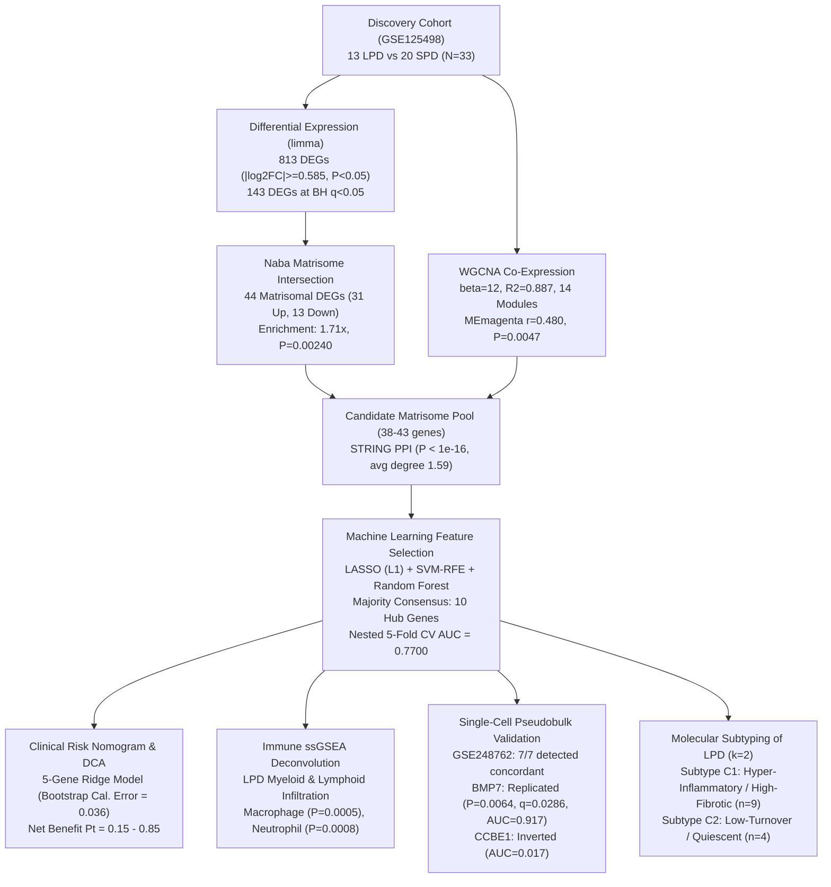

# Peritoneal Dialysis Effluent Transcriptomics & Peritoneal Fibrosis: Extracellular Matrix Remodeling, Diagnostic Machine Learning Biomarkers, and Multi-Cohort Validation

[](https://opensource.org/licenses/MIT)
[](https://www.python.org/downloads/)
[](https://www.r-project.org/)
[](https://bioconductor.org/)

---

## 1. Executive Summary & Publication-Facing Statement

This repository hosts the complete, auditable research codebase, analytical pipelines, processed datasets, and publication figures for an in-depth transcriptomic investigation of peritoneal membrane remodeling and fibrosis in peritoneal dialysis (PD) patients. 

### Core Focus & Scientific Scope
- **Non-Invasive Diagnostic Discovery:** Identifying molecular drivers and extracellular matrix (ECM / Matrisome) biomarkers in PD dialysate effluent to detect early peritoneal membrane remodeling prior to the onset of irreversible encapsulating peritoneal sclerosis (EPS).
- **Multi-Phase Framework:** Integrating differential expression profiling (limma), weighted gene co-expression network analysis (WGCNA), three-algorithm machine learning feature selection (LASSO, SVM-RFE, Random Forest), clinical risk nomograms with decision curve analysis (DCA), single-sample GSEA immune deconvolution, network pharmacology (GeneMANIA, DSigDB), and unsupervised molecular subtyping of long-term PD patients.
- **Multi-Cohort Validation:** External evaluation across independent single-cell RNA-sequencing effluent cohorts (GSE248762, GSE130888) and human peritoneal biopsy tissue (GSE62928).
- **Scientific Rigor & Preregistration:** All external validations adhered to strict group-blind preprocessing, preregistered candidate panels, locked random seeds (seed 42), sample-level pseudobulk aggregation via edgeR to prevent single-cell pseudoreplication, and fully nested cross-validation to prevent feature selection leakage.

> **Important Clinical & Methodological Notice:**  
> These analyses establish exploratory biological signatures and candidate biomarkers. They do **not** constitute a clinically validated diagnostic test or establish direct causal mechanisms in humans. Validation cohorts are small, single-cell dropout impacts specific panel genes, and patient overlap between effluent cohorts cannot be formally excluded using public GEO metadata. No wet-lab *in vitro* or *in vivo* interventional experiments were conducted.

---

## 2. Cohorts and Datasets

| Accession | Tissue / Material | Phenotypic Contrast | Role in Study | Sample Sizes | Platform |
| :--- | :--- | :--- | :--- | :--- | :--- |
| **[GSE125498](https://www.ncbi.nlm.nih.gov/geo/query/acc.cgi?acc=GSE125498)** | Peritoneal dialysate effluent cell pellets | Long-term PD ($\ge 25-48$ mo) vs Short-term PD ($< 6-12$ mo) | **Discovery Cohort** | 13 LPD, 20 SPD ($N = 33$) | Illumina HumanHT-12 v4 (11,741 unique genes) |
| **[GSE248762](https://www.ncbi.nlm.nih.gov/geo/query/acc.cgi?acc=GSE248762)** | PD effluent single-cell suspensions | Long Vintage (LV: 4 LV_UF + 6 LV_NOT_UF) vs Short Vintage (SV) | **Primary Effluent scRNA-seq Validation** | 10 LV, 6 SV ($N = 16$) | 10x Genomics Chromium (mesothelial & all-cell pseudobulk) |
| **[GSE130888](https://www.ncbi.nlm.nih.gov/geo/query/acc.cgi?acc=GSE130888)** | PD effluent single-cell suspensions | Long-term PD vs Short-term PD | **Secondary Effluent scRNA-seq Validation** | 4 Long, 6 Short ($N = 10$; 3 healthy controls descriptive only) | 10x Genomics Chromium (pseudobulk) |
| **[GSE62928](https://www.ncbi.nlm.nih.gov/geo/query/acc.cgi?acc=GSE62928)** | Human parietal peritoneal biopsies | Severe surgical EPS vs Combined non-EPS controls | **External Tissue Biopsy Validation** | 4 EPS, 4 non-EPS controls ($N = 8$) | Affymetrix Human Genome U133 Plus 2.0 |
| **[GSE92455](https://www.ncbi.nlm.nih.gov/geo/query/acc.cgi?acc=GSE92455)** | Effluent-derived mesothelial cell lines | Epithelioid vs Non-epithelioid morphology | Audited Contextual Cohort | Cell lines (distinct phenotype; not pooled) | Affymetrix Human Genome U133 Plus 2.0 |

---

## 3. Comprehensive Summary of Discoveries & Analytical Findings



### 3.1. Phase 1 & 2: Differential Expression & Global Pathway Remodeling
- **Global Transcriptomic Divergence:** Principal Component Analysis (PCA) and Uniform Manifold Approximation and Projection (UMAP) of the 33 discovery samples demonstrated clear transcriptomic separation between long-term PD cases and short-term PD controls.
- **Primary DEGs:** Using limma moderated $t$-statistics with $| \log_2\text{FC} | \ge 0.585$ (1.5-fold) and nominal $P < 0.05$, **813 genes** were differentially expressed (496 upregulated in LPD, 317 downregulated in LPD).
- **Multiple-Testing Correction:** Genome-wide Benjamini–Hochberg (BH) adjustment across the 11,741-gene background yielded **143 DEGs** at BH $q < 0.05$ (135 of which fell within the primary fold-change threshold).
- **Preranked KEGG GSEA (320 pathways tested):**
  - **Upregulated in LPD (Positive NES):** Dominance of pro-inflammatory and cell-adhesion cascades:
    - Primary immunodeficiency (NES = 2.47–2.52, BH $q = 5.56 \times 10^{-6}$)
    - Hematopoietic cell lineage (NES = 2.12–2.17, BH $q = 2.10 \times 10^{-4}$)
    - Intestinal immune network for IgA production (NES = 2.11, BH $q = 0.0022$)
    - Cytokine-cytokine receptor interaction (NES = 1.98–1.99, BH $q = 1.16 \times 10^{-4}$)
    - NF-$\kappa$B signaling pathway (NES = 1.93, BH $q = 2.53 \times 10^{-3}$)
    - Cell adhesion molecule interaction (NES = 1.84–1.85, BH $q = 4.13 \times 10^{-3}$)
  - **Downregulated in LPD (Negative NES):** Metabolic and translational shutdown:
    - Ribosome (NES = -2.07, BH $q = 5.56 \times 10^{-6}$)
    - Oxidative phosphorylation (NES = -2.05, BH $q = 2.84 \times 10^{-4}$)
    - Ribosome biogenesis in eukaryotes (NES = -1.89, BH $q = 4.13 \times 10^{-3}$)
    - Neurodegenerative / mitochondrial stress pathways

### 3.2. Phase 3 & 4: Matrisome Screening & Weighted Co-expression (WGCNA)
- **Matrisome Overlap & Hypergeometric Significance:** Intersecting the 813 DEGs with the 428 measured Naba matrisome genes identified **44 Matrisome DEGs** (31 upregulated, 13 downregulated). This represents a **1.7145-fold enrichment** over genomic expectation (hypergeometric $P = 2.403 \times 10^{-3}$; 10,000-iteration Monte Carlo permutation empirical $P = 0.0307$).
- **WGCNA Module Architecture:** Signed dynamic WGCNA across 5,001 variable genes with soft-thresholding power $\beta = 12$ (scale-free topology $R^2 = 0.887$, mean connectivity = 69.4) resolved 14 co-expression modules:
  - `MEmagenta` (37 core genes) showed the strongest positive module-trait correlation with LPD stage ($r = +0.480, P = 4.66 \times 10^{-3}$).
  - `MEblack` harbored 25 of the 31 upregulated matrisome DEGs.
- **Candidate Pool:** Intersecting the 44 Matrisome DEGs with non-grey dynamic WGCNA modules isolated **38–43 candidate genes**.
- **Protein-Protein Interaction (STRING):** STRING network analysis (minimum interaction confidence $\ge 0.40$) demonstrated significant functional interconnectedness (35 observed edges vs 5 expected, PPI enrichment $P < 1.0 \times 10^{-16}$, average degree 1.59, clustering coefficient 0.367), topologically anchored by CCL5 (degree 14), TNFAIP6 (degree 6), LTA/LTB (degree 5), C1QA/C1QB (degree 5), and ADAM19 (degree 3).

### 3.3. Phase 5: Machine Learning Consensus Feature Selection
Three complementary algorithms were applied to the matrisome candidate pool in GSE125498 (baseline null classification error = $13/33 = 0.3939$):
1. **LASSO L1-regularized Logistic Regression:** Identified 17 features at fixed $C = 5.0$, and 5 features at optimal 10-fold CV $\lambda_{\min}$ (TNFSF15, LTB, NAT6, BMP7, SEMA4F).
2. **Linear SVM-RFE:** Ranked features by recursive feature elimination; 10-fold CV identified the single most discriminative feature as EBI3 (CV accuracy 0.783). Top-10 features retained for consensus voting.
3. **Random Forest:** Ranked by Mean Decrease in Gini impurity across 500 balanced trees (OOB error rate = 0.242).

#### Consensus Hub Gene Panels:
- **10 Majority-Vote Hubs ($\ge 2/3$ algorithms):** BMP7, CCBE1, CLEC2D, COL8A1, EBI3, NAT6 (NAA80), SFRP4, TGM3, LTB, TNFSF15.
- **5-Gene Ridge Model:** TNFSF15, ADAM19, FLT3LG, NAT6, ECM1.
- **Preregistered 8-Gene Panel for External Validation:** TNFSF15, FLT3LG, EBI3, LTB, ADAM19, ECM1, SERPINA10, CST7.
- **Nested Cross-Validation (Guard against Leakage):** A 10-repeat stratified 5-fold nested CV (50 outer folds; seed 42) executing preprocessing, matrisome filtering, feature selection, and model training strictly within training folds yielded a mean out-of-fold AUC of **0.7700** (repeat-level bootstrap 95% CI: **0.7408–0.7946**, SD = 0.0453). In-sample apparent AUC (1.000) reflects optimism and is reported only as a baseline.

Discovery apparent AUCs for individual hub genes:
| Gene Symbol | Full Name / Description | Discovery log2FC | Nominal P | BH q | Apparent AUC |
| :--- | :--- | :---: | :---: | :---: | :---: |
| **TNFSF15** | TNF superfamily member 15 (TL1A) | +0.974 | $2.73 \times 10^{-5}$ | $1.77 \times 10^{-3}$ | **0.904** |
| **LTB** | Lymphotoxin beta | +1.675 | $3.33 \times 10^{-6}$ | $5.76 \times 10^{-4}$ | **0.804** |
| **EBI3** | Epstein-Barr virus induced 3 (IL-27b/IL-35) | +0.803 | $2.44 \times 10^{-3}$ | $2.61 \times 10^{-2}$ | **0.792** |
| **CCBE1** | Collagen and calcium EGF domains 1 | +0.605 | $6.14 \times 10^{-3}$ | $4.21 \times 10^{-2}$ | **0.788** |
| **NAT6 / NAA80** | N-alpha-acetyltransferase 80 | +0.784 | $3.50 \times 10^{-3}$ | $3.18 \times 10^{-2}$ | **0.788** |
| **BMP7** | Bone morphogenetic protein 7 | -0.837 | $3.11 \times 10^{-2}$ | $5.19 \times 10^{-2}$ | **0.727** |
| **SFRP4** | Secreted frizzled related protein 4 | +0.812 | $1.15 \times 10^{-2}$ | $5.84 \times 10^{-2}$ | **0.700** |
| **TGM3** | Transglutaminase 3 | +0.931 | $2.24 \times 10^{-2}$ | $7.85 \times 10^{-2}$ | **0.673** |
| **COL8A1** | Collagen type VIII alpha 1 chain | +0.764 | $3.89 \times 10^{-2}$ | $1.06 \times 10^{-1}$ | **0.581** |
| **CLEC2D** | C-type lectin domain family 2 member D | +0.612 | $4.78 \times 10^{-2}$ | $1.20 \times 10^{-1}$ | **0.465** |

---

### 3.4. Phase 6: Multi-Cohort & Single-Cell Pseudobulk External Validation

To test whether discovery signatures reproduce in independent patient data, external cohorts were audited without sample pooling. Single-cell datasets (GSE248762 and GSE130888) were processed via Scanpy (blinded filtering at $\ge 200$ genes, $\le 20\%$ mitochondrial reads), followed by sample-level pseudobulk aggregation and edgeR differential expression.

#### External Validation Results:
1. **GSE248762 (Primary scRNA-seq Effluent, LV $n=10$ vs SV $n=6$):**
   - **Directional Concordance:** 7 of 7 detected panel genes were positive in LV (higher in long dialysis vintage). SERPINA10 was undetectable in effluent scRNA-seq counts.
   - **BMP7 (Sole Statistically Robust Replication):** Downregulated in LV mesothelial pseudobulk ($\log_2\text{FC} = -2.461$, raw $P = 0.0064$, BH $q = 0.0286$). In-sample verification AUC = **0.917** (bootstrap 95% CI: 0.73–1.00), reproducing its discovery downregulation.
   - **CCBE1 (Directional Inversion Discovery):** Significantly upregulated in discovery bulk effluent ($\log_2\text{FC} = +0.605$), but significantly upregulated in short-vintage controls in mesothelial pseudobulk ($\log_2\text{FC} = -3.667$, $P = 0.0013$, BH $q = 0.0113$), yielding a verification AUC of only **0.017** (95% CI: 0.00–0.10).
   - **Detected-Gene-Only 7-Gene Score:** Yielded an empirical AUC of **0.7833** (95% CI: 0.5000–1.0000, Mann–Whitney $P = 0.0727$, matched-null permutation empirical $P = 0.0460$).
   - **ECM1 Sensitivity Audit:** High raw counts in sample GSM7919584 (115,870 counts; 76,200 in mesothelial cells, 38,545 in neutrophils). Sensitivity fits excluding GSM7919584 confirmed consistent positive effect ($\log_2\text{FC} = +5.0152, P = 0.00839$; in mesothelial-only pseudobulk $\log_2\text{FC} = +7.2997, P = 0.00139$).
2. **GSE130888 (Secondary scRNA-seq Effluent, Long $n=4$ vs Short $n=6$):**
   - 5 of 6 detected panel genes were directionally concordant (FLT3LG, EBI3, LTB, ADAM19, CST7 up; ECM1 was discordant; TNFSF15 and SERPINA10 undetectable).
   - Detected-gene-only score yielded AUC = **0.7083** (95% CI: 0.2917–1.0000, empirical $P = 0.0519$).
3. **GSE62928 (External Peritoneal Biopsy, EPS $n=4$ vs non-EPS $n=4$):**
   - Composite panel score yielded AUC = **0.875** (95% CI: 0.500–1.000; Mann–Whitney $P = 0.1143$). 4/8 genes were directionally concordant; tissue biopsy expression differs substantially from dialysate effluent cellular suspensions.

---

### 3.5. Phase 7: Clinical Nomogram & Effluent Immune Microenvironment
- **5-Gene Ridge Nomogram:** Constructed using multivariable coefficients:
  $$\text{Logit}(P) = -0.6251 + 0.8186 \cdot \text{TNFSF15} + 0.6033 \cdot \text{ADAM19} + 0.5522 \cdot \text{FLT3LG} + 0.4364 \cdot \text{NAT6} + 0.3351 \cdot \text{ECM1}$$
- **Model Calibration & Net Benefit:** Quintile calibration across 1,000 bootstrap resamples showed an absolute mean error of **0.036**. Decision Curve Analysis (DCA) demonstrated substantial net clinical benefit over 'treat all' and 'treat none' across threshold probabilities from $P_t = 0.15$ to $0.85$.
- **Effluent Immune Infiltration (ssGSEA):** Leukocyte and stromal deconvolution revealed profound compositional shifts in effluent cell pellets:
  - Significant expansion in LPD: Macrophages ($P = 0.0005$, BH $q = 0.0078$), Neutrophils ($P = 0.0008$, BH $q = 0.0078$), CD4 T cells ($P = 0.0006$, BH $q = 0.0078$), Monocytes ($P = 0.0051$, BH $q = 0.033$), Dendritic cells ($P = 0.0068$, BH $q = 0.037$).
  - **Hub-Immune Crosstalk:** 38 of 91 Spearman associations between diagnostic genes and immune cell scores passed BH-FDR $q < 0.05$. Specifically, ECM1 and ADAM19 strongly correlated with macrophage/myeloid scores, while FLT3LG and TNFSF15 tracked lymphoid signatures.

---

### 3.6. Phase 8: Functional Network, Pharmacology & Regulatory Axes
- **GeneMANIA Interaction Architecture:** Expanded network with 20 interactors (TNFRSF25, FAS, TRADD, TRAF2, CD70, LTA, LTBR) revealed evidence from shared protein domains (67.4%), physical interactions (14.2%), and co-expression (11.8%), enriched for TNF signaling, cell adhesion, and NF-$\kappa$B activation.
- **DSigDB Drug Repositioning Predictions:** Identified small-molecule perturbational signatures correlating with biomarker profiles:
  - Trichostatin A (combined score 1,482, BH $q = 0.038$)
  - Rifaximin (combined score 795, BH $q = 0.040$)
  - Raloxifene (ADAM19, TNFSF15, LTB; nominal $P = 0.00127$)
  - Decitabine (ADAM19, EBI3, CST7; nominal $P = 0.0193$)
  - 5-Azacytidine (combined score 312, BH $q = 0.048$)
  *(Note: DSigDB predictions represent cell-line transcriptional matches and do not constitute proof of clinical drug efficacy).*
- **Single-Hub KEGG GSEA:** Preranked GSEA ranking all 11,741 genes by correlation with each validated hub identified 150 pathway associations at within-hub BH-FDR $< 0.05$. Immune and cytokine pathways were shared across 5 hubs; ECM1 uniquely correlated with ECM-receptor interaction (NES = 2.12, $q = 0.0039$) and focal adhesion (NES = 1.80, $q = 0.0399$).
- **Multi-Omics ceRNA Regulatory Layer:** Putative miRNA and lncRNA interactions were mapped via ENCORI and multiMiR, identifying candidate regulatory non-coding RNA axes.

---

### 3.7. Phase 9: Molecular Subtyping of Long-Term PD Patients
Unsupervised consensus clustering (1,000 iterations, 80% subsampling, $k=2-6$) on the 13 LPD discovery patients using diagnostic panel expression established $k = 2$ as the primary binary partition (PAC = 0.000):
- **Subtype C1 ($n = 9$, 69.2%): "Hyper-Inflammatory / High-Fibrotic Endotype"**
  - Significantly higher expression of matrix remodeling genes (ADAM19, FLT3LG, ECM1; all $P < 0.01$).
  - Markedly elevated immune infiltration scores for macrophages ($P = 0.011$), neutrophils ($P = 0.019$), and CD4 T cells ($P = 0.024$).
- **Subtype C2 ($n = 4$, 30.8%): "Quiescent / Low-Turnover Endotype"**
  - Attenuated inflammation and lower matrix gene expression despite sustained long-term dialysis vintage.
  - Suggests that peritoneal remodeling in long-term PD is biologically heterogeneous, distinguishing patients at high risk of rapid fibrotic progression from those with stable membrane biology.

---

## 4. Master Figure Manifest (High-Resolution 300 DPI & Vector PDF)

All figures follow publication layouts, Arial typography, curated palettes, and have corresponding source data CSVs in `results/paper_style/`:

| Figure | Description | Key Panels | PNG / PDF | Source Data CSV |
| :--- | :--- | :--- | :--- | :--- |
| **Fig. 1** | Study Workflow & Architecture | Analytical pipeline flowchart across discovery, machine learning, validation, and subtyping | `Fig1.png` / `Fig1.pdf` | `Fig1_source_data.csv` |
| **Fig. 2** | Discovery Differential Expression | PCA, UMAP, Volcano plot, Top-50 heatmap, and KEGG GSEA curves | `Fig2.png` / `Fig2.pdf` | `Fig2A_dimension_reduction_source.csv`, `Fig2_limma_gene_results_unique_symbols.csv`, `Fig2C_top50_heatmap_source.csv`, `Fig2D_KEGG_up_LPD_FDR05.csv` |
| **Fig. 3** | Matrisome Screening & WGCNA | Scale-free fit, module-trait heatmap, Venn diagram, GO enrichment, and STRING PPI network | `Fig3.png` / `Fig3.pdf` | `Fig3A_soft_threshold_source.csv`, `Fig3C_module_trait_source.csv`, `Fig3D_three_way_intersection_counts.csv`, `Fig3E_intersection_enrichment_source.csv`, `Fig3F_saved_STRING_edges_score_ge_0_4.csv` |
| **Fig. 4** | Machine Learning Biomarker Selection | LASSO coefficient trajectory, SVM-RFE accuracy, Random Forest Gini, Selector Venn, ROC curves, and expression violins | `Fig4.png` / `Fig4.pdf` | `Fig4_39_gene_pool_selector_results_reused.csv`, `Fig4_39_gene_pool_intersections_reused.csv`, `Fig4E_training_ROC_points.csv`, `Fig4G_discovery_expression_source.csv` |
| **Fig. 5** | Nomogram, DCA & Immune Infiltration | Point-scoring nomogram, quintile calibration curve, DCA net benefit, clinical impact curve, immune ssGSEA violins, and Spearman correlation matrices | `Fig5.png` / `Fig5.pdf` | `Fig5A_five_gene_ridge_point_display.csv`, `Fig5B_calibration_bins_source.csv`, `Fig5C_decision_curve_source.csv`, `Fig5D_clinical_impact_source.csv`, `Fig5E_saved_ssgsea_sample_scores.csv` |
| **Fig. 6** | Network Biology & Pharmacology | GeneMANIA functional association network, DSigDB perturbational barplots, and single-hub KEGG GSEA running score curves | `Fig6.png` / `Fig6.pdf` | `Fig6A_GeneMANIA_nodes_source.csv`, `Fig6A_GeneMANIA_edges_source.csv`, `Fig6B_DSigDB_top_terms.csv`, `Fig6C_single_gene_KEGG_GSEA_all_source.csv` |
| **Fig. 7** | Molecular Subtyping of LPD | Consensus clustering matrix ($k=2$), CDF delta area curve, PAC metric, PCA separation, panel boxplots, and immune score comparisons | `Fig7.png` / `Fig7.pdf` | `Fig7A_consensus_CDF_source.csv`, `Fig7A_consensus_metrics.csv`, `Fig7A_best_k_consensus_matrix.csv`, `Fig7_cluster_assignments_k2.csv`, `Fig7D_ssgsea_cluster_scores_source.csv` |

---

## 5. Repository Structure

```
Peritoneal Project/
├── run_pipeline.py                       # Master end-to-end Python pipeline runner
├── results/
│   ├── paper_style/                      # Publication-grade figures, source data & documentation
│   │   ├── 01_Fig1_workflow.py           # Multi-panel Figure 1 generator
│   │   ├── 02_Fig2_differential_expression.py
│   │   ├── 03_Fig3_matrisome_WGCNA.py
│   │   ├── 04_Fig4_diagnostic_genes.py
│   │   ├── 05_Fig5_nomogram_immune_context.py
│   │   ├── 06_Fig6_network_drug_pathway.py
│   │   ├── 07_Fig7_molecular_subtypes.py
│   │   ├── Fig1.png .. Fig7.png          # High-resolution 300 DPI publication images
│   │   ├── Fig1.pdf .. Fig7.pdf          # Vector publication figures
│   │   ├── results_section.md            # Complete manuscript results text with stats
│   │   ├── methods_and_limitations.md    # Detailed methodology and limitation statements
│   │   └── *.csv                         # Exact matching source data tables
│   ├── tables/                           # Reconciled tabular outputs across all 8 phases
│   │   ├── T01_GSE125498_expression_QC.csv
│   │   ├── T02_ML_selection_intersections.csv
│   │   ├── T03_matrisome_category_composition.csv
│   │   ├── T04_random_effects_meta_analysis.csv
│   │   ├── T05_STRING_edges.csv
│   │   ├── T06_lasso_bootstrap_stability.csv
│   │   ├── T06_calibration_dca_summary.csv
│   │   ├── T07_single_hub_GSEA.csv
│   │   ├── T11_Table1_cohort_characteristics.csv
│   │   └── Table_10_hub_genes_discovery_validation_stats.csv
│   └── revision/                         # Audited sensitivity analyses, single-cell pseudobulk, WGCNA
│       ├── effluent_validation/          # Preregistered GSE248762 and GSE130888 scRNA-seq outputs
│       ├── microenvironment_deconvolution/ # Permutation statistics and ssGSEA tables
│       ├── network_7hub/                 # ceRNA network tables and figures
│       └── wgcna_paper_figures/          # WGCNA clusterProfiler and dendrogram plots
├── scripts/
│   ├── 01_batch_qc.R                     # Preprocessing & batch audit (R/limma)
│   ├── 02_ml_selection.R                 # Machine learning feature selection suite
│   ├── 03_enrichment_matrisome.R         # Matrisome hypergeometric enrichment & Monte Carlo
│   ├── 04_hub_expression_meta.R          # Hub expression statistics & meta-analysis
│   ├── 05_interaction_regulation.R       # STRING PPI and interaction subnetwork
│   ├── 06_diagnostic_models.R            # Nomogram, calibration, and DCA modeling
│   ├── 07_single_gene_gsea.R             # Preranked KEGG GSEA per hub gene
│   ├── 08_immune_infiltration.R          # ssGSEA leukocyte deconvolution
│   ├── 09_drug_prediction.R              # DSigDB perturbational signature query
│   ├── 10_external_resources.R           # External database annotations
│   ├── 11_summary_tables.R               # Summary table generation
│   ├── task1_audit_existing_results.py   # Baseline reproducibility audit
│   ├── task2_nested_cv.py                # 50-fold nested cross-validation
│   ├── task3_validation_robustness.py    # Cross-cohort robustness evaluation
│   └── task4_leukocyte_confounding.py    # Compositional confounding audit
├── data/                                 # Reference annotations and raw data pointers
│   └── ECM genes all.xlsx                # Curated Naba Human Matrisome database (1,027 genes)
├── .gitignore                            # Git rules protecting large raw archives (>25MB)
└── README.md                             # Comprehensive project and discovery documentation
```

---

## 6. Reproducing the Analysis & Generating Figures

### Prerequisites
- **Python:** $\ge 3.10$ with `numpy`, `pandas`, `scipy`, `scikit-learn`, `statsmodels`, `matplotlib`, `seaborn`, `scanpy`, `anndata`, `networkx`, `gseapy`, `xgboost`, `openpyxl`.
- **R:** $\ge 4.4$ with Bioconductor packages `limma`, `WGCNA`, `clusterProfiler`, `org.Hs.eg.db`, `Biobase`, `GEOquery`, `ggplot2`.

### Execution
1. **Generate All Publication Figures (Fig 1–7):**
   ```bash
   python results/paper_style/01_Fig1_workflow.py
   python results/paper_style/02_Fig2_differential_expression.py
   python results/paper_style/03_Fig3_matrisome_WGCNA.py
   python results/paper_style/04_Fig4_diagnostic_genes.py
   python results/paper_style/05_Fig5_nomogram_immune_context.py
   python results/paper_style/06_Fig6_network_drug_pathway.py
   python results/paper_style/07_Fig7_molecular_subtypes.py
   ```
2. **Execute Full Legacy Analytical Suite:**
   ```bash
   python run_pipeline.py
   ```
3. **Execute R Statistical Modules:**
   ```bash
   Rscript scripts/run_all.R
   ```

---

## 7. Citation & Data Availability

All source expression datasets analyzed in this study are publicly available through the NCBI Gene Expression Omnibus (GEO):
- GSE125498: [https://www.ncbi.nlm.nih.gov/geo/query/acc.cgi?acc=GSE125498](https://www.ncbi.nlm.nih.gov/geo/query/acc.cgi?acc=GSE125498)
- GSE248762: [https://www.ncbi.nlm.nih.gov/geo/query/acc.cgi?acc=GSE248762](https://www.ncbi.nlm.nih.gov/geo/query/acc.cgi?acc=GSE248762)
- GSE130888: [https://www.ncbi.nlm.nih.gov/geo/query/acc.cgi?acc=GSE130888](https://www.ncbi.nlm.nih.gov/geo/query/acc.cgi?acc=GSE130888)
- GSE62928: [https://www.ncbi.nlm.nih.gov/geo/query/acc.cgi?acc=GSE62928](https://www.ncbi.nlm.nih.gov/geo/query/acc.cgi?acc=GSE62928)
- Naba Matrisome Project: [http://matrisomeproject.mit.edu/](http://matrisomeproject.mit.edu/)
