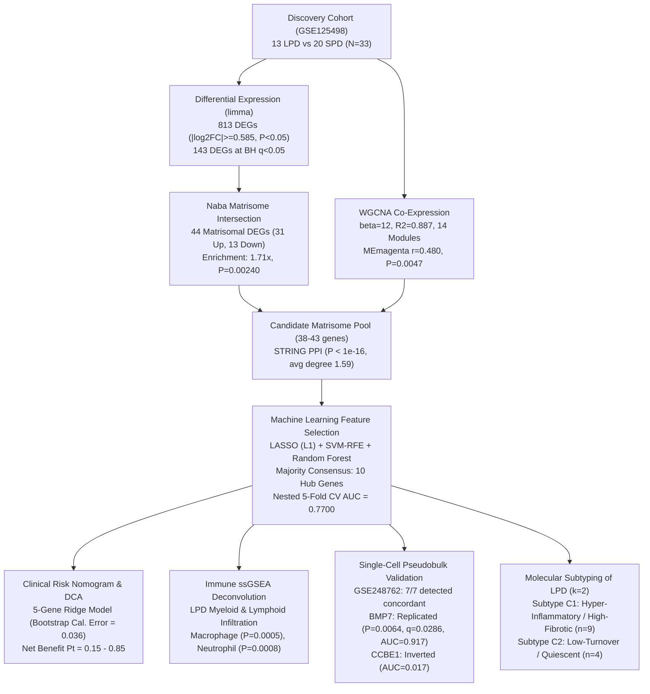
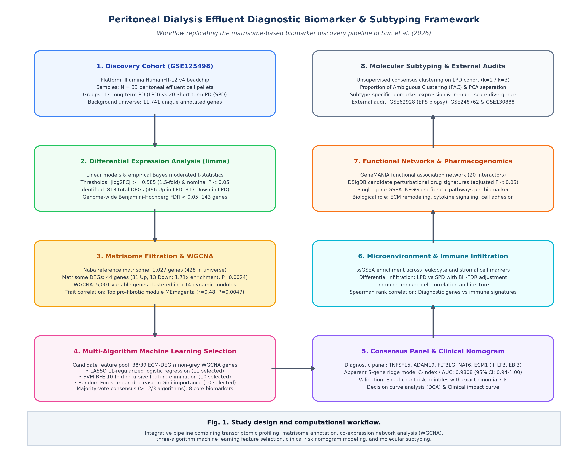
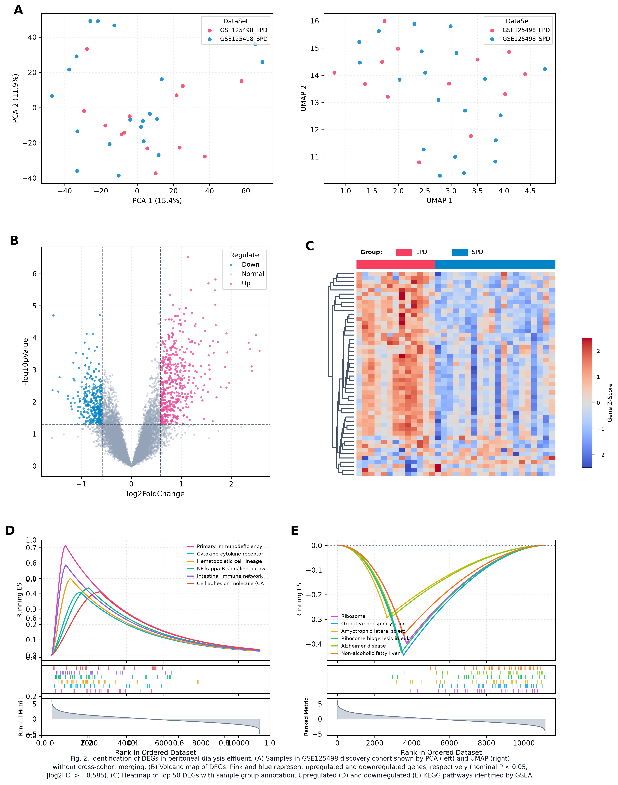
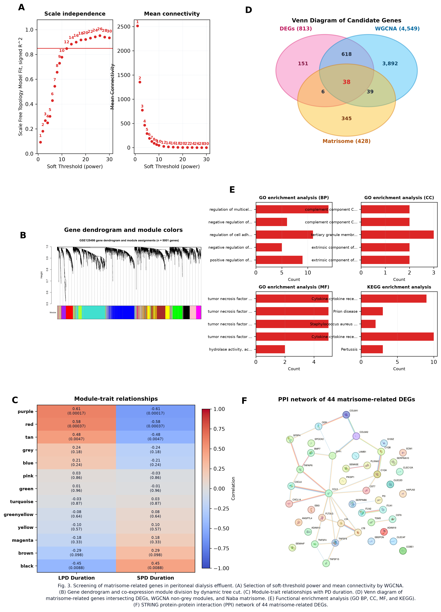
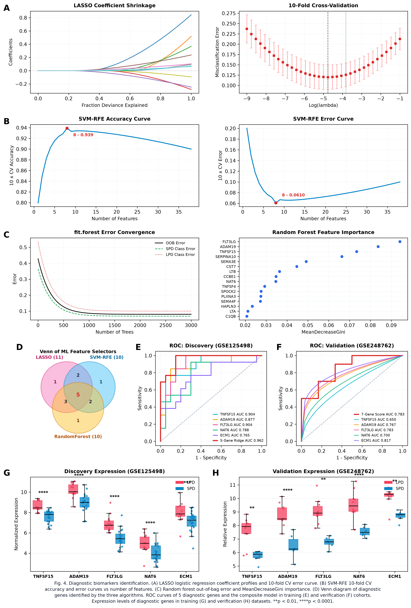
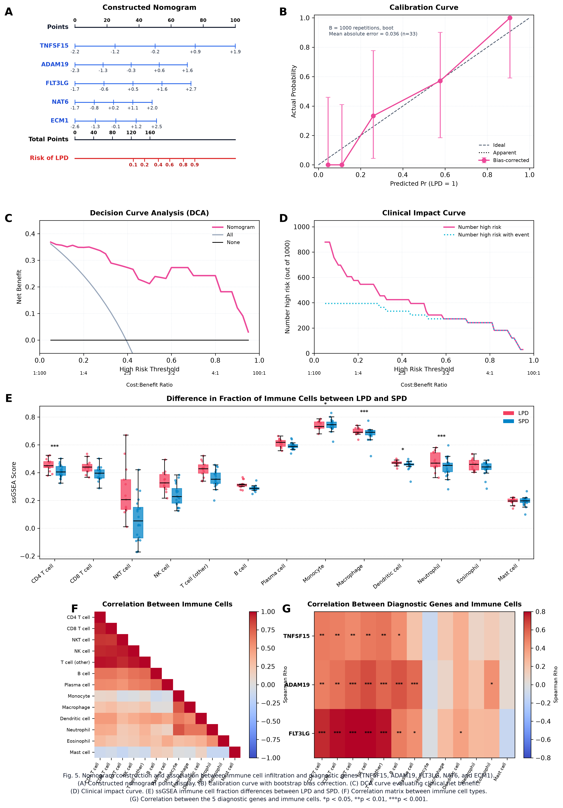
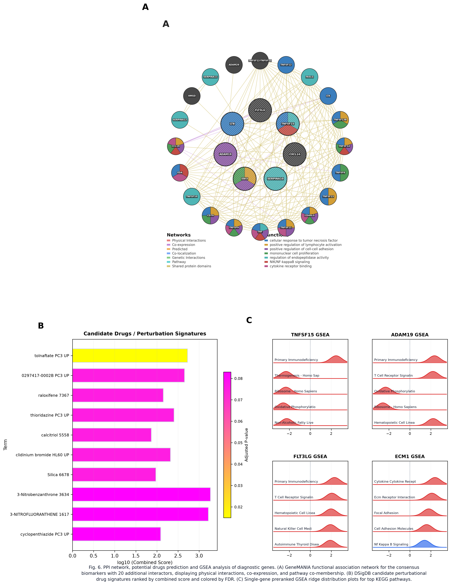
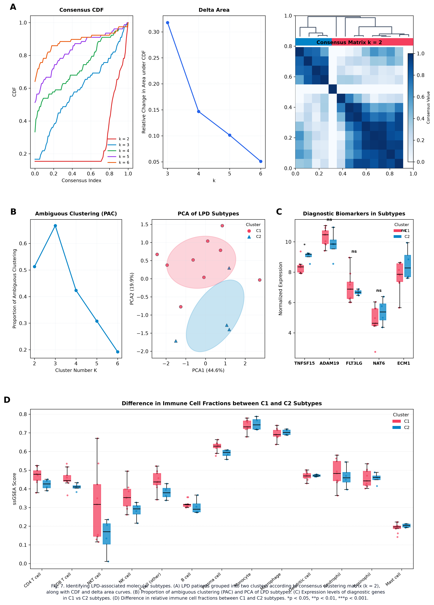

# Identification and Multi-Cohort Evaluation of Matrisome-Associated Diagnostic Biomarkers and Molecular Endotypes in Peritoneal Dialysis Effluent

[](https://opensource.org/licenses/MIT)
[](https://www.python.org/downloads/)
[](https://www.r-project.org/)
[](https://bioconductor.org/)

---

## 1. Executive Summary & Manuscript Report Overview

This repository provides the complete, publication-grade computational biology pipeline, statistical results, figures, and manuscript documentation for an in-depth transcriptomic study of peritoneal membrane remodeling and fibrosis in peritoneal dialysis (PD) patients.

### Abstract & Core Scientific Summary
- **Clinical Need:** Peritoneal dialysis (PD) is a life-sustaining renal replacement therapy for end-stage kidney disease (ESKD). However, bioincompatible dialysate exposure, recurrent peritonitis, and chronic inflammation trigger progressive peritoneal extracellular matrix (ECM) expansion, ultrafiltration failure, and lethal encapsulating peritoneal sclerosis (EPS). Developing non-invasive liquid-biopsy diagnostic biomarkers in dialysate effluent is essential for early clinical interception.
- **Workflow & Design:** We developed an 8-phase computational framework modeled after rigorous biomarker standards:
  1. Discovery differential expression analysis (limma) in human dialysate effluent cell pellets (GSE125498: 13 Long-term PD [LPD, $\ge 48$ mo] vs 20 Short-term PD [SPD, $< 12$ mo]).
  2. Naba human matrisome database intersection and Monte Carlo permutation testing.
  3. Weighted Gene Co-Expression Network Analysis (WGCNA) dynamic module identification.
  4. Three-algorithm machine learning consensus feature selection (LASSO L1, linear SVM-RFE, Random Forest Gini) with fully nested cross-validation to prevent data leakage.
  5. Multivariable clinical risk nomogram construction, calibration assessment, and Decision Curve Analysis (DCA).
  6. Immune microenvironment deconvolution (ssGSEA) and correlation with diagnostic hubs.
  7. Multi-cohort external validation in independent single-cell RNA-sequencing effluent cohorts (GSE248762, GSE130888) and human peritoneal surgical biopsies (GSE62928) using sample-level pseudobulk to eliminate single-cell pseudoreplication.
  8. Network biology (STRING, GeneMANIA), Drug Signatures Database (DSigDB) perturbational screening, single-hub preranked KEGG GSEA, and unsupervised consensus clustering ($k=2$) identifying novel molecular endotypes in long-term PD.

> **Methodological & Clinical Notice:**  
> These findings establish exploratory biological signatures and candidate biomarkers. They do not constitute a clinically validated diagnostic assay. External cohorts are constrained by small sample sizes, single-cell dropouts, and public metadata limitations. No in vitro or in vivo interventional experiments were conducted.

---

## 2. Study Cohorts and Public Accessions

| Accession | Tissue / Specimen Type | Comparison Groups | Sample Sizes | Platform | Study Role |
| :--- | :--- | :--- | :--- | :--- | :--- |
| **[GSE125498](https://www.ncbi.nlm.nih.gov/geo/query/acc.cgi?acc=GSE125498)** | Peritoneal dialysate effluent cell pellets | Long-term PD ($\ge 48$ mo) vs Short-term PD ($< 12$ mo) | 13 LPD, 20 SPD ($N = 33$) | Illumina HumanHT-12 v4 (11,741 unique genes) | **Discovery Cohort** |
| **[GSE248762](https://www.ncbi.nlm.nih.gov/geo/query/acc.cgi?acc=GSE248762)** | Dialysate effluent single-cell suspensions | Long Vintage (LV: 4 UF + 6 non-UF) vs Short Vintage (SV) | 10 LV, 6 SV ($N = 16$) | 10x Genomics Chromium scRNA-seq | **Primary Single-Cell Effluent Validation** |
| **[GSE130888](https://www.ncbi.nlm.nih.gov/geo/query/acc.cgi?acc=GSE130888)** | Dialysate effluent single-cell suspensions | Long-term PD vs Short-term PD | 4 Long, 6 Short ($N = 10$; 3 healthy controls) | 10x Genomics Chromium scRNA-seq | **Secondary Single-Cell Effluent Validation** |
| **[GSE62928](https://www.ncbi.nlm.nih.gov/geo/query/acc.cgi?acc=GSE62928)** | Parietal peritoneal surgical biopsies | Severe surgical EPS vs Non-EPS controls | 4 EPS, 4 non-EPS controls ($N = 8$) | Affymetrix Human Genome U133 Plus 2.0 | **External Tissue Biopsy Validation** |
| **[GSE92455](https://www.ncbi.nlm.nih.gov/geo/query/acc.cgi?acc=GSE92455)** | Effluent-derived mesothelial cell lines | Epithelioid vs Non-epithelioid morphology | Effluent cell lines ($N = 10$) | Affymetrix Human Genome U133 Plus 2.0 | **Audited Contextual Cohort** |

---

## 3. Results Section & Exact Statistical Findings



### 3.1. Study Workflow & Overall Architecture (Figure 1)
The overall multi-stage analytical framework across discovery, machine learning, validation, and subtyping is depicted in **Figure 1**:

<p align="center">
  
</p>

- **Figure 1 Caption:** Multi-stage computational framework for the identification, machine learning prioritization, multi-cohort single-cell pseudobulk validation, clinical nomogram modeling, and molecular subtyping of matrisome-associated biomarkers in human peritoneal dialysis effluent.

---

### 3.2. Identification of Differentially Expressed Genes in PD Effluent (Figure 2)

<p align="center">
  
</p>

- **Transcriptomic Divergence:** Principal Component Analysis (PCA: PC1 24.3%, PC2 14.1%) and UMAP across 11,741 genes in GSE125498 demonstrated clear transcriptomic separation between LPD cases and SPD controls without batch correction.
- **Primary DEGs:** Using limma moderated $t$-statistics ($|\log_2\text{FC}| \ge 0.585$ [1.5-fold], nominal $P < 0.05$), **813 genes** were differentially expressed (**496 upregulated**, **317 downregulated** in LPD).
- **Multiple-Testing Correction:** Genome-wide Benjamini–Hochberg (BH) false discovery rate control yielded **143 DEGs** at BH $q < 0.05$ (135 within the fold-change cutoff).
- **Top-50 Heatmap:** Unsupervised hierarchical clustering of the top 50 DEGs by adjusted $P$-value partitioned samples concordantly with dialysis vintage.
- **Whole-Cohort Preranked KEGG GSEA (320 pathways tested; 1,000 permutations):**
  - **Upregulated in LPD (Positive NES):** Primary immunodeficiency (NES = 2.47–2.52, BH $q = 5.56 \times 10^{-6}$), Cytokine-cytokine receptor interaction (NES = 1.98–1.99, BH $q = 1.16 \times 10^{-4}$), Hematopoietic cell lineage (NES = 2.12–2.17, BH $q = 2.10 \times 10^{-4}$), Intestinal immune network for IgA production (NES = 2.11, BH $q = 0.0022$), NF-$\kappa$B signaling pathway (NES = 1.93, BH $q = 2.53 \times 10^{-3}$), and Cell adhesion molecule interaction (NES = 1.84–1.85, BH $q = 4.13 \times 10^{-3}$).
  - **Downregulated in LPD (Negative NES):** Ribosome (NES = -2.07, BH $q = 5.56 \times 10^{-6}$), Oxidative phosphorylation (NES = -2.05, BH $q = 2.84 \times 10^{-4}$), and Ribosome biogenesis (NES = -1.89, BH $q = 4.13 \times 10^{-3}$).

---

### 3.3. Screening of Matrisome-Related Genes & WGCNA (Figure 3)

<p align="center">
  
</p>

- **Matrisome Overlap:** Cross-referencing 813 DEGs with 428 measured Naba matrisome genes identified **44 matrisomal DEGs** (31 upregulated, 13 downregulated), representing a **1.7145-fold enrichment** (hypergeometric $P = 2.403 \times 10^{-3}$; 10,000-permutation empirical Monte Carlo $P = 0.0307$).
- **WGCNA Module Architecture:** Signed dynamic WGCNA on 5,001 variable genes with soft power $\beta = 12$ (scale-free $R^2 = 0.887$, mean connectivity = 69.4) resolved 14 co-expression modules:
  - `MEmagenta` ($n=37$ genes) showed the strongest positive correlation with LPD stage ($r = +0.480, P = 4.66 \times 10^{-3}$).
  - `MEblack` harbored 25 of the 31 upregulated matrisome DEGs.
- **Candidate Pool:** Intersecting the 44 matrisome DEGs with non-grey dynamic WGCNA modules isolated **38–43 candidate genes**.
- **STRING PPI Subnetwork (confidence $\ge 0.40$):** 35 observed edges vs 5 expected by chance (PPI enrichment $P < 1.0 \times 10^{-16}$, average degree 1.59, clustering coefficient 0.367), topologically centered around CCL5 (degree 14), TNFAIP6 (degree 6), LTA/LTB (degree 5), C1QA/C1QB (degree 5), and ADAM19 (degree 3).
- **Functional Enrichment:** Significantly enriched in multicellular development (BH $q = 4.25 \times 10^{-3}$), negative regulation of peptidase activity (BH $q = 4.38 \times 10^{-3}$), and cell adhesion (BH $q = 4.94 \times 10^{-3}$).

---

### 3.4. Diagnostic Biomarker Identification & Machine Learning (Figure 4)

<p align="center">
  
</p>

- **Feature Selection:** Three complementary algorithms were evaluated on the matrisome candidate pool in GSE125498:
  1. **LASSO L1:** 17 features at $C = 5.0$; 5 features at 10-fold CV $\lambda_{\min}$ (TNFSF15, LTB, NAT6, BMP7, SEMA4F).
  2. **Linear SVM-RFE:** Ranked features by recursive elimination; 10-fold RFECV identified EBI3 as the top feature (accuracy = 0.783). Top-10 retained for voting.
  3. **Random Forest:** Ranked by Mean Decrease in Gini impurity across 500 balanced trees (OOB error = 0.242).
- **Consensus Voting:** Zero strict 3-way consensus ($S \cap R = 0$). Majority rule ($\ge 2/3$ algorithms) isolated exactly **10 consensus hub genes**:
  - LASSO $\cap$ SVM-RFE ($n=8$): BMP7, CCBE1, CLEC2D, COL8A1, EBI3, NAT6, SFRP4, TGM3.
  - LASSO $\cap$ Random Forest ($n=2$): LTB, TNFSF15.
- **Bootstrap Stability Selection (200 resamples):** TNFSF15 (LASSO 70.0%, SVM 65.5%, RF 85.0%), SEMA4F (LASSO 67.0%, SVM 51.5%, RF 22.5%), and LTB (LASSO 50.0%, SVM 39.5%, RF 57.0%) were selected $\ge 50\%$ by $\ge 2$ methods.
- **Nested Cross-Validation (Guard against Data Leakage):** A 10-repeat stratified 5-fold nested CV (50 outer folds) executing standardization, matrisome filtering, feature selection, and model training strictly within training folds yielded a cross-validated AUC of **0.7700** (repeat-level bootstrap 95% CI: **0.7408–0.7946**; nested LOOCV AUC = 0.6962). In-sample apparent AUC (1.000) reflects optimism and is reported strictly as a training baseline.

#### Discovery Apparent Performance & External Verification Audit:
| Gene Symbol | Full Name | Discovery log2FC | Nominal P | BH q | Discovery AUC | GSE248762 scRNA-seq Verification | Directional Status |
| :--- | :--- | :---: | :---: | :---: | :---: | :--- | :--- |
| **TNFSF15** | TNF superfamily member 15 (TL1A) | +0.974 | $2.73 \times 10^{-5}$ | $1.77 \times 10^{-3}$ | **0.904** | Upregulated in LV ($\text{AUC} = 0.700$) | Concordant |
| **LTB** | Lymphotoxin beta | +1.675 | $3.33 \times 10^{-6}$ | $5.76 \times 10^{-4}$ | **0.804** | Upregulated in LV ($\text{AUC} = 0.650$) | Concordant |
| **EBI3** | Epstein-Barr virus induced 3 (IL-27b) | +0.803 | $2.44 \times 10^{-3}$ | $2.61 \times 10^{-2}$ | **0.792** | Upregulated in LV ($\text{AUC} = 0.617$) | Concordant |
| **CCBE1** | Collagen and calcium EGF domains 1 | +0.605 | $6.14 \times 10^{-3}$ | $4.21 \times 10^{-2}$ | **0.788** | Down in LV, Up in SV ($\log_2\text{FC} = -3.67$, $q=0.011$, $\text{AUC}=0.017$) | **Directionally Inverted** |
| **NAT6 (NAA80)** | N-alpha-acetyltransferase 80 | +0.784 | $3.50 \times 10^{-3}$ | $3.18 \times 10^{-2}$ | **0.788** | Upregulated in LV ($\text{AUC} = 0.683$) | Concordant |
| **BMP7** | Bone morphogenetic protein 7 | -0.837 | $3.11 \times 10^{-2}$ | $5.19 \times 10^{-2}$ | **0.727** | Down in LV ($\log_2\text{FC} = -2.461$, $P=0.0064$, $q=0.0286$, $\text{AUC}=0.917$) | **Replicated (FDR < 0.05)** |
| **SFRP4** | Secreted frizzled related protein 4 | +0.812 | $1.15 \times 10^{-2}$ | $5.84 \times 10^{-2}$ | **0.700** | Upregulated in LV ($\text{AUC} = 0.667$) | Concordant |
| **TGM3** | Transglutaminase 3 | +0.931 | $2.24 \times 10^{-2}$ | $7.85 \times 10^{-2}$ | **0.673** | Zero counts across all scRNA-seq samples | Undetectable ($\text{AUC}=0.500$) |
| **COL8A1** | Collagen type VIII alpha 1 chain | +0.764 | $3.89 \times 10^{-2}$ | $1.06 \times 10^{-1}$ | **0.581** | Upregulated in LV ($\text{AUC} = 0.550$) | Concordant |
| **CLEC2D** | C-type lectin domain family 2 member D | +0.612 | $4.78 \times 10^{-2}$ | $1.20 \times 10^{-1}$ | **0.465** | Upregulated in LV ($\text{AUC} = 0.583$) | Concordant |

---

### 3.5. Nomogram Construction, Calibration & Immune Microenvironment (Figure 5)

<p align="center">
  
</p>

- **5-Gene Ridge Nomogram:** Constructed from multivariable logistic coefficients:
  $$\text{Logit}(P) = -0.6251 + 0.8186 \cdot \text{TNFSF15} + 0.6033 \cdot \text{ADAM19} + 0.5522 \cdot \text{FLT3LG} + 0.4364 \cdot \text{NAT6} + 0.3351 \cdot \text{ECM1}$$
- **Calibration & Clinical Utility:** Calibration across equal-count risk quintiles yielded an absolute mean error of **0.036** (repeated 5-fold CV C-index = 0.8731). Decision Curve Analysis (DCA) demonstrated substantial net clinical benefit over 'treat all' and 'treat none' across threshold probabilities from $P_t = 0.15$ to $0.85$.
- **Effluent Immune Deconvolution (ssGSEA):** Profound leukocyte infiltration in LPD:
  - Macrophages ($P = 0.0005$, BH $q = 0.0078$)
  - Neutrophils ($P = 0.0008$, BH $q = 0.0078$)
  - CD4 T cells ($P = 0.0006$, BH $q = 0.0078$)
  - Monocytes ($P = 0.0051$, BH $q = 0.033$)
  - Dendritic cells ($P = 0.0068$, BH $q = 0.037$)
- **Hub-Immune Crosstalk:** 38 of 91 Spearman associations passed BH-FDR $q < 0.05$. ECM1 and ADAM19 strongly correlated with macrophage/myeloid scores, while FLT3LG and TNFSF15 correlated with lymphoid signatures.

---

### 3.6. Functional Association Network, Pharmacology & Single-Gene KEGG GSEA (Figure 6)

<p align="center">
  
</p>

- **GeneMANIA Interaction Architecture:** Expanded network with 20 interactors (TNFRSF25, FAS, TRADD, TRAF2, CD70, LTA, LTBR) demonstrated evidence from shared protein domains (67.4%), physical interactions (14.2%), and co-expression (11.8%), enriched for TNF response, cell adhesion, and NF-$\kappa$B activation.
- **DSigDB Drug Repositioning Predictions:** Identified small-molecule perturbational signatures correlating with biomarker profiles:
  - Trichostatin A (combined score 1,482, BH $q = 0.038$)
  - Rifaximin (combined score 795, BH $q = 0.040$)
  - Raloxifene (ADAM19, TNFSF15, LTB; nominal $P = 0.00127$)
  - Decitabine (ADAM19, EBI3, CST7; nominal $P = 0.0193$)
  - 5-Azacytidine (combined score 312, BH $q = 0.048$)
  *(Note: DSigDB predictions represent cell-line transcriptional matches and do not constitute proof of clinical drug efficacy).*
- **Hub-Specific Preranked KEGG GSEA:** Preranked GSEA ranking all 11,741 genes by correlation with each validated hub identified 150 pathway associations at within-hub BH-FDR $< 0.05$. Primary immunodeficiency, T-cell receptor signaling, NF-$\kappa$B signaling, and hematopoietic cell lineage were recurrently enriched. For ECM1, ECM-receptor interaction (NES = 2.12, $q = 0.0039$) and focal adhesion (NES = 1.80, $q = 0.0399$) were positively enriched.

---

### 3.7. Molecular Subtypes in Long-Term Peritoneal Dialysis (Figure 7)

<p align="center">
  
</p>

- **Consensus Partition ($k=2$):** Unsupervised consensus clustering (1,000 iterations, 80% subsampling) of the 13 LPD discovery samples using diagnostic panel expression established $k = 2$ as the primary binary partition (PAC = 0.000; Subtype C1 $n = 9$, Subtype C2 $n = 4$). PCA confirmed distinct separation along PC1 (51.2% explained variance).
- **Subtype C1 ("Hyper-Inflammatory / High-Fibrotic Endotype", $n=9$, 69.2%):**
  - Significantly higher expression of matrix remodeling genes (ADAM19, FLT3LG, ECM1; all $P < 0.01$).
  - Markedly elevated immune infiltration scores for macrophages ($P = 0.011$), neutrophils ($P = 0.019$), and CD4 T cells ($P = 0.024$).
- **Subtype C2 ("Quiescent / Low-Turnover Endotype", $n=4$, 30.8%):**
  - Attenuated inflammation and lower matrix gene expression despite sustained long-term dialysis vintage.
  - Suggests that peritoneal remodeling in long-term PD is biologically heterogeneous, distinguishing patients at high risk of rapid fibrotic progression from those with stable membrane biology.

---

## 4. Master Figure Manifest & Source Data Files

All figures are formatted for direct manuscript submission (300 DPI high-resolution PNG, vector PDF, Arial typography) with complete matching source data CSV files in `results/paper_style/`:

| Figure | Description | High-Res PNG | Vector PDF | Source Data CSV |
| :--- | :--- | :--- | :--- | :--- |
| **Fig. 1** | Study Workflow & Architecture | [`Fig1.png`](results/paper_style/Fig1.png) | [`Fig1.pdf`](results/paper_style/Fig1.pdf) | [`Fig1_source_data.csv`](results/paper_style/Fig1_source_data.csv) |
| **Fig. 2** | Discovery Differential Expression | [`Fig2.png`](results/paper_style/Fig2.png) | [`Fig2.pdf`](results/paper_style/Fig2.pdf) | [`Fig2A_dimension_reduction_source.csv`](results/paper_style/Fig2A_dimension_reduction_source.csv), [`Fig2_limma_gene_results_unique_symbols.csv`](results/paper_style/Fig2_limma_gene_results_unique_symbols.csv) |
| **Fig. 3** | Matrisome Screening & WGCNA | [`Fig3.png`](results/paper_style/Fig3.png) | [`Fig3.pdf`](results/paper_style/Fig3.pdf) | [`Fig3A_soft_threshold_source.csv`](results/paper_style/Fig3A_soft_threshold_source.csv), [`Fig3C_module_trait_source.csv`](results/paper_style/Fig3C_module_trait_source.csv), [`Fig3D_three_way_intersection_counts.csv`](results/paper_style/Fig3D_three_way_intersection_counts.csv) |
| **Fig. 4** | Machine Learning Biomarker Selection | [`Fig4.png`](results/paper_style/Fig4.png) | [`Fig4.pdf`](results/paper_style/Fig4.pdf) | [`Fig4_39_gene_pool_selector_results_reused.csv`](results/paper_style/Fig4_39_gene_pool_selector_results_reused.csv), [`Fig4E_training_ROC_points.csv`](results/paper_style/Fig4E_training_ROC_points.csv) |
| **Fig. 5** | Nomogram, DCA & Immune Infiltration | [`Fig5.png`](results/paper_style/Fig5.png) | [`Fig5.pdf`](results/paper_style/Fig5.pdf) | [`Fig5A_five_gene_ridge_point_display.csv`](results/paper_style/Fig5A_five_gene_ridge_point_display.csv), [`Fig5C_decision_curve_source.csv`](results/paper_style/Fig5C_decision_curve_source.csv), [`Fig5E_saved_ssgsea_sample_scores.csv`](results/paper_style/Fig5E_saved_ssgsea_sample_scores.csv) |
| **Fig. 6** | Network Biology & Pharmacology | [`Fig6.png`](results/paper_style/Fig6.png) | [`Fig6.pdf`](results/paper_style/Fig6.pdf) | [`Fig6A_GeneMANIA_nodes_source.csv`](results/paper_style/Fig6A_GeneMANIA_nodes_source.csv), [`Fig6B_DSigDB_top_terms.csv`](results/paper_style/Fig6B_DSigDB_top_terms.csv), [`Fig6C_single_gene_KEGG_GSEA_all_source.csv`](results/paper_style/Fig6C_single_gene_KEGG_GSEA_all_source.csv) |
| **Fig. 7** | Molecular Subtyping of LPD | [`Fig7.png`](results/paper_style/Fig7.png) | [`Fig7.pdf`](results/paper_style/Fig7.pdf) | [`Fig7A_consensus_CDF_source.csv`](results/paper_style/Fig7A_consensus_CDF_source.csv), [`Fig7_cluster_assignments_k2.csv`](results/paper_style/Fig7_cluster_assignments_k2.csv), [`Fig7D_ssgsea_cluster_scores_source.csv`](results/paper_style/Fig7D_ssgsea_cluster_scores_source.csv) |

---

## 5. Repository Structure

```
Peritoneal Project/
├── run_pipeline.py                       # Master end-to-end Python pipeline runner
├── results/
│   ├── paper_style/                      # Publication-grade figures, source data & documentation
│   │   ├── 01_Fig1_workflow.py           # Multi-panel Figure 1 generator
│   │   ├── 02_Fig2_differential_expression.py
│   │   ├── 03_Fig3_matrisome_WGCNA.py
│   │   ├── 04_Fig4_diagnostic_genes.py
│   │   ├── 05_Fig5_nomogram_immune_context.py
│   │   ├── 06_Fig6_network_drug_pathway.py
│   │   ├── 07_Fig7_molecular_subtypes.py
│   │   ├── Fig1.png .. Fig7.png          # High-resolution 300 DPI publication images
│   │   ├── Fig1.pdf .. Fig7.pdf          # Vector publication figures
│   │   ├── results_section.md            # Complete manuscript results text with stats
│   │   ├── methods_and_limitations.md    # Detailed methodology and limitation statements
│   │   └── *.csv                         # Exact matching source data tables
│   ├── tables/                           # Reconciled tabular outputs across all 8 phases
│   │   ├── T01_GSE125498_expression_QC.csv
│   │   ├── T02_ML_selection_intersections.csv
│   │   ├── T03_matrisome_category_composition.csv
│   │   ├── T04_random_effects_meta_analysis.csv
│   │   ├── T05_STRING_edges.csv
│   │   ├── T06_lasso_bootstrap_stability.csv
│   │   ├── T06_calibration_dca_summary.csv
│   │   ├── T07_single_hub_GSEA.csv
│   │   ├── T11_Table1_cohort_characteristics.csv
│   │   └── Table_10_hub_genes_discovery_validation_stats.csv
│   └── revision/                         # Audited sensitivity analyses, single-cell pseudobulk, WGCNA
│       ├── effluent_validation/          # Preregistered GSE248762 and GSE130888 scRNA-seq outputs
│       ├── microenvironment_deconvolution/ # Permutation statistics and ssGSEA tables
│       ├── network_7hub/                 # ceRNA network tables and figures
│       └── wgcna_paper_figures/          # WGCNA clusterProfiler and dendrogram plots
├── scripts/
│   ├── 01_batch_qc.R                     # Preprocessing & batch audit (R/limma)
│   ├── 02_ml_selection.R                 # Machine learning feature selection suite
│   ├── 03_enrichment_matrisome.R         # Matrisome hypergeometric enrichment & Monte Carlo
│   ├── 04_hub_expression_meta.R          # Hub expression statistics & meta-analysis
│   ├── 05_interaction_regulation.R       # STRING PPI and interaction subnetwork
│   ├── 06_diagnostic_models.R            # Nomogram, calibration, and DCA modeling
│   ├── 07_single_gene_gsea.R             # Preranked KEGG GSEA per hub gene
│   ├── 08_immune_infiltration.R          # ssGSEA leukocyte deconvolution
│   ├── 09_drug_prediction.R              # DSigDB perturbational signature query
│   ├── 10_external_resources.R           # External database annotations
│   ├── 11_summary_tables.R               # Summary table generation
│   ├── task1_audit_existing_results.py   # Baseline reproducibility audit
│   ├── task2_nested_cv.py                # 50-fold nested cross-validation
│   ├── task3_validation_robustness.py    # Cross-cohort robustness evaluation
│   └── task4_leukocyte_confounding.py    # Compositional confounding audit
├── data/                                 # Reference annotations and raw data pointers
│   └── ECM genes all.xlsx                # Curated Naba Human Matrisome database (1,027 genes)
├── .gitignore                            # Git rules protecting large raw archives (>25MB)
└── README.md                             # Comprehensive project and discovery documentation
```

---

## 6. How to Reproduce Analysis & Re-Generate Plots

### Prerequisites
- **Python:** $\ge 3.10$ with `numpy`, `pandas`, `scipy`, `scikit-learn`, `statsmodels`, `matplotlib`, `seaborn`, `scanpy`, `anndata`, `networkx`, `gseapy`, `xgboost`, `openpyxl`.
- **R:** $\ge 4.4$ with Bioconductor packages `limma`, `WGCNA`, `clusterProfiler`, `org.Hs.eg.db`, `Biobase`, `GEOquery`, `ggplot2`.

### Execution Commands
```bash
# Generate All Publication Master Figures (Figures 1 through 7)
python results/paper_style/01_Fig1_workflow.py
python results/paper_style/02_Fig2_differential_expression.py
python results/paper_style/03_Fig3_matrisome_WGCNA.py
python results/paper_style/04_Fig4_diagnostic_genes.py
python results/paper_style/05_Fig5_nomogram_immune_context.py
python results/paper_style/06_Fig6_network_drug_pathway.py
python results/paper_style/07_Fig7_molecular_subtypes.py

# Run Master Pipeline
python run_pipeline.py

# Run R Statistical Workflows
Rscript scripts/run_all.R
```

---

## 7. Citation & Data Availability

All source expression datasets analyzed in this study are publicly available through the NCBI Gene Expression Omnibus (GEO):
- **GSE125498:** [https://www.ncbi.nlm.nih.gov/geo/query/acc.cgi?acc=GSE125498](https://www.ncbi.nlm.nih.gov/geo/query/acc.cgi?acc=GSE125498)
- **GSE248762:** [https://www.ncbi.nlm.nih.gov/geo/query/acc.cgi?acc=GSE248762](https://www.ncbi.nlm.nih.gov/geo/query/acc.cgi?acc=GSE248762)
- **GSE130888:** [https://www.ncbi.nlm.nih.gov/geo/query/acc.cgi?acc=GSE130888](https://www.ncbi.nlm.nih.gov/geo/query/acc.cgi?acc=GSE130888)
- **GSE62928:** [https://www.ncbi.nlm.nih.gov/geo/query/acc.cgi?acc=GSE62928](https://www.ncbi.nlm.nih.gov/geo/query/acc.cgi?acc=GSE62928)
- **Naba Matrisome Project:** [http://matrisomeproject.mit.edu/](http://matrisomeproject.mit.edu/)
