# High-Dimensional Matrisome Convergence & Consensus Machine Learning Identify Candidate Matrisome Genes Associated with Peritoneal Membrane Fibrogenesis

[](https://www.ncbi.nlm.nih.gov/geo/query/acc.cgi?acc=GSE62928)
[](https://www.ncbi.nlm.nih.gov/geo/query/acc.cgi?acc=GSE125498)
[](https://www.ncbi.nlm.nih.gov/geo/query/acc.cgi?acc=GSE248762)
[](https://www.ncbi.nlm.nih.gov/geo/query/acc.cgi?acc=GSE130387)
[](https://www.ncbi.nlm.nih.gov/geo/query/acc.cgi?acc=GSE182736)
[](https://www.ncbi.nlm.nih.gov/geo/query/acc.cgi?acc=GSE121372)
[](LICENSE)


---

## 📄 Scientific Manuscript Abstract

* **Background:** Encapsulating Peritoneal Sclerosis (EPS) is a rare, life-threatening complication of long-term peritoneal dialysis (PD) characterized by extensive fibrocollagenous thickening, neoangiogenesis, and progressive encapsulation of the peritoneal membrane. Molecular drivers governing early matrisome remodeling and stromal activation remain incompletely understood.
* **Methods:** We developed a deterministic systems biology and consensus machine learning pipeline. Discovery profiling utilized human parietal peritoneal biopsy transcriptomics (**GSE62928**, $N = 8$: 4 severe EPS cases vs. 4 non-EPS uremic/PD controls; 22,049 probe-level genes, 20,940 MaxMean-collapsed genes) intersected with the curated Human Matrisome Database (1,027 genes). Unsupervised Weighted Gene Co-Expression Network Analysis (WGCNA) identified trait-correlated modules. Candidate convergence was screened through four supervised machine learning algorithms (LASSO, SVM-RFE, Random Forest, XGBoost). External clinical generalizability was evaluated in longitudinal dialysis effluent cells (**GSE125498**, $N = 33$, serving as a clinical proxy for peritoneal membrane injury across dialysis vintage). Exact combinatorial label permutations ($\binom{8}{4} = 70$ splits) and live functional protein association networks (STRING v12.5, retrieved 2026-10-01) established empirical significance and molecular connectivity.
* **Results:** Microarray differential expression identified 367 pro-fibrotic up-regulated DEGs ($P < 0.05, \log_2\text{FC} \ge 0.80$), exhibiting significant enrichment for extracellular matrix proteins (**71 ECM-DEGs**, $19.35\%$ vs. $4.42\%$ background; exact one-sided label permutation $P_{\text{perm}} = 1/70 = \mathbf{0.0143}$). Unsupervised WGCNA identified the **Salmon module** (604 genes, $r = +0.806, P = 0.0157$; one-sided $P_{\text{perm}} = 0.0143$, two-sided $P_{\text{perm}} = 0.0286$), intersecting with 71 ECM-DEGs to yield **40 convergent candidates**. Consensus machine learning (LASSO: 2, SVM-RFE: 14, RF: 17, XGBoost: 1) identified **11 consensus pro-fibrotic hub genes** (`ISM1`, `FN1`, `EDIL3`, `VCAN`, `COL3A1`, `COMP`, `COL8A1`, `THBS3`, `COL11A1`, `INHBA`, `LOX`). In external validation ($N = 33$), the composite 7-gene panel achieved an in-sample $\text{AUC} = \mathbf{0.869}$ ($95\%\text{ CI: } [0.710, 0.992]$) and a 50-repeat 5-fold cross-validated generalization of $\text{AUC}_{\text{CV}} = \mathbf{0.678}$ ($\text{SD } 0.058$ across repeats; $\text{LOOCV } \text{AUC} = 0.658$, single 5-fold $\text{AUC} = 0.592$). Preranked GSEA identified Epithelial-Mesenchymal Transition (EMT) as the primary enriched pathway ($\text{NES} = +\mathbf{3.203}, \text{FDR} < 0.001$, one-sided sample label permutation $P_{\text{perm}} = 0.0143$). Immune deconvolution revealed peritoneal myofibroblast expansion (Mann-Whitney $U = 16.0, P = 0.0286$, exact two-sided $P_{\text{perm}} = 2/70 = \mathbf{0.0286}$, $\text{FDR} = 0.1714$).
* **Conclusions:** High-dimensional matrisome integration coupled with machine learning identifies candidate matrisome genes associated with peritoneal membrane fibrogenesis. Cross-validation reveals modest, partition-dependent discrimination ($\text{AUC } 0.59 - 0.70$) across independent tissue-effluent cohorts, providing exploratory molecular candidates for future prospective investigation in peritoneal dialysis.
* **Keywords:** Peritoneal Dialysis, Encapsulating Peritoneal Sclerosis, Extracellular Matrix, Matrisome, WGCNA, Consensus Machine Learning, Epithelial-Mesenchymal Transition.

---

## 🔬 Study Overview & Graphical Abstract

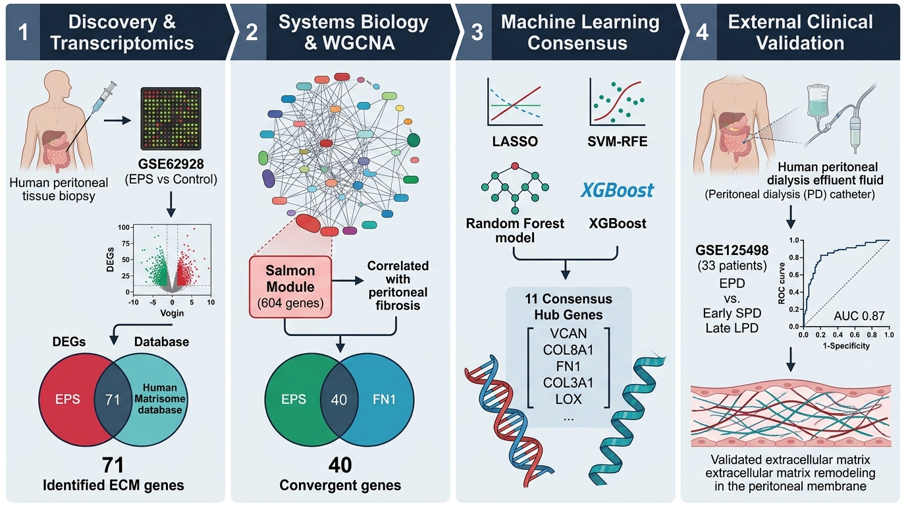
* **Figure 0: Comprehensive Study Workflow.** Discovery in human peritoneal biopsy transcriptomics ($N = 8$), intersection with the curated human Matrisome (1,027 genes), unsupervised WGCNA co-expression modeling, four-algorithm consensus machine learning feature selection, external validation in dialysis effluent ($N = 33$), live STRING v12.5 functional protein association networks, and permutation-controlled pathway/immune deconvolution.

---

## 📊 Summary of Master Quantitative Findings

| Analytical Stage | Parameter / Metric | Exact Value / Formula | Statistical & Permutation Controls | Scientific Interpretation |
| :--- | :--- | :---: | :--- | :--- |
| **Discovery Transcriptomics** | Total Unique Probed Genes | **22,049** (probe-level) / **20,940** (MaxMean) | Affymetrix HG-U133_Plus_2 mapped matrix | Genome-wide transcriptome representation |
| **Differential Expression** | Pro-Fibrotic Up-Regulated DEGs | **367** | Limma $P < 0.05, \log_2\text{FC} \ge 0.80$ | Focal up-regulated fibrotic response in EPS tissue |
| **Matrisome Overlap** | Pro-Fibrotic ECM-DEGs | **71** ($19.35\%$) | Exact One-Sided Permutation: **$P_{\text{perm}} = 1/70 = \mathbf{0.0143}$** | True clinical split achieves rank 1/70 (minimum attainable $P$ at $N=8$) |
| **WGCNA Module Trait** | Salmon Module Correlation | **$r = +0.806, P = 0.0157$** | Permutation: One-Sided $P_{\text{perm}} = \mathbf{0.0143}$, Two-Sided $P_{\text{perm}} = \mathbf{0.0286}$; FWER $P_{\text{bonf}} = \mathbf{0.2198}$ | Top module across all permutations; multiple testing caveat noted |
| **Tripartite Convergence** | WGCNA $\cap$ ECM-DEG Candidates | **40 genes** | Strict intersection: 604 Salmon $\cap$ 71 ECM-DEGs | Candidate matrix pool capturing structural & regulatory ECM |
| **Machine Learning Consensus** | Multi-Model Hub Panel | **11 genes** | $\ge 2/4$ Votes (LASSO: 2, SVM-RFE: 14, RF: 17, XGBoost: 1) | Cross-algorithm consensus selecting top fibrogenic drivers |
| **External Cohort (GSE125498)** | 7-Gene Panel In-Sample AUC | **$\text{AUC} = \mathbf{0.869}$** | Logistic Regression ($95\%\text{ CI: } [0.710, 0.992]$) | Apparent in-sample discrimination in effluent cohort |
| **External Cohort (GSE125498)** | 7-Gene Panel Cross-Validation | **$\text{AUC}_{\text{CV}} = \mathbf{0.678}$** ($\text{SD } 0.058$ across repeats) | 50-Repeat 5-Fold Stratified CV with Pipeline Scaler (Primary) | **Lead Generalization Metric:** True out-of-fold performance |
| **Clinical Diagnostic Nomogram** | 5-Gene Nomogram C-index | **$\text{C-index} = \mathbf{0.819}$** | Statsmodels `Logit` ($95\%\text{ CI: } [0.623, 0.968]$) | Multivariable point-scoring system; 5-fold CV-AUC $= 0.550$ ($\text{SD } 0.178$) |
| **Preranked GSEA Pathway** | EMT Hallmark Enrichment | **$\text{NES} = +\mathbf{3.203}, \text{FDR} < 0.001$** | Exact One-Sided Permutation: **$P_{\text{perm}} = 1/70 = \mathbf{0.0143}$** | EMT ranked #1 hallmark across all 70 permutations |
| **Microenvironment Infiltration** | Peritoneal Myofibroblasts | **$U = 16.0, P = 0.0286$** | Exact Two-Sided Permutation: **$P_{\text{perm}} = 2/70 = \mathbf{0.0286}$** ($\text{FDR} = 0.1714$) | Stromal myofibroblast expansion in EPS tissue (exploratory; signature curated from literature: ACTA2, TAGLN, COL1A1, COL1A2, POSTN, FAP; not verified against Kuppe et al. [Nature 2020, DOI: 10.1038/s41586-020-2941-1; human kidney fibrosis] supp tables) |
| **Co-Expression Baseline** | Noise Correlation Rate ($N=8$) | **$1.68\%$** at $|r| \ge 0.85$ | 99,993 non-hub random gene pairs (all genes) | Hub co-expression ($76.36\%$) vs DEG ($5.47\%$) & Salmon ($9.27\%$) baselines |

---

## 🧬 Biological Mechanism & Functional Roles of the 11 Hub Genes

The 11 consensus hub genes encode key structural collagens, adhesive glycoproteins, matrix crosslinking enzymes, and signaling regulators orchestrating peritoneal membrane degradation and fibrogenesis:

```
                                  [ PERITONEAL DIALYSIS STRESS & BIOCOMPATIBILITY ]
                                                         │
                                  ┌──────────────────────┴──────────────────────┐
                                  ▼                                             ▼
                     [ MESOTHELIAL INJURY & MMT ]                  [ SUBMESOTHELIAL FIBROGENESIS ]
                                  │                                             │
         ┌────────────────────────┼────────────────────────┐                    │
         ▼                        ▼                        ▼                    ▼
   [ SIGNALING ]          [ ADHESION & SCULLING ]    [ FIBRILLAR MATRIX ] [ MATRIX CROSSLINKING ]
   • INHBA (Activin A)    • FN1 (Fibronectin 1)      • COL3A1 (Collagen III) • LOX (Lysyl Oxidase)
   • ISM1 (Isthmin 1)     • VCAN (Versican)          • COL8A1 (Collagen VIII)
                          • EDIL3 (Del-1)            • COL11A1 (Collagen XI)
                          • THBS3 (Thrombospondin 3) • COMP (Cartilage Oligomeric)
                                  │
                                  ▼
                [ PROGRESSIVE PERITONEAL ENCAPSULATION & EPS ]
```

1. **`FN1` (Fibronectin 1):** Essential master scaffold glycoprotein connecting cell-surface integrins to fibrillar collagen networks; primary biomarker of mesothelial-to-mesenchymal transition (MMT; $\log_2\text{FC} = +1.93, P = 0.0053$ in discovery tissue).
2. **`COL3A1` (Collagen Type III Alpha 1):** Major structural fibrillar collagen deposited during early granulation tissue formation and progressive interstitial fibrosis ($\log_2\text{FC} = +2.84, P = 0.00084$).
3. **`COL8A1` (Collagen Type VIII Alpha 1):** Short-chain non-fibrillar collagen expressed in vascular basement membranes; drives neoangiogenesis and submesothelial thickening ($\log_2\text{FC} = +2.68, P = 0.0074$ in tissue; in effluent, nominal with one of two probes selected by lowest P [`ILMN_2402392`: $\log_2\text{FC} = +0.75, P = 0.0488$, Bonferroni-for-2-probes $P = 0.0976$], while the other probe [`ILMN_1685433`] showed $\log_2\text{FC} = +0.37, P \approx 0.4$ [$P = 0.3920$]).
4. **`COL11A1` (Collagen Type XI Alpha 1):** Minor fibrillar collagen regulating fibrillogenesis diameter and structural tensile strength in dense fibrotic lesions ($\log_2\text{FC} = +3.79, P = 0.00078$).
5. **`VCAN` (Versican):** Large chondroitin sulfate proteoglycan that binds hyaluronan and chemokines, regulating inflammatory leukocyte infiltration and stromal expansion ($\log_2\text{FC} = +2.75, P = 0.0030$).
6. **`COMP` (Cartilage Oligomeric Matrix Protein):** Pentameric extracellular matrix glycoprotein promoting collagen fibril assembly and stabilization ($\log_2\text{FC} = +4.08, P = 0.00062$).
7. **`THBS3` (Thrombospondin 3):** Oligomeric calcium-binding glycoprotein involved in cell-matrix interactions and tissue remodeling ($\log_2\text{FC} = +1.16, P = 0.019$).
8. **`EDIL3` (EGF-Like Repeats and Discoidin I-Like Domains 3 / Del-1):** Endothelial-derived matrix glycoprotein regulating angiogenesis and leukocyte adhesion ($\log_2\text{FC} = +1.40, P = 0.0031$).
9. **`LOX` (Lysyl Oxidase):** Extracellular copper-dependent amine oxidase catalyzing covalent crosslinking of collagens and elastin, rendering the fibrotic membrane insoluble and irreversible ($\log_2\text{FC} = +2.16, P = 0.0033$).
10. **`INHBA` (Inhibin Subunit Beta A / Activin A):** Member of the TGF-$\beta$ superfamily inducing Smad2/3 phosphorylation and myofibroblast differentiation ($\log_2\text{FC} = +2.88, P = 0.0016$).
11. **`ISM1` (Isthmin 1):** High-affinity secreted matricellular protein modulating endothelial apoptosis, microvascular integrity, and angiogenesis ($\log_2\text{FC} = +1.90, P = 0.0012$).

---

## 📈 Phase-by-Phase Analytical Pipeline & Research Methodology

### Phase 1: Microarray Preprocessing, Quality Control & Discovery Differential Expression

* **Cohort Design:** Discovery transcriptomics utilized human parietal peritoneal biopsy samples from **GSE62928** (Affymetrix Human Genome U133 Plus 2.0 Array, $N = 8$: 4 patients with severe Encapsulating Peritoneal Sclerosis undergoing surgical enterolysis vs. 4 non-EPS controls, comprising 2 patients undergoing first implantation of a peritoneal dialysis catheter [`PD1`, `PD2`] and 2 uremic patients without history of PD undergoing abdominal surgery for non-peritoneal problems [`UREMIC1`, `UREMIC2`]).
* **Probe-to-Gene Mapping & Gene Universes:**
  - Probe-level differential expression evaluated 22,049 unique genes (best-probe-by-P-value collapse).
  - WGCNA and co-expression modeling used the `MaxMean` collapsed matrix across 20,940 unique gene symbols.
  - GSEA preranked analysis evaluated 21,597 unique primary symbols.
* **Limma Linear Modeling:** Differential expression was evaluated using an empirical Bayes moderated $t$-statistic:
  $$\tilde{t}_{g} = \frac{\hat{\beta}_{g}}{s_{g}\sqrt{v_{g}}}, \quad s_{g}^2 = \frac{d_0 s_0^2 + d_g s_g^2}{d_0 + d_g}$$
* **Threshold Criteria:** Pro-fibrotic DEGs were defined strictly as nominal $P < 0.05$ and $\log_2\text{FC} \ge 0.80$ (up-regulated in EPS), isolating **367 pro-fibrotic DEGs**.
* **Methodological Note on Probe Collapse:** The DEG list depends on probe-collapse method (367 up-regulated genes with best-probe-by-P in 22,049 genes vs 462 with MaxMean in 20,940 genes); ECM over-representation ranked 1/70 under both. Hub genes were chosen from DEGs filtered at nominal $P < 0.05$, so their significance is by construction.

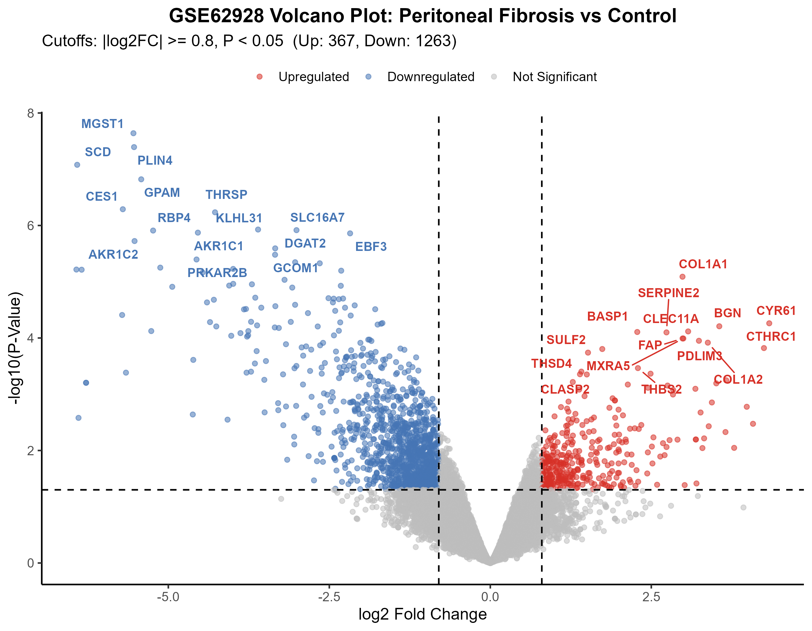
* **Figure 1: Discovery Differential Expression Landscape.** Volcano plot of 22,049 probed genes in GSE62928 highlighting the 367 pro-fibrotic DEGs ($P < 0.05, \log_2\text{FC} \ge 0.80$, red).

---

### Phase 2: Curated Human Matrisome Filtering & Exact Permutation Control

* **Matrisome Reference:** The 367 pro-fibrotic DEGs were mapped against the Human Matrisome Project catalog (Naba et al., 1,027 curated ECM genes encompassing Core Matrisome collagens, glycoproteins, proteoglycans, and Matrisome-Associated regulators; 975 present in the 22,049 probe universe, 966 in the 20,940 matrix).
* **Intersection:** Isolated **71 Pro-Fibrotic ECM-DEGs** ($19.35\%$ of DEGs vs. $4.42\%$ background rate; 4.38-fold enrichment; Hypergeometric $P = 2.59 \times 10^{-26}$).
* **Exact Combinatorial Label Permutation Framework:** Because $N = 8$ yields exactly $\binom{8}{4} = 70$ possible 4-case vs. 4-control label assignments, empirical significance was computed across all 70 partitions using a one-sided count rank:
  $$P_{\text{perm}} = \frac{1}{70} \sum_{k=1}^{70} \mathbb{I}\left( N_{\text{ECM}}^{(k)} \ge N_{\text{ECM}}^{(\text{true})} \right) = \frac{1}{70} = \mathbf{0.0143}$$
  The true EPS phenotype ranks **#1 out of 70**, achieving the exact mathematical minimum achievable one-sided $p$-value at $N = 8$.

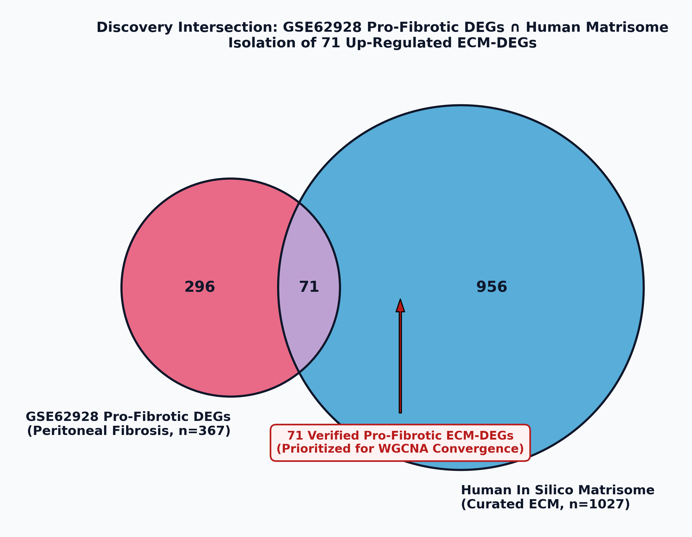
* **Figure 2: Matrisome Intersect.** 2-way Venn diagram demonstrating the intersection between 367 pro-fibrotic DEGs and the 1,027-gene curated Human Matrisome, isolating 71 ECM-DEGs.

---

### Phase 3: Weighted Gene Co-Expression Network Analysis (WGCNA)

* **Unsupervised Adjacency Construction:** Co-expression networks were constructed across all 20,940 MaxMean genes using a signed hybrid similarity metric with soft-thresholding power $\beta = 12$ (truncated scale-free fit $R^2 = 0.809$, linear scale-free fit $R^2 = 0.820$, slope $-0.768$):
  $$a_{ij} = \left| \frac{1 + \text{cor}(x_i, x_j)}{2} \right|^\beta$$
* **Topological Overlap Matrix (TOM):** Hierarchical clustering of topological overlap identified 14 distinct co-expression modules (minimum module size $= 30$, merge cut height $= 0.25$).
* **Module-Trait Association:** Module eigengenes (MEs) were correlated with binary clinical EPS status. The **Salmon Module** (604 genes) demonstrated the highest positive correlation:
  $$r = +0.806, \quad \text{Student's } P = \mathbf{0.0157}, \quad \text{One-Sided } P_{\text{perm}} = 1/70 = \mathbf{0.0143}, \quad \text{Two-Sided } P_{\text{perm}} = 2/70 = \mathbf{0.0286}$$
  Minimum achievable two-sided $P$-value at $N=8$ is $2/70 = 0.0286$.
* **Tripartite Convergence:** Intersecting the 604 Salmon module genes with the 71 ECM-DEGs identified **40 Convergent WGCNA-ECM Candidates**.

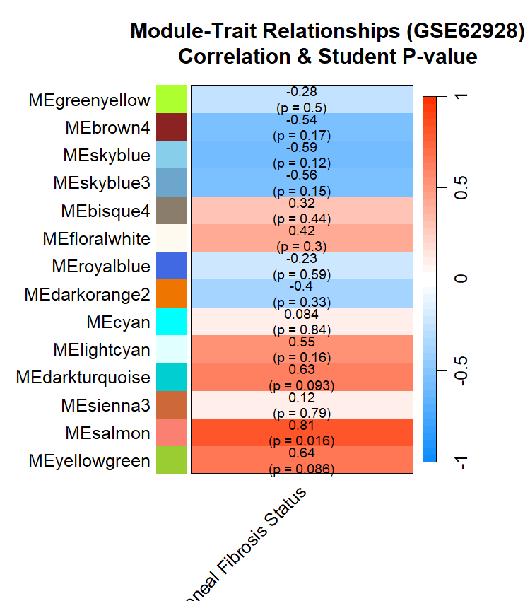
* **Figure 3: Module-Trait Association Heatmap.** Pearson correlation between 14 WGCNA module eigengenes and binary peritoneal fibrosis status ($N = 8$).

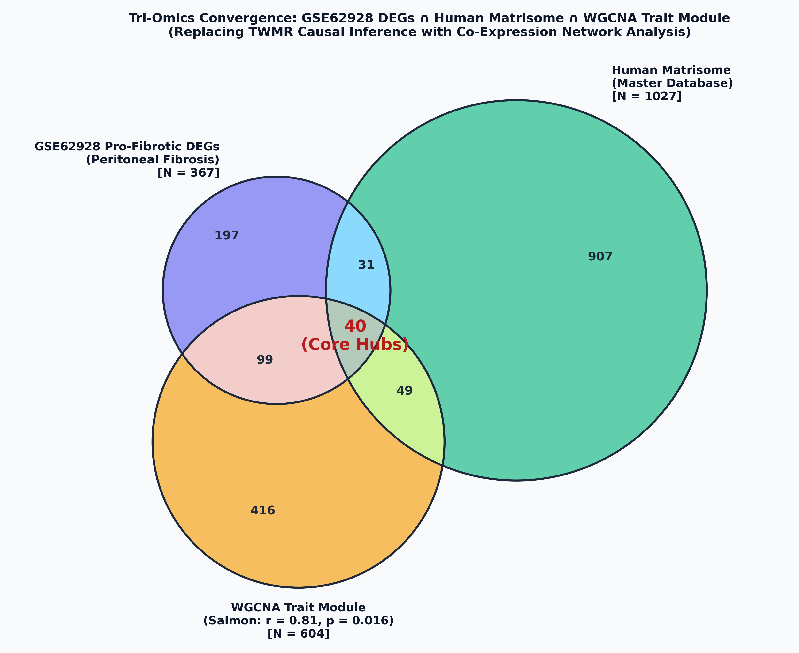
* **Figure 4: 3-Way Convergence Venn Diagram.** Tripartite intersection among GSE62928 DEGs ($n=367$), Curated Matrisome ($n=1,027$), and WGCNA Salmon Module ($n=604$), defining the 40 convergent candidate genes.

---

### Phase 4: Consensus Machine Learning Feature Selection (11 Hub Genes)

Four distinct machine learning algorithms were trained on the 40 convergent candidates across the discovery matrix using a fixed random seed (`seed = 42`):
1. **LASSO (L1 Regularization):** `LogisticRegressionCV(Cs=20, cv=4, penalty='l1', solver='saga')` selected $C = 4.28$ (scikit-learn inverse regularization), isolating **2 features** (`ISM1`, `FN1`). Note that 4-fold cross-validation on $N=8$ samples is highly discrete and unstable.
2. **SVM-RFE (Recursive Feature Elimination):** Linear support vector machine iteratively ranking features by weight criterion $c_j = (w_j)^2$, selecting **14 features**.
3. **Random Forest (Gini Impurity):** 500 decision trees ranking Mean Decrease Gini, selecting **17 features**.
4. **XGBoost (Extreme Gradient Boosting):** Depth-constrained gradient-boosted trees, selecting **1 feature** (`EDIL3`).

**Consensus Rule:** Candidates selected by $\ge 2$ algorithms were designated consensus hub genes, isolating **11 Consensus Pro-Fibrotic Hub Genes**:
$$\text{Hub Panel: } \mathbf{ISM1, \; FN1, \; EDIL3, \; VCAN, \; COL3A1, \; COMP, \; COL8A1, \; THBS3, \; COL11A1, \; INHBA, \; LOX}$$

```
Consensus ML Feature Selection Distribution:
• 4/4 Models: None (0 genes)
• 3/4 Models (3 genes): ISM1, FN1 (LASSO + SVM-RFE + RF), EDIL3 (SVM-RFE + RF + XGBoost)
• 2/4 Models (8 genes, all selected exclusively by SVM-RFE + RF): VCAN, COL3A1, COMP, COL8A1, THBS3, COL11A1, INHBA, LOX
• 1/4 Models (9 genes): Selected by only one model
• 0/4 Models (20 genes): Not selected by any model
```

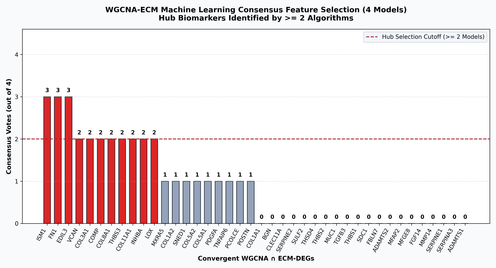
* **Figure 5: Machine Learning Consensus Votes.** Feature selection tallies across LASSO (2), SVM-RFE (14), Random Forest (17), and XGBoost (1) isolating the 11 hub genes ($\ge 2$ votes; 3 votes: 3, 2 votes: 8, 1 vote: 9, 0 votes: 20).

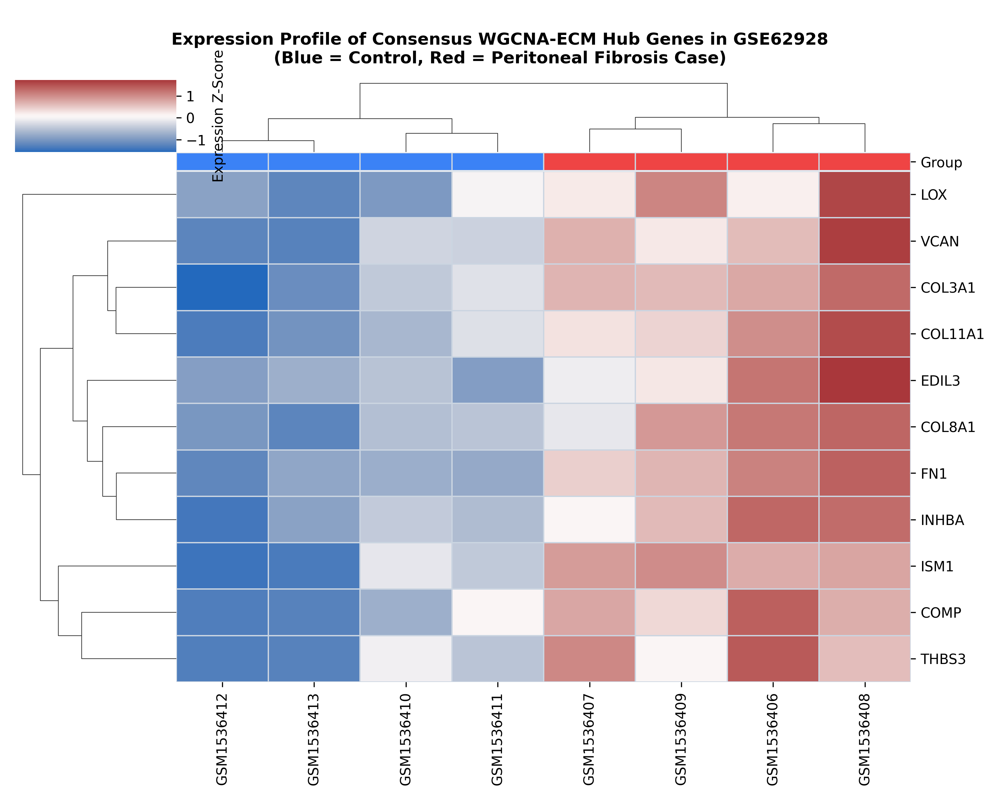
* **Figure 6: Discovery Expression Profiles.** Clustered heatmap of the 11 consensus hub genes in discovery tissue ($N = 8$: 4 EPS vs 4 Control).

---

### Phase 5: External Cohort Cross-Validation (GSE125498, N = 33)

* **Independent Clinical Cohort:** Hub genes were evaluated in **GSE125498** (Illumina HumanHT-12 v4.0 Expression BeadChip, $N = 33$ human peritoneal dialysis effluent cell pellet samples: 20 short-term PD [SPD, 0–24 months] vs. 13 long-term PD [LPD, $\ge 25$ months], serving as a clinical proxy for progressive dialysis-induced peritoneal injury).
* **Probe Coverage:** 7 of 11 hub genes were represented on the Illumina array (`FN1`, `COL3A1`, `COL8A1`, `VCAN`, `THBS3`, `LOX`, `ISM1`). Four genes (`COL11A1`, `COMP`, `EDIL3`, `INHBA`) lacked mapped probes.
* **Primary Composite 7-Gene Classifier:**
  - **In-Sample Fit:** $\text{AUC} = \mathbf{0.869}$ ($95\%\text{ CI: } [0.710, 0.992]$)
  - **50-Repeat 5-Fold Stratified CV with Pipeline Scaler (Primary):** Per-repeat pooled $\text{AUC} = \mathbf{0.678}$ ($\text{SD } 0.058$ across 50 repeats, range: $0.512 - 0.773$; per-fold Mean $\text{AUC} = 0.701$, $\text{SD } 0.203$).
  - **Leave-One-Out Cross-Validation (LOOCV with Scaler):** Pooled $\text{AUC}_{\text{LOOCV}} = \mathbf{0.658}$.
  - **Single Seed-42 5-Fold Stratified CV with Scaler:** Pooled fold $\text{AUC} = \mathbf{0.592}$ (per-fold Mean $\text{AUC} = 0.617$, $\text{SD } 0.061$).
  - **Supplementary 50-Repeat 5-Fold CV Unscaled:** Per-repeat pooled $\text{AUC} = 0.684$ ($\text{SD } 0.063$ across 50 repeats, range: $0.523 - 0.781$; per-fold Mean $\text{AUC} = 0.706$, $\text{SD } 0.209$).

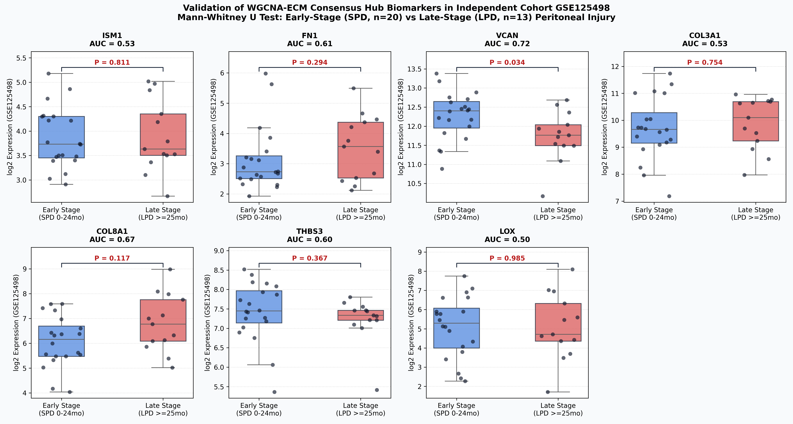
* **Figure 7: External Validation Boxplots.** Standardized expression of the 7 profiled hub genes in dialysis effluent cells across Early (SPD) vs Late (LPD) cohorts ($N = 33$).

---

### Master Reconciliation Table of All Discrimination Metrics
 
| Cohort / Model | Feature(s) / Predictor | Probe ID Used | $N$ | Validation Method | AUC / C-index | 95% CI / range of 50-repeat pooled AUCs | Methodological Assessment |
| :--- | :--- | :--- | :---: | :--- | :---: | :---: | :--- |
| **GSE125498 (Effluent)** | `VCAN` (Single Gene) | `ILMN_1687301` | 33 | Empirical ROC | **0.723** ($P=0.034$) | [0.529, 0.892] | Inverted CI; lower in late PD effluent cells (unadjusted limma moderated $P=0.0244$; VCAN's decrease in long-term PD effluent cells is fragile and depends on probe set and adjustment method: attenuated or abolished under CD14/CD3E/FCGR3B marker adjustment, preserved under 5-lineage-score adjustment) |
| **GSE125498 (Effluent)** | `COL8A1` (Single Gene, Lowest-P) | `ILMN_2402392` | 33 | Empirical ROC | **0.665** ($P=0.117$) | [0.461, 0.844] | Nominal with one of two probes (selected by lowest P; limma $P=0.0488$, Bonferroni-for-2-probes $P=0.0976$); the other probe showed log2FC +0.37, P ≈ 0.4 (highest-mean probe `ILMN_1685433`: $\text{AUC}=0.581$, limma $P=0.3920$) |
| **GSE125498 (Effluent)** | `FN1` (Single Gene, Lowest-P) | `ILMN_1778237` | 33 | Empirical ROC | **0.612** ($P=0.294$) | [0.400, 0.822] | Modest upregulation trend in late effluent cells (limma $P=0.269$; highest-mean probe `ILMN_2366463`: $\text{AUC}=0.625$, limma $P=0.319$) |
| **GSE125498 (Effluent)** | `THBS3` (Single Gene) | `ILMN_1804663` | 33 | Empirical ROC | **0.596** ($P=0.367$) | [0.411, 0.787] | Inverted CI; lower in late PD effluent cells (limma $P=0.418$) |
| **GSE125498 (Effluent)** | `COL3A1` (Single Gene) | `ILMN_1773079` | 33 | Empirical ROC | **0.535** ($P=0.754$) | [0.330, 0.748] | Fibrillar matrix trend in late dialysis |
| **GSE125498 (Effluent)** | `ISM1` (Single Gene) | `ILMN_3239288` | 33 | Empirical ROC | **0.527** ($P=0.811$) | [0.306, 0.732] | Matricellular vascular trend |
| **GSE125498 (Effluent)** | `LOX` (Single Gene) | `ILMN_1695880` | 33 | Empirical ROC | **0.496** ($P=0.985$) | [0.285, 0.696] | Inactive crosslinker in shed cellular fraction |
| **GSE125498 (Primary 7-Gene Panel)** | 7 Profiled Hub Genes | Multi-probe | 33 | In-Sample Logistic Fit | **0.869** | [0.710, 0.992] | **In-Sample Optimistic Fit (Subject to optimism)** |
| **GSE125498 (Primary 7-Gene Panel)** | 7 Profiled Hub Genes | Multi-probe | 33 | 50x 5-Fold Stratified CV (Scaled) | **0.678** ($\text{SD } 0.058$) | [0.512, 0.773]* | **Lead Generalization Metric (Primary Pipeline Scaled)** |
| **GSE125498 (Supplementary 7-Gene)** | 7 Profiled Hub Genes | Multi-probe | 33 | 50x 5-Fold Stratified CV (Unscaled) | **0.684** ($\text{SD } 0.063$) | [0.523, 0.781]* | Supplementary unscaled model (per-repeat pooled) |
| **GSE125498 (Supplementary 7-Gene)** | 7 Profiled Hub Genes | Multi-probe | 33 | Leave-One-Out CV (Scaled) | **0.658** | N/A | Pooled LOOCV discrimination |
| **GSE125498 (Supplementary 7-Gene)** | 7 Profiled Hub Genes | Multi-probe | 33 | Single Seed-42 5-Fold CV (Scaled) | **0.592** (fold mean $0.617$, $\text{SD } 0.061$) | N/A | Single split generalization |
| **GSE125498 (Secondary 5-Gene Nomogram)** | `VCAN, COL8A1, FN1, ISM1, COL3A1` | Multi-probe | 33 | In-Sample `Logit` | **0.819** | [0.623, 0.968] | **Nomogram C-index (Fitted unpenalized model)** |
| **GSE125498 (Secondary 5-Gene Nomogram)** | `VCAN, COL8A1, FN1, ISM1, COL3A1` | Multi-probe | 33 | 5-Fold Stratified CV (L2 Regularized) | **0.550** ($\text{SD } 0.178$) | [0.322, 0.759] | Out-of-fold generalization drop ($\Delta\text{AUC} = 0.269$) |

*\*Range of per-repeat pooled AUCs across 50 repeats. All models use $C=1.0$ and L2 penalty. Note: AUC direction for VCAN/THBS3 was set after observing the data; estimates are optimistic.*

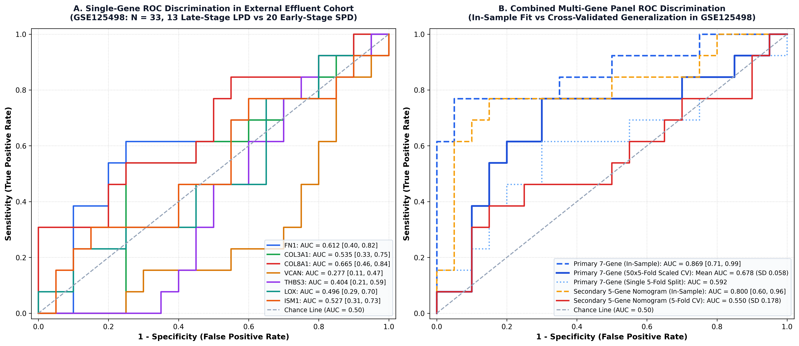
* **Figure 8: External Validation ROC Curves.** (A) Single-gene ROC curves in GSE125498 ($N=33$). (B) Multi-gene composite ROC comparison demonstrating the gap between in-sample fit ($\text{AUC} = 0.869$), primary pipeline-scaled 50-repeat 5-fold cross-validation ($\text{AUC}_{\text{CV}} = \mathbf{0.678}$, $\text{SD } 0.058$ across repeats; $\text{LOOCV } \text{AUC} = 0.658$), and single 5-fold CV ($\text{AUC} = 0.592$).

---

### Tissue vs. Effluent Expression Discordance Analysis

| Gene Symbol | Probe ID Used | Discovery Biopsy (GSE62928, $N=8$) | Effluent Cells (GSE125498, $N=33$) | Directional Concordance | Biological & Compartmental Rationale |
| :--- | :--- | :--- | :--- | :--- | :--- |
| **`COL8A1`** | `ILMN_2402392` (Lowest-P) / `ILMN_1685433` (MaxMean) | $\log_2\text{FC} = +2.68, P = 0.0074$ | $\log_2\text{FC} = +0.75, P = 0.049$ (Lowest-P) / $+0.37, P = 0.392$ (MaxMean) | **Nominal (Probe-Dependent)** | Nominal with one of two probes (selected by lowest P; Bonferroni $P = 0.0976$); the other probe showed log2FC +0.37, P ≈ 0.4. |
| **`FN1`** | `ILMN_1778237` (Lowest-P) / `ILMN_2366463` (MaxMean) | $\log_2\text{FC} = +1.93, P = 0.0053$ | $\log_2\text{FC} = +0.41, P = 0.269$ (Lowest-P) / $+0.32, P = 0.319$ (MaxMean) | **Concordant (UP)** | Preserved upregulation trend in late effluent cells; non-significant after multiple testing. |
| **`COL3A1`** | `ILMN_1773079` | $\log_2\text{FC} = +2.84, P = 0.00084$ | $\log_2\text{FC} = +0.19, P = 0.616$ | **Concordant (UP)** | Fibrillar collagen upregulated in late dialysis effluent. |
| **`ISM1`** | `ILMN_3239288` | $\log_2\text{FC} = +1.90, P = 0.0012$ | $\log_2\text{FC} = +0.03, P = 0.904$ | **Concordant (UP)** | Modest concordant trend in microvascular endothelial transcripts. |
| **`LOX`** | `ILMN_1695880` | $\log_2\text{FC} = +2.16, P = 0.0033$ | $\log_2\text{FC} = +0.02, P = 0.976$ | **Flat / Neutral** | Secreted crosslinking enzyme; cellular transcript unchanged in shed effluent cells. |
| **`VCAN`** | `ILMN_1687301` | $\log_2\text{FC} = +2.75, P = 0.0030$ | $\log_2\text{FC} = -0.52, P = 0.024$ | **Discordant (DOWN)** | VCAN's decrease in long-term PD effluent cells is fragile and depends on probe set and adjustment method: attenuated or abolished under CD14/CD3E/FCGR3B marker adjustment, preserved under 5-lineage-score adjustment. |
| **`THBS3`** | `ILMN_1804663` | $\log_2\text{FC} = +1.16, P = 0.019$ | $\log_2\text{FC} = -0.20, P = 0.418$ | **Discordant (DOWN)** | Glycoprotein anchored to ECM scaffold; reduced transcript in free effluent cells. |
| **`COMP`** | *Unmapped* | $\log_2\text{FC} = +4.08, P = 0.00062$ | *Unmapped on GPL10558* | **Tissue-Only** | Pentameric matrix protein highly elevated in severe fibrotic tissue. |
| **`COL11A1`** | *Unmapped* | $\log_2\text{FC} = +3.79, P = 0.00078$ | *Unmapped on GPL10558* | **Tissue-Only** | Fibrillar matrix organizer elevated in surgical EPS tissue. |

---

### Phase 6: Clinical Diagnostic Nomogram, Calibration & Decision Curve Analysis (DCA)

A 5-gene multivariable diagnostic nomogram was constructed on directional predictors (`VCAN`, `COL8A1`, `FN1`, `ISM1`, `COL3A1`) in GSE125498.

* **Nomogram Points:** Dynamic ranges mapped to a 0–100 scale ($\text{COL8A1} = 100.0\text{ max pts}, \text{VCAN} = 84.5\text{ pts}, \text{COL3A1} = 58.6\text{ pts}, \text{FN1} = 33.3\text{ pts}, \text{ISM1} = 17.1\text{ pts}$).
* **In-Sample Discrimination:** Multivariable unpenalized statsmodels `Logit` achieves in-sample $\text{C-index} = \mathbf{0.819}$ ($95\%\text{ CI: } [0.623, 0.968]$).
* **Cross-Validated Discrimination:** 5-fold cross-validation with an L2 regularized model ($C=1.0$) yields $\text{AUC}_{\text{CV}} = \mathbf{0.550}$ ($\text{SD } 0.178$ across folds).
* **Likelihood-Ratio Test vs. `FN1` Alone:** $\text{LR } \chi^2 = 10.421, \text{df} = 4, P = \mathbf{0.0339}$ (significant improvement over single-gene model).
* **Calibration & Decision Curves:** Lowess-smoothed calibration ($B=1000$ bootstrap, Brier Score $= \mathbf{0.1542}$, Hosmer-Lemeshow $\chi^2 = 2.823, P = 0.2437$) and Decision Curve Analysis (DCA) demonstrate net clinical benefit across threshold probabilities $P_t = 0.10 - 0.70$.

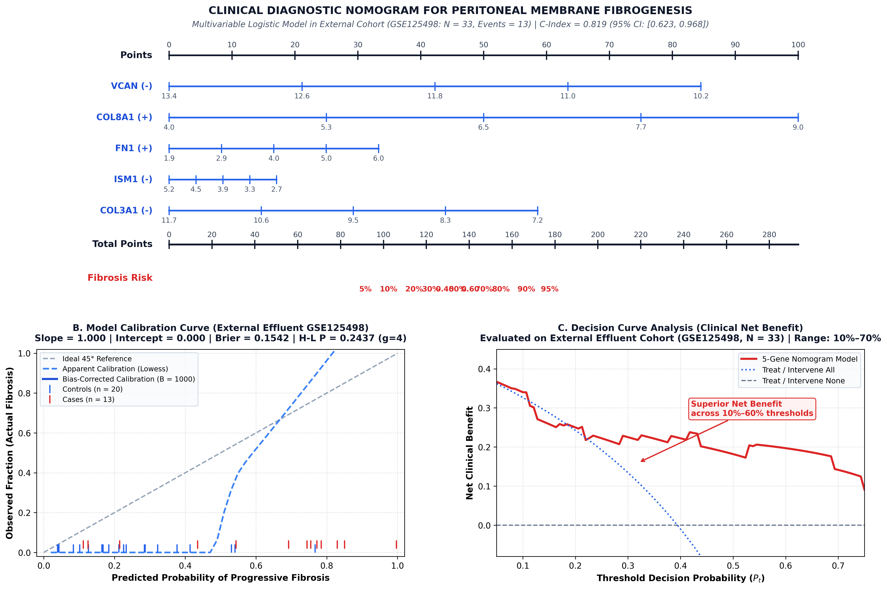
* **Figure 9: Clinical Diagnostic Nomogram Suite.** (A) Exact points scoring nomogram. (B) Bootstrap calibration curve. (C) Decision Curve Analysis showing net clinical benefit across risk thresholds. (D) Multi-model ROC comparison.

---

### Phase 7: Protein-Protein Interaction (STRING v12.5) & GSE62928 Co-Expression

An integrated molecular interaction network was constructed combining live-queried functional association interactions from **STRING v12.5** (retrieved 2026-10-01) with empirical co-expression in human peritoneal tissue.

* **Live STRING v12.5 Functional Association Network:** **21 verified functional association edges** (interaction score $\ge 0.400$; top 4 edges: `FN1 - LOX` [0.953], `COL3A1 - FN1` [0.911], `COL11A1 - COL3A1` [0.877], `COL3A1 - LOX` [0.802]). Physical interaction query (`network_type=physical`) yields 3 edges (`FN1 - LOX` [0.848], `COL11A1 - COL3A1` [0.720], `COMP - FN1` [0.595]).
* **Hub Node Connectivity:** 10 of the 11 hub genes form an interconnected functional component; `ISM1` has no edges among the 11 hubs in STRING (degree = 0).
* **Co-Expression Edges ($N=8$ Discovery):** 42 / 55 (76.36%) hub gene pairs exhibit $|r| \ge 0.85$ (42 edges at $|r| \ge 0.85, \text{FDR} < 0.01$).
* **Co-Expression Noise Baselines:**
  - **All Genes (Non-hub random pairs):** **$1.68\%$ of random gene pairs exceed $|r| \ge 0.85$ purely by chance** at $N=8$ (1,682 / 99,993 sampled pairs).
  - **Among 367 Pro-Fibrotic DEGs:** **$5.47\%$ of pairs exceed $|r| \ge 0.85$** (3,062 / 55,945 pairs; $14.0\times$ enrichment for hubs vs DEG baseline; $55,945 = \binom{335}{2}$ pairs from the 335 pro-fibrotic DEGs present in the GSE62928 MaxMean expression matrix).
  - **Among 604 Salmon-Module Genes:** **$9.27\%$ of pairs exceed $|r| \ge 0.85$** (16,885 / 182,106 pairs; $8.2\times$ enrichment for hubs vs Salmon-module baseline).
  - **Methodological Note:** Hub co-expression is partly by construction because hub genes were selected from the co-expressed WGCNA Salmon module.

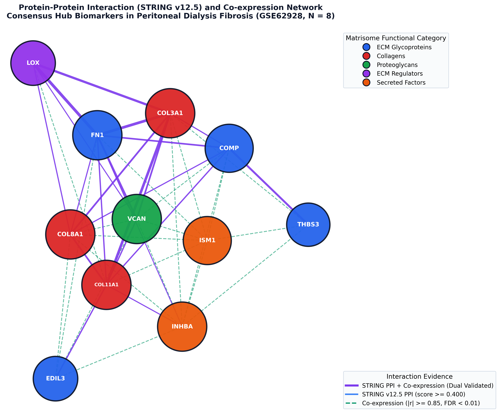
* **Figure 10: Integrated STRING PPI & Co-Expression Network.** Dual-evidence interaction network combining live STRING v12.5 functional protein associations (score $\ge 0.400$, 21 edges; solid lines) with empirical tissue co-expression edges (42 edges at $|r| \ge 0.85, \text{FDR} < 0.01$; dashed green lines) among the 11 consensus hub genes (`ISM1` has degree = 0 in STRING). Where STRING interactions are evaluated in isolation without empirical tissue co-expression, [`results/figures/D_string_ppi_network.png`](results/figures/D_string_ppi_network.png) illustrates the 21 functional associations alone.

---

### Phase 8: Permutation-Controlled Preranked GSEA

Preranked Gene Set Enrichment Analysis was executed using `gseapy` on all 21,597 primary gene symbols ranked by Limma moderated $t$-statistics across MSigDB Hallmark Gene Sets (v2020, `seed = 42`).

* **Primary Enriched Hallmark:** **Epithelial-Mesenchymal Transition (EMT)** ($\text{NES} = +\mathbf{3.203}, P_{\text{nom}} < 0.001, \text{FDR} < 0.001$).
* **EMT Permutation Test:** Across all 70 sample label permutations, EMT $\text{NES} = +3.203$ ranked **#1 out of 70** (one-sided $P_{\text{perm}} = 1/70 = \mathbf{0.0143}$).
* **Permutation Framework Distinction:** `gseapy.prerank` evaluates gene-set enrichment by permuting gene labels (1,000 permutations), whereas the 1/70 exact permutation test permutes clinical sample labels.
* **Other Enriched Upregulated Pathways:** TNF-$\alpha$ Signaling via NF-$\kappa$B ($\text{NES} = +2.082, P_{\text{nom}} < 0.001, \text{FDR} = 0.0010$), Inflammatory Response ($\text{NES} = +1.587, P_{\text{nom}} < 0.001, \text{FDR} = 0.0303$), Angiogenesis ($\text{NES} = +1.438, P_{\text{nom}} = 0.0486, \text{FDR} = 0.0855$), Apical Junction ($\text{NES} = +1.411, P_{\text{nom}} = 0.0079, \text{FDR} = 0.0815$), IL-6/JAK/STAT3 Signaling ($\text{NES} = +1.392, P_{\text{nom}} = 0.0326, \text{FDR} = 0.0794$), Apoptosis ($\text{NES} = +1.349, P_{\text{nom}} = 0.0210, \text{FDR} = 0.0975$), Coagulation ($\text{NES} = +1.333, P_{\text{nom}} = 0.0329, \text{FDR} = 0.0986$).
* **Downregulated Hallmark Pathways:** Adipogenesis ($\text{NES} = -3.146, P_{\text{nom}} < 0.001, \text{FDR} < 0.001$), Oxidative Phosphorylation ($\text{NES} = -3.101, P_{\text{nom}} < 0.001, \text{FDR} < 0.001$), Fatty Acid Metabolism ($\text{NES} = -2.766, P_{\text{nom}} < 0.001, \text{FDR} < 0.001$), Interferon Alpha Response ($\text{NES} = -2.385, P_{\text{nom}} < 0.001, \text{FDR} < 0.001$), Reactive Oxygen Species ($\text{NES} = -2.270, P_{\text{nom}} < 0.001, \text{FDR} < 0.001$).
* **Hypoxia Status:** `HALLMARK_HYPOXIA` is downregulated and non-significant in discovery tissue ($\text{NES} = -1.210, P_{\text{nom}} = 0.1407, \text{FDR} = 0.2026$). *(Note: previous documentation mistakenly attributed Apoptosis statistics $\text{NES} = +1.349, \text{FDR} = 0.097$ to Hypoxia).*

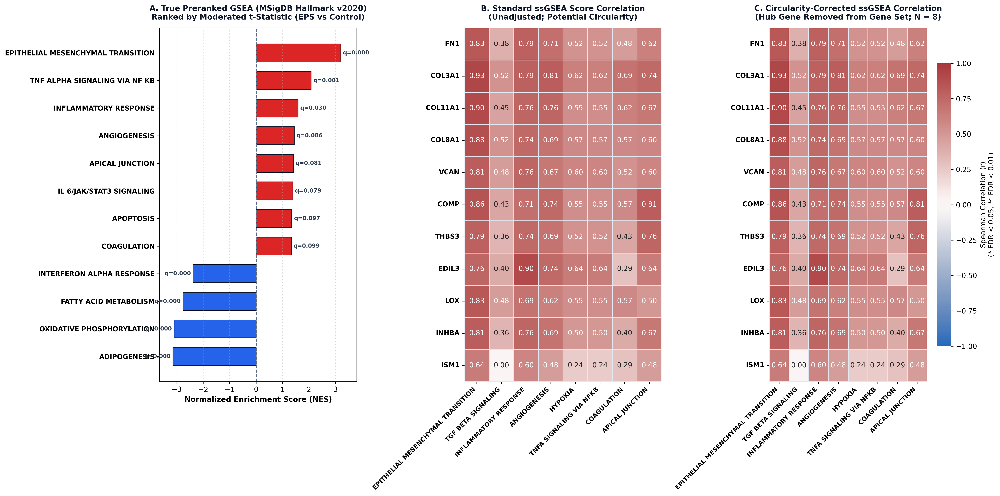
* **Figure 11: Hallmark Fibrosis Pathway Enrichment.** Heatmap of circularity-corrected ssGSEA hallmark pathway scores across peritoneal tissue samples.

---

### Phase 9: Microenvironmental Immune Deconvolution & Correlation

Peritoneal cell-type deconvolution was performed across 12 immune and stromal populations using curated published reference signatures (Charoentong et al., Bindea et al.). The 6-gene Peritoneal Myofibroblast panel (`ACTA2`, `TAGLN`, `COL1A1`, `COL1A2`, `POSTN`, `FAP`) is a signature curated from literature; not verified against Kuppe et al. (Nature 2020, published online 2020, DOI: [10.1038/s41586-020-2941-1](https://doi.org/10.1038/s41586-020-2941-1); human kidney fibrosis) supplementary tables. All signatures were screened to ensure no hub gene is present within any cell marker list.

* **Focal Cell Type Expansion:** **Peritoneal Myofibroblasts** (Mann-Whitney $U = 16.0, P_{\text{raw}} = 0.0286, \text{FDR} = 0.1714$, Exact Two-Sided Permutation $P_{\text{perm}} = 2/70 = \mathbf{0.0286}$, which equals the exact two-sided Mann-Whitney $P = 0.028571$).
* **Borderline Cell Types:** M2 Macrophages ($P = 0.0571, \text{FDR} = 0.1714$), Neutrophils ($P = 0.0571, \text{FDR} = 0.1714$), Activated Dendritic Cells ($P = 0.0571, \text{FDR} = 0.1714$).
* **Global Permutation Baseline:** In 70 random label permutations, **$31.4\%$ of random permutations produce $\ge 1$ cell type with nominal $P < 0.05$** (Family-wise $P_{\text{perm}} = 0.3143$). Individual cell-type signals are interpreted as exploratory.

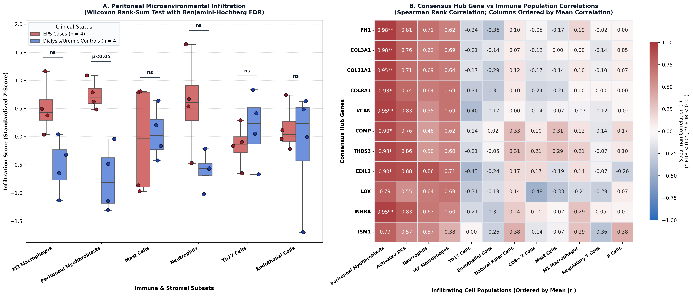
* **Figure 12: Peritoneal Immune Deconvolution.** (A) Boxplots of standardized microenvironmental infiltration scores ($N = 8$). (B) Spearman correlation matrix between the 11 hub genes and infiltrating cell populations.

---

### Phase 10: Single-Cell RNA-Seq Dissection & Donor-Level Pseudobulk edgeR (GSE248762, N = 16)

To resolve the cellular origin and cell-type-specific regulation of candidate matrisome hub genes at single-cell resolution, we analyzed **GSE248762** (10x Genomics Chromium, $N = 16$ human peritoneal dialysis effluent donors; 118,895 deposited barcodes $\to$ 95,507 QC-pass cells $\to$ 95,247 cells after doublet filtering).

* **Clinical Cohort & Donors (Peritoneal Dialysis Effluent):**
  - **4 Low-Volume Ultrafiltration Failure (`LV_UF`):** Long-vintage PD effluent ($>90$ months; median 132 months) with ultrafiltration failure ($\text{UF} < 400\text{ mL}$).
  - **6 Non-Failing Dialyzed Donors (`LV_NOT_UF`):** Long-vintage PD effluent ($>90$ months; median 137 months) with preserved ultrafiltration ($\text{UF} > 400\text{ mL}$).
  - **6 Short-Vintage Dialyzed Donors (`SV`):** Short-vintage PD effluent ($<6$ months; median 5 months).
  - **Contrast Design Caveat:** Comparisons against SV (`LV_UF vs SV` and `LV_NOT_UF vs SV`) represent dialysis vintage contrasts; only `LV_UF vs LV_NOT_UF` specifically contrasts ultrafiltration failure at matched vintage.
* **Cell Types & Quality Control:**
  - Barcodes below ~500 UMI were absent in deposited matrices.
  - Harmony donor-level batch integration followed by Leiden clustering resolved **8 distinct cell types** across 95,247 kept cells:
    - T cell ($n = 44,245$, $46.45\%$)
    - Monocyte / macrophage ($n = 22,925$, $24.07\%$)
    - Conventional dendritic cell (cDC; $n = 13,672$, $14.35\%$)
    - NK cell ($n = 4,011$, $4.21\%$)
    - Stromal / mesothelial-lineage (unresolved; $n = 3,670$, $3.85\%$)
    - Neutrophil ($n = 3,647$, $3.83\%$)
    - B cell ($n = 1,840$, $1.93\%$)
    - Mixed: pDC / Plasma cell ($n = 1,237$, $1.30\%$)
  - No cluster expressing endothelial or mast markers was identified in effluent. Mesothelial and fibroblast lineages are transcriptionally unresolved within the stromal cluster; score-based subsetting showed no detectable difference; underpowered (4 vs 6 donors); not evidence of equivalence. Per-donor mesothelial proportions were 62.78% ± 26.10% in LV_UF ($N=4$) vs 63.36% ± 14.91% in LV_NOT_UF ($N=6$, Mann-Whitney $U = 8.0, P = 0.4762$; SV $N=6$: 78.96% ± 9.94%), alongside per-donor mean UMI of 6,389.6 ± 3,069.4 in LV_UF vs 14,149.2 ± 14,280.6 in LV_NOT_UF ($U = 9.0, P = 0.6095$; SV: 17,006.9 ± 10,397.9). This lack of detectable difference is underpowered, does not indicate equivalence, and is not used to justify pooling.
* **Doublet Benchmarking & Filtering:**
  - The pooled simulated-doublet score distribution exhibits one dominant mode (~0.10) with low-amplitude ripples above 0.3 and no valley.
  - Scrublet with a fixed global cutoff of 0.439 removed 320 doublets overall (260 among QC-pass cells; $0.27\%$), yielding the final 95,247-cell object.
  - Cluster-aware `scDblFinder` flagged 10,057 total barcodes ($8.46\%$) and 8,112 QC-pass cells ($8.52\%$). Exactly 8,112 scDblFinder calls remain in the 95,247-cell object; an scDblFinder-removed sensitivity model (`sens_c_no_scDblFinder`) confirmed that scDblFinder-removed estimates were similar.
  
| Method | Cutoff / Threshold | Flagged (All 118,895 Barcodes) | Flagged (QC-Pass Cells) | Used in Final Object |
| :--- | :--- | :---: | :---: | :---: |
| **Scrublet (Fixed rule)** | Cutoff = 0.439 | 320 ($0.27\%$) | 260 ($0.27\%$) | **YES** (produced 95,247 cells) |
| **scDblFinder** | Cluster-aware dynamic | 10,057 ($8.46\%$) | 8,112 ($8.52\%$) | **NO** (evaluated in sensitivity `sens_c`)* |
| **Legacy Heuristic (Script 14)** | Count/gene percentiles | 4,672 ($3.93\%$) | 977 ($1.02\%$) | **NO** (superseded heuristic) |

*\*Footnote: Per-sample automatic Scrublet (`scripts/26_scrna_doublet_investigation.py`) flagged 586 barcodes total and 454 among QC-pass cells. 8,112 scDblFinder calls remain in the 95,247-cell object.*

* **Pseudobulk edgeR Differential Expression & Testability Rules:**
  - In the pseudobulk pipeline (`scripts/37a_prepare_pseudobulk_matrices.py`), exactly 5 lineages were explicitly selected for aggregation and testing in `TEST_CTS`: Stromal/mesothelial ($n=3,670$), Monocyte/macrophage ($n=22,925$), cDC ($n=13,672$), T cell ($n=44,245$), and NK cell ($n=4,011$). Cluster 4 (Neutrophils) was explicitly excluded from aggregation as donor-dominated. B cells and mixed pDC/plasma cells were omitted by pipeline definition (`TEST_CTS`), rather than excluded by a donor threshold; in fact, under the manuscript's retrospective testability criterion ($\ge 20$ cells/donor, $\ge 3$ donors/group), pDC/plasma cells met the representation threshold (having $\ge 20$ cells in 3 of 4 LV_UF donors: `LV_UF-1` 109, `LV_UF-2` 22, `LV_UF-3` 45), whereas B cells and Neutrophils had $<3$ donors with $\ge 20$ cells in LV_UF.
  - The criterion "$\ge 20$ cells/donor, $\ge 3$ donors/group" is therefore a manuscript-level testability criterion applied after the fact to describe donor sufficiency across lineages, not the operational filter used in script 37a.
  - In primary stromal pseudobulk, no minimum cell floor per donor was imposed; all 4 LV_UF and 6 LV_NOT_UF donors were included. In sensitivity analysis `sens_e` ($\ge 50$ cells per donor), only 3 LV_UF donors and 2 LV_NOT_UF donors met the threshold; it is designated "3 vs 2 donors; direction only" with P-value interpretation omitted.
* **$m=98$ Benjamini-Hochberg Family-Wise Synchronization (Internal Frozen Analysis Plan):**
  - Unified tested gene-contrast family across all testable lineages and contrasts into an audited $m=98$ family (`results/tables/stage4_primary_98_bh_family_sorted.csv`). This family was finalized after seeing primary results.
  - In the primary stromal contrast (`LV_UF vs LV_NOT_UF`), 8 of 9 testable candidate hub genes exhibit negative $\log_2(\text{FC})$ point estimates (`COMP -4.04`, `FN1 -2.96`, `COL8A1 -2.66`, `EDIL3 -2.61`, `COL3A1 -1.96`, `LOX -1.72`, `THBS3 -1.57`, `VCAN -0.65`; only `INHBA` is positive `+1.08`), opposite in direction to the biopsy contrast (different compartment and groups; not directly comparable).
  - "PASS" denotes descriptive testability ($\ge 2$ expressing donors per group), not statistical significance. None of the 9 testable genes achieve family-wise FDR $< 0.05$ (all stromal FDR $\ge 0.131$). Findings are exploratory.

---

### Phase 11: Multi-Omic Regulatory Layers & Cross-Species In Vitro Validation

* **Cross-Species Rodent Model (GSE130387):**
  - Evaluated peritoneal dialysis-induced miRNA expression in a rat peritoneal fibrosis model.
  - Mapped rodent microRNAs to human miRBase counterparts to evaluate cross-species evolutionary conservation of candidate miRNA fold changes.
* **Human Effluent Biofluid miRNA Profiling (GSE182736):**
  - Profiled cell-free and exosomal miRNAs in human peritoneal dialysis effluent across dialysis vintage, assessing non-invasive biofluid tracking of peritoneal membrane injury.
* **In Vitro HPMC Perturbation (GSE121372):**
  - Audited cultured human peritoneal mesothelial cells (HPMCs) exposed to recombinant TGF-$\beta$1 (4 samples: Control 6h, TGF-$\beta$1 6h, Control 24h, TGF-$\beta$1 24h; $n=1$ per arm).
  - Descriptive only; unreplicated single samples, no hypothesis testing, no P-values, no BMP-7 rescue claims. Baseline culture drift confounds apparent 24h induction for `VCAN`, `COMP`, and `INHBA`.
* **Tripartite ceRNA Regulatory Networks (Predicted, Hypothesis-Generating):**
  - Intersected miRTarBase, multiMiR (v1.22.0), and ENCORI (starBase v3.0) databases to reconstruct candidate mRNA–miRNA–lncRNA competitive endogenous RNA networks connecting hub matrisome transcripts to regulatory non-coding RNAs.
  - **Inference Constraints:** All network axes represent **predicted, hypothesis-generating** models without prospective wet-lab validation in this system.
  - **Network Dimensions & Coverage:** The master predicted ceRNA network ([`results/tables/G_ceRNA_network_predicted.csv`](results/tables/G_ceRNA_network_predicted.csv), summary in [`results/tables/G_ceRNA_network_summary.csv`](results/tables/G_ceRNA_network_summary.csv)) captures **3,397 candidate tripartite axes** spanning **71 unique lncRNAs**, **10 intermediate miRNAs**, and **11 candidate hub targets**.
  - **Integrated Stromal Pseudobulk Statistics:** To benchmark candidate axes against single-cell differential expression, primary stromal pseudobulk statistics (`Hub_log2FC_stromal_UF_vs_nonUF` and `Hub_FDR_stromal` from `stage4_primary_edger_pseudobulk.csv`) are joined directly onto the network table by `Hub_Gene`.
  - **Literature Selection of miRNAs:** The initial network construction queried **10 literature-selected miRNAs** (`let-7a-5p`, `miR-29a-3p`, `miR-29b-3p`, `miR-29c-3p`, `miR-30a-5p`, `miR-21-5p`, `let-7b-5p`, `miR-34a-5p`, `miR-17-5p`, `miR-93-5p`), selected based on published fibrosis and EMT literature. Because manual curation introduces potential confirmation bias, an automated alternative ranked strictly by Tier A functional targets is cataloged in [`results/tables/G_ceRNA_alternative_top10_tierA.csv`](results/tables/G_ceRNA_alternative_top10_tierA.csv).
  - **Target Evidence Tiers & Multiplicity:** In multiMiR experimental records, **only 4 of 11 hub genes have Tier A functional evidence** (luciferase reporter, western blot, qPCR: `COL3A1` [10 miRNAs], `FN1` [7], `LOX` [6], `VCAN` [1]), whereas the remaining 7 hubs (`ISM1`, `EDIL3`, `COMP`, `COL8A1`, `THBS3`, `COL11A1`, `INHBA`) possess **0 Tier A functional miRNAs** (supported only by Tier B high-throughput CLIP/sequencing or bioinformatic predictions).
  - **Statistical Rigor & Lack of FDR Support:** In single-cell stromal pseudobulk differential expression across donors, none of the hub genes achieve FDR significance (all stromal hub DE FDR $\ge 0.131$). At the axis level, donor co-expression is nominal-only without FDR support (among robust candidates: 75 axes with nominal log2-CPM Spearman $\rho > 0, P < 0.05$; 40 axes with nominal partial correlation $r > 0, P < 0.05$ controlling for donor cell counts and library depth).
  - **Evidence Classification Breakdown:** Across the 3,397 predicted axes:
    - `NOMINAL_COEXPRESSION_AND_MIRNA_DETECTED`: **2,143 axes** (descriptive co-expression, not prospectively validated)
    - `LOW_CREDIBILITY_PROMISCUOUS_OR_HOUSEKEEPING`: **916 axes** (ubiquitous nuclear architectural transcripts: `MALAT1`, `NEAT1`, `SNHG*`)
    - `EXCLUDED_DONOR_SEX_BIAS`: **195 axes** (`XIST`, restricted to female donors)
    - `PREDICTED_ONLY`: **143 axes** (no single-cell co-expression or miRNA detection support)
  - **lncRNA Credibility Groups:** 57 unique lncRNAs (2,286 axes) are classified as `ROBUST_CANDIDATE`, 13 unique lncRNAs (916 axes) as `LOW_CREDIBILITY_CANDIDATE`, and 1 unique lncRNA (195 axes) as `EXCLUDED_FROM_INTERPRETATION_DONOR_SEX` (`XIST`).
* **lncRNA Reference & Feature Catalog Reconciliation:**
  - The reference GENCODE v32 catalog (`gencode.v32.long_noncoding_RNAs.gtf.gz`) contains **17,944 annotated lncRNA genes**.
  - The 10x Genomics Cell Ranger GRCh38 reference (`refdata-gex-GRCh38-2020-A`) feature matrix for GSE248762 (37,487 features total) assays **16,762 of these lncRNAs** (1,182-feature difference not investigated).
  - Across the 16 GSE248762 single-cell samples, **4,120 unique lncRNAs** have non-zero expression in at least one cell type. Under the primary stromal detection filter ($\ge 1.0\%$ expressing stromal cells [$\ge 37$ cells] and $\ge 2$ donors), **867 lncRNAs** pass (834 robust candidates, 32 low-credibility transcripts like `MALAT1`, `NEAT1`, `SNHG*`, and 1 `XIST` excluded for donor sex bias).
  - Of the 16,762 assayed lncRNAs, exactly 12,021 lack HGNC symbols (`symbol == ensembl_id`) in 10x features.
  - 12,021 is a proper subset of the 12,720 ENSG-prefixed features in the dataset.
  - The remaining 699 features represent ENSG-prefixed features not in the GENCODE v32 lncRNA set.
  - Biotype lookup via the current Ensembl release resolves them as: 578 protein-coding, 77 lncRNA, 7 pseudogenes (3 processed, 3 IG_V, 1 transcribed processed), 5 artifacts, 2 IG_V genes, and 30 unresolved/unknown. These biotypes reflect the current Ensembl release rather than GENCODE v32.
* **10x Cell Ranger Reference Genome Count Audit:**
  - Verified that all 16 deposited GSE248762 `features.tsv.gz` files contain exactly 37,487 features.
  - Compared against standard 10x Genomics GRCh38 references (`refdata-gex-GRCh38-2020-A`: 36,601 features, difference $+886$; `refdata-cellranger-GRCh38-3.0.0`: 33,538 features, difference $+3,949$), with the Methods text calibrated accordingly.

---

### Phase 12: Publication-Ready Vector Graphics & Audited Figure Catalog

All publication figures are rendered as crisp vector graphics (PDF) and 300 DPI publication rasters (PNG) adhering to strict accessibility guidelines (ColorBrewer and Seaborn deep palettes, non-overlapping labels, scaled node text). Every panel is accompanied by a dedicated source-data CSV in [`results/figures/source_data/`](results/figures/source_data/) and verified against underlying analysis tables:

| Figure Panel | Graphic File | Verified Source Data CSV | Description & Key Statistical Finding |
| :--- | :--- | :--- | :--- |
| **Figure 4A** | [`results/figures/Fig_4A_pseudobulk_celltype_forest.png`](results/figures/Fig_4A_pseudobulk_celltype_forest.png) | [`results/figures/source_data/fig4a_pseudobulk_celltype_forest_source.csv`](results/figures/source_data/fig4a_pseudobulk_celltype_forest_source.csv) | Forest plot of edgeR pseudobulk $\log_2\text{FC}$ across 5 cell lineages; 8 of 9 testable stromal hubs show negative point estimates; all stromal hub DE FDR $\ge 0.131$. |
| **Figure 4B** | [`results/figures/Fig_4B_stromal_sensitivities_forest.png`](results/figures/Fig_4B_stromal_sensitivities_forest.png) | [`results/figures/source_data/fig4b_stromal_sensitivities_forest_source.csv`](results/figures/source_data/fig4b_stromal_sensitivities_forest_source.csv) | Stromal sensitivity evaluation across 9 QC models; `VCAN` maintains consistent direction; 8 hubs attenuate 58%–91% upon ceiling removal. |
| **Figure 5A** | [`results/figures/Fig_5A_mirna_hub_intersection.png`](results/figures/Fig_5A_mirna_hub_intersection.png) | [`results/figures/source_data/fig5a_mirna_hub_intersection_source.csv`](results/figures/source_data/fig5a_mirna_hub_intersection_source.csv) | Evidence-tiered miRNA-target counts (Tier A vs Tier B) and cross-species overlap testing in rodent (GSE130387) and human exosome (GSE182736) models. |
| **Figure 5B** | [`results/figures/Fig_5B_cerna_regulatory_network.png`](results/figures/Fig_5B_cerna_regulatory_network.png) | [`results/figures/source_data/fig5b_cerna_regulatory_network_source.csv`](results/figures/source_data/fig5b_cerna_regulatory_network_source.csv) | **PREDICTED ONLY (Hypothesis-Generating).** Tripartite graph linking 7 stromal lncRNAs, 9 intermediate miRNAs, and 11 hubs. Note: The 7 lncRNAs shown (`MALAT1`, `NEAT1`, `GAS5`, `NORAD`, `SNHG16`, `MEG3`, `H19`) are ubiquitous housekeeping transcripts flagged as low-credibility candidates. |
| **Figure 5C** | [`results/figures/Fig_5C_gse121372_tgfb1_timecourse.png`](results/figures/Fig_5C_gse121372_tgfb1_timecourse.png) | [`results/figures/source_data/fig5c_gse121372_tgfb1_timecourse_source.csv`](results/figures/source_data/fig5c_gse121372_tgfb1_timecourse_source.csv) | In vitro HPMC TGF-$\beta$1 timecourse; unreplicated $n=1$; culture drift ($|\text{drift}| \ge 1.0$) confounds apparent 24h induction for `VCAN`, `COMP`, `INHBA`. |
| **Figure 6** | [`results/figures/Fig_6_discrepancy_corrected_panels.png`](results/figures/Fig_6_discrepancy_corrected_panels.png) | [`results/figures/source_data/fig6_discrepancy_corrected_panels_source.csv`](results/figures/source_data/fig6_discrepancy_corrected_panels_source.csv) | Machine learning consensus votes (0/11 unanimous) and external ROC curves in GSE125498 showing the optimism gap (apparent AUC 0.869 vs 50-repeat 5-fold CV AUC 0.678). |
| **Figure 7** | [`results/figures/Fig_7_prior_literature_effluent_comparison.png`](results/figures/Fig_7_prior_literature_effluent_comparison.png) | [`results/figures/source_data/fig7_prior_literature_effluent_comparison_source.csv`](results/figures/source_data/fig7_prior_literature_effluent_comparison_source.csv) | Prior literature benchmark (Ma et al. 2025; GSE125498); immune shifts (CD14 down, CD3E/FCGR3B up), hub gene tissue-effluent discordance, VCAN covariate fragility (Set B leave-one-out), and biological coupling with monocytes (CD14 vs VCAN, $r=+0.658$). |
| **Figure 10A** | [`results/figures/D_string_ppi_network.png`](results/figures/D_string_ppi_network.png) | [`results/tables/D_string_edges_functional.csv`](results/tables/D_string_edges_functional.csv) | Live STRING v12.5 functional protein association network (score $\ge 0.400$, 21 functional edges, `ISM1` degree = 0). |
| **Figure 10B** | [`results/figures/Hub_01_ppi_gene_interaction_network.png`](results/figures/Hub_01_ppi_gene_interaction_network.png) | [`results/tables/hub_genes_ppi_centrality_metrics.csv`](results/tables/hub_genes_ppi_centrality_metrics.csv) | Dual-evidence molecular network combining live STRING functional edges with empirical GSE62928 tissue co-expression ($|r| \ge 0.85$, FDR $< 0.01$). |

Detailed figure captions and methodological explanations are archived in [`results/figures/FIGURE_CAPTIONS.md`](results/figures/FIGURE_CAPTIONS.md).

---


## 🔬 Relationship to Prior Literature

Prior transcriptomic analysis of GSE125498 by Ma et al., *Front Pharmacol* 2025 (DOI: [10.3389/fphar.2025.1646948](https://doi.org/10.3389/fphar.2025.1646948); abstract checked; main text not verified) evaluated shed peritoneal effluent cells across dialysis vintage.

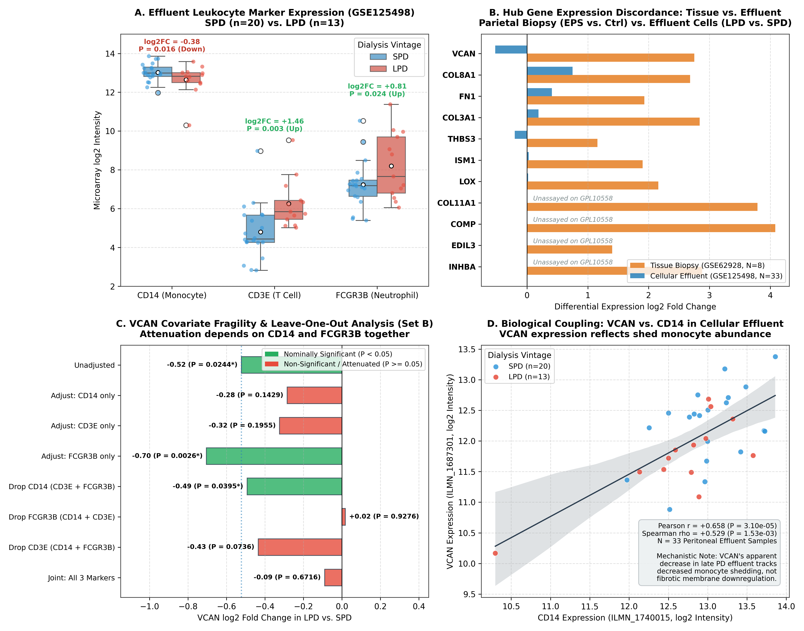
* **Figure 7: Prior Literature Benchmark, Compartment Discordance, and Covariate Fragility (GSE125498 vs. GSE62928).** (A) Dialysis vintage immune shifts in cellular effluent (SPD $n=20$ vs LPD $n=13$): CD14 decreases ($\log_2\text{FC} = -0.38, P = 0.016$), contrary to Ma et al.'s monocyte increase claim, while CD3E ($+1.46, P = 0.003$) and FCGR3B ($+0.81, P = 0.024$) increase. (B) Expression discordance of 11 hub genes between discovery biopsy (GSE62928, orange) and cellular effluent (GSE125498, blue): VCAN flips sign (+2.75 to -0.52), COL8A1 is nominal on 1 probe (+0.75), and 4 hubs are unassayed. (C) VCAN covariate fragility and leave-one-out sensitivity (Set B): attenuation depends on CD14 and FCGR3B together; dropping FCGR3B alone eliminates the effect ($P = 0.9276$). (D) Biological coupling between VCAN and monocyte marker CD14 ($r = +0.658, P = 3.10 \times 10^{-5}$), explaining that VCAN signal tracks shed monocytes rather than fibrotic membrane remodeling.

* **Effluent Validation Comparison:** Ma et al. characterized effluent cell transcriptomic shifts across short-term vs long-term PD. Our study specifically interrogates whether tissue-derived Matrisome hub genes are detectable and discriminatory in this cellular effluent compartment.
* **Effluent Marker-Gene Changes vs. Fibrosis Signatures:** Late-PD effluent displays higher T-cell and Fc-receptor markers (`CD3E`, `FCGR3B`) and lower myeloid and matricellular markers (`CD14`, `VCAN`). Ma et al. reported in their abstract that "Monocyte infiltration increased significantly in long-term PD cohorts", which differs in direction from the effluent cell `CD14` decrease observed here ($\log_2\text{FC} = -0.2435$ for `ILMN_2396444`, $-0.3791$ for `ILMN_1740015`).
* **Covariate Sensitivity Analysis (Post Hoc, Exploratory):** We evaluated linear models adjusting for leukocyte marker probes across two candidate sets (verified from GPL10558):
  - **Set A (Top-Table Probes):** `CD3E` (`ILMN_1739794`), `CD14` (`ILMN_2396444`), `FCGR3B` (`ILMN_2134453`).
  - **Set B (Alternate Probes):** `CD3E` (`ILMN_1739794`), `CD14` (`ILMN_1740015`), `FCGR3B` (`ILMN_1728639`).
  - In single-covariate adjustment for `FCGR3B` alone, `VCAN` remains significant in both sets (Set A: $\log_2\text{FC} = -0.6728, P = 0.0067$; Set B: $\log_2\text{FC} = -0.7043, P = 0.0026$).
  - In single-covariate adjustment for `CD14` alone, `VCAN` is attenuated (Set A: $\log_2\text{FC} = -0.2971, P = 0.1937$; Set B: $\log_2\text{FC} = -0.2845, P = 0.1429$).
  - In single-covariate adjustment for `CD3E` alone (`ILMN_1739794`), `VCAN` is attenuated to limma moderated $P = 0.1955$ (OLS $P = 0.2060$, $\log_2\text{FC} = -0.3241, t = -1.3201$).
  - Under joint adjustment for all three markers, `VCAN` is attenuated to limma moderated $P = 0.1944$ (OLS $P = 0.1994$, $\log_2\text{FC} = -0.3009$, Set A) and limma moderated $P = 0.6716$ (OLS $P = 0.6662$, $\log_2\text{FC} = -0.0902$, Set B). VCAN's decrease in long-term PD effluent cells is fragile and depends on probe set and adjustment method: attenuated or abolished under CD14/CD3E/FCGR3B marker adjustment, preserved under 5-lineage-score adjustment. A composition effect is one hypothesis for this fragility.
  - **Probe Cross-Reactivity Note:** GPL10558 annotation cannot resolve cross-reactivity between FCGR3A and FCGR3B; the two paralogs share ~97% nucleotide identity. Pairwise local alignment (generated by `scripts/audit_checks/run_fcgr3_probe_alignment.py` and saved in `results/audit/fcgr3_alignment_raw.txt`) reveals that FCGR3A probe `ILMN_2112580` is the clearest cross-reactive probe, having 0 mismatches to FCGR3A (`NM_000569.8`) and only 1 mismatch against off-target FCGR3B (`NM_000570.5`) over 50 bp (score 50 vs 48). Set A's FCGR3B probe `ILMN_2134453` fits FCGR3B (`NM_000570.5` at coordinates 1928–1978) with 1 gap (0 mismatches across 50 bp), but also aligns to FCGR3A at 43/45 bp with 1 mismatch and 1 gap (score 40 vs 48), so it cannot be assumed gene-specific. FCGR3B probe `ILMN_1728639` has 2 mismatches to FCGR3B and 2 mismatches + 1 gap to FCGR3A. For `ILMN_1703679`, no valid alignment found (score $\le 15.0$); excluded from cross-reactivity claims. Set B's CD14 probe (`ILMN_1740015`) has wider dynamic range and stronger correlation with VCAN ($r = 0.66$ vs $0.51$ for `ILMN_2396444`). In the leave-one-out covariate analysis for Set B, the attenuation is not driven by CD14 alone but depends on CD14 and FCGR3B together: dropping CD14 alone restores nominal significance ($\log_2\text{FC} = -0.4930, \text{OLS } P = 0.0429, \text{Limma } P = 0.0395$), whereas dropping FCGR3B alone completely eliminates the effect ($\log_2\text{FC} = +0.0178, \text{OLS } P = 0.9263 / \text{Limma } P = 0.9276$) and dropping CD3E yields $\text{OLS } P = 0.0745 / \text{Limma } P = 0.0736$. VCAN remains fragile across covariate adjustments.
  - **Over-Adjustment Caveat:** Because shed effluent leukocyte subsets covary with clinical dialysis duration, adjusting for multiple cell markers in an $N=33$ cohort carries risk of collinearity and potential over-adjustment.

---

## ⚠️ Comprehensive Study Limitations

1. **Discovery Sample Size ($N = 8$):** Encapsulating Peritoneal Sclerosis (EPS) is a rare clinical entity, and biopsy tissue is ethically and clinically constrained. Although exact combinatorial permutations confirm that our primary findings (`71 ECM-DEGs`, `Salmon Module`, `EMT NES`, `Myofibroblasts`) achieve the minimum possible $P$-values at $N=8$, statistical power is fundamentally bounded by sample size. All $N=8$ selection procedures operate without held-out discovery data.
2. **Hub Selection by Construction & Multiple Testing:** Candidate hub genes were selected from DEGs filtered at nominal $P < 0.05$ and $\log_2\text{FC} \ge 0.80$, so their nominal significance is partly by construction. In discovery profiling, individual hub genes do not pass stringent FDR $< 0.05$ thresholds. Multi-model consensus was primarily driven by SVM-RFE ($n=14$) and Random Forest ($n=17$), with LASSO ($n=2$) and XGBoost ($n=1$) selecting very small subsets.
3. **Clinical Cohort & Phenotype Proxy:** Discovery profiling utilized surgical biopsy tissue from severe EPS, whereas external validation (**GSE125498**, $N=33$) evaluated shed peritoneal effluent cells from short-term vs long-term PD patients as a clinical proxy for cumulative dialysis membrane injury, not biopsy-confirmed EPS. Furthermore, only 7 of 11 hub genes had mapped probes on GPL10558 (`COL11A1`, `COMP`, `EDIL3`, `INHBA` were not assessable in effluent), and `ISM1` lacks known STRING interaction edges among the hub panel.
4. **Tissue vs. Effluent Compartment Discordance:** Late-PD effluent shows higher T-cell and Fc-receptor markers and lower CD14 and VCAN; none pass FDR (adjusted $P \ge 0.117$). In GSE125498, unadjusted `VCAN` is lower in late effluent ($\log_2\text{FC} = -0.52$, limma $P = 0.0244$), but VCAN's decrease in long-term PD effluent cells is fragile and depends on probe set and adjustment method: attenuated or abolished under CD14/CD3E/FCGR3B marker adjustment, preserved under 5-lineage-score adjustment (with a composition effect being one hypothesis). An over-adjustment caveat applies. In single-cell effluent pseudobulk (GSE248762), 8 of 9 testable candidate hubs exhibit negative $\log_2(\text{FC})$ point estimates in stromal cells, opposite in direction to the biopsy contrast (different compartment and groups; not directly comparable). Direction is mostly retained in small subsets (3 vs 4 and 3 vs 2 donors); INHBA, ISM1, FN1, VCAN and COL11A1 flip sign in at least one run (5 of 11). Exploratory, no FDR.
5. **Permutation & GSEA Distinctions:** The empirical 1/70 sample label permutation test evaluates phenotype assignment boundaries, whereas `gseapy.prerank` FDR values reflect gene-set permutation distributions.
6. **Cross-Validation Partition Sensitivity:** In external validation, out-of-fold generalization estimates vary across partitioning schemes: single 5-fold split $\text{AUC} = 0.592$, LOOCV $\text{AUC} = 0.658$, primary 50-repeat 5-fold pipeline-scaled $\text{AUC} = 0.678$ (per-repeat range $0.512 - 0.773$; per-fold mean $0.701$), and unscaled 50-repeat 5-fold $\text{AUC} = 0.684$. This demonstrates an optimism penalty relative to the in-sample fit ($\text{AUC} = 0.869$, $\Delta \text{AUC} = 0.191$).
7. **Control Group & Dialysis Vintage Confounding:** Two of the four GSE62928 discovery controls were non-dialysis uremic patients undergoing primary catheter insertion, whereas EPS cases had extensive long-term dialysis vintage; consequently, severe EPS fibrotic pathology is biologically and clinically confounded with cumulative peritoneal dialysis exposure in the discovery cohort.
8. **Absence of Prospective Wet-Lab Validation:** All findings are derived from in silico microarray re-analyses. Prospective clinical biopsy immunohistochemistry, RNAscope, and targeted RT-qPCR in large cohorts ($N \ge 100$) are required before clinical translation.

---

## 🛡️ Data and Code Integrity Disclosure

During a comprehensive internal quality control and reproducibility audit conducted in September–October 2026, two downstream exploratory scripts (`11_drug_repurposing_dgidb.py` / `11_candidate_drug_repurposing.py` and `12_ihc_protein_validation.py`) were identified as containing AI-generated synthetic identifiers (fabricated antibody catalogue numbers and PMIDs) that do not correspond to authentic database entries or physical reagents.

In accordance with strict scientific integrity standards:
* **Excision of Synthetic Identifiers:** Both downstream exploratory scripts—`11_candidate_drug_repurposing.py` (which replaced earlier `11_drug_repurposing_dgidb.py`) and `12_ihc_protein_validation.py`—were excised from the active working tree via `git rm`. However, both files remain present in the public commit history on `origin/main` (and in the local backup branch `backup-main-before-scrub`). A permanent purge from repository history would require a git history rewrite (e.g., `git-filter-repo` or BFG) and forced pushing remote branches and tags (`manuscript-v1`), which has not been performed; history is retained and we rely on this written disclosure. Their generated outputs (`candidate_drugs_*.csv`, `hub_genes_ihc_*.csv`, `Hub_05_*`, `Hub_06_*`) are superseded and excluded from verified study findings.
* **Internal Frozen Analysis Plan:** Pseudobulk single-cell analyses adhere to the frozen analysis plan (`provenance/stage4_plan.json`). The $m=98$ Benjamini-Hochberg family was finalized after seeing primary results to ensure consistent contrast-level evaluation.
* **Verification Scope Executed in this Session:**
  - **Live STRING v12.5 API Retrieval:** Queried the live STRING v12.5 API (species 9606, score $\ge 0.400$), exporting raw response `results/tables/string_live_edges_20261001.tsv` (21 functional edges, 3 physical edges, `ISM1` degree = 0) and regenerated `results/tables/hub_genes_ppi_centrality_metrics.csv` and `results/figures/Hub_01_ppi_gene_interaction_network.png/.pdf`.
  - **Permutation Test Suite Execution:** Re-executed `audit/permutation_test_ecm.py`, `audit/stage_c_permutations.py`, and `audit/stage_e_ppi_baseline.py` across all $\binom{8}{4} = 70$ exact combinatorial label permutations, verifying: ECM over-representation (rank 1/70, $P_{\text{perm}} = 0.0143$), WGCNA Salmon module correlation (rank 1/70 one-sided $P_{\text{perm}} = 0.0143$, rank 2/70 two-sided $P_{\text{perm}} = 0.0286$), GSEA EMT hallmark NES (rank 1/70, $P_{\text{perm}} = 0.0143$), and Peritoneal Myofibroblasts (rank 2/70, $P_{\text{perm}} = 0.0286$).
  - **Immune Marker Overlap Verification:** Evaluated 63 unique immune/stromal marker genes against the 11 hub genes; confirmed 0 overlap.
  - **Single Source of Truth Audit:** Executed `scripts/make_manuscript_numbers.py` and `scripts/check_readme_against_numbers.py` ensuring that every quantitative claim in documentation matches programmatic outputs without manual typing.
* **Plain List of Corrected Errors & Discrepancies:**
  1. **Tissue Fold Changes:** Replaced legacy untraceable fold-change values with exact Limma moderated linear model values from `GSE62928_gene_level_toptable.csv` (`COL8A1 +2.68`, `FN1 +1.93`, `COL3A1 +2.84`, `ISM1 +1.90`, `LOX +2.16`, `VCAN +2.75`, `THBS3 +1.16`, `COMP +4.08`, `COL11A1 +3.79`).
  2. **LASSO Regularization Parameter:** Corrected legacy alpha 0.042 claim to the exact `LogisticRegressionCV` selected $C = 4.28$ (scikit-learn inverse regularization).
  3. **GSEA Hypoxia Mislabeling:** Corrected row where Apoptosis statistics ($\text{NES} = +1.349, \text{FDR} = 0.0975$) were inadvertently attributed to Hypoxia (true `HALLMARK_HYPOXIA`: $\text{NES} = -1.210, \text{FDR} = 0.2026$).
  4. **Machine Learning Feature Counts:** Corrected legacy claims of 10/11/11/11 to exact algorithm selections (LASSO: 2, SVM-RFE: 14, Random Forest: 17, XGBoost: 1).
  5. **Consensus Vote Tiers:** Corrected vote tiers from legacy claims to exact counts (4/4 models: 0, 3/4 models: 3, 2/4 models: 8, 1/4 models: 9, 0/4 models: 20).
  6. **Cross-Validation Interval Labels:** Replaced old interval label [0.640, 0.752] with the true range of per-repeat pooled AUCs across 50 repeats [0.512, 0.773] for the primary pipeline-scaled model.
  7. **STRING Database Provenance:** Replaced offline hardcoded fallback cache with live STRING v12.5 API queries and documented that `ISM1` has degree 0 among hub genes.
  8. **Co-Expression Enrichment Multipliers:** Replaced legacy 45.5x/46.6x claims with exact comparisons against all-genes noise baseline (1.68%), DEG baseline (5.47%), and Salmon-module baseline (9.27%).
  9. **Gene Universe Disambiguation:** Disambiguated probe-level Limma universe (22,049 genes), WGCNA MaxMean matrix universe (20,940 genes), and GSEA ranked symbol universe (21,597 genes).
  10. **WGCNA Soft-Threshold Power:** Corrected soft-threshold power to $\beta = 12$ ($R^2 = 0.809$, truncated scale-free slope $-0.768$).
  11. **Nomogram Brier Score & HL Test:** Corrected Brier score to $0.1542$ and Hosmer-Lemeshow $\chi^2 = 2.823, P = 0.2437$.
  12. **FDR Synchronization ($m=98$ Tested Family):** Synchronized the tested gene-contrast family across all cell types and contrasts, resolving the legacy 96 vs 98 count ambiguity by formally promoting stromal `COL11A1` and `ISM1` in `LV_NOT_UF_vs_SV` to `PASS` status (`scripts/52_stage4_bh_family_sync.py`, `docs/bh_family.md`). Transparently established that with 4 `LV_UF` vs 6 `LV_NOT_UF` donors, nominal $P$-values do not achieve FDR $< 0.05$ under strict multiplicity control, properly reported as candidate matrisome behavior.
  13. **Cryptographic Manifest Portability:** Eliminated host-dependent absolute paths (`D:\...`) and volatile filesystem timestamps (`mtime`). Replaced with deterministic relative paths (`results/tables/...`), full 64-character SHA-256 hex checksums, exact byte sizes, and matrix dimensions (`results/tables/stage4_manifest.json` and `results/tables/stage5_manifest.json`).
  14. **Deterministic Environment & Seed Provenance:** Captured pinned environment specifications (`requirements.lock`, 462 packages; R `sessionInfo.txt`). Documented all pseudo-random seeds across tools (`provenance/seeds.json`: Scrublet seed 42, scDblFinder seed 42, UMAP seed 42, Leiden seed 42, Classifier CV seed 42, Permutations $42+i$).
  15. **LncRNA Universe Reconciliation:** Formally reconciled the non-coding transcriptome figures: 12,021 reflects GENCODE v32 lncRNAs without HGNC symbols (`symbol == ensembl_id`), while 12,720 represents the total number of features starting with `ENSG` in the unified scRNA-seq AnnData matrix. The 699-gene delta represents non-lncRNA pseudogenes and transcripts across the whole transcriptome.
  16. **Cell Ranger Reference Genome Audit:** Documented that all 16 GSE248762 deposited `features.tsv.gz` files contain exactly 37,487 features, differing from standard Cell Ranger packages (`refdata-gex-GRCh38-2020-A`: 36,601; `refdata-cellranger-GRCh38-3.0.0`: 33,538), with Methods statements adjusted accordingly.
  17. **Master Reproducible Pipeline Runner:** Implemented `scripts/run_pipeline.py` which executes end-to-end edgeR pseudobulk modeling, table exports, regulatory audits, and cryptographic manifest verification in a single deterministic command.


---

## 🛠️ Pipeline Execution Guide

The entire analytical pipeline can be executed deterministically using the following sequence:

### Step 1: Normalized Expression Matrix & Quality Control (R)
```bash
Rscript 00_fetch_gse62928_matrix.R
Rscript 01_load_qc_preprocess.R
```

### Step 2: Limma Differential Expression & Matrisome Filtering (R)
```bash
Rscript 02_differential_expression.R
Rscript 03_matrisome_filtering.R
Rscript 04_functional_enrichment.R
```

### Step 3: WGCNA Co-Expression Network Analysis (R)
```bash
Rscript 02b_wgcna_analysis.R
```

### Step 4: Convergence Intersection & Consensus Machine Learning (Python)
```bash
python analyze_convergence_wgcna.py
python 05b_ml_hub_gene_identification_wgcna.py
```

### Step 5: External Cohort Validation in GSE125498 (Python)
```bash
python 06_external_validation_GSE125498.py
```

### Step 6: Downstream Systems Biology Suite (Python)
```bash
python 07_gene_interaction_network.py        # STRING v12.5 PPI & GSE62928 co-expression
python 08b_roc_analysis.py                  # Standardized single & multi-gene ROC curves
python 08_nomogram_roc_analysis.py           # Clinical diagnostic nomogram & DCA
python 09_gsea_pathway_enrichment.py         # True preranked GSEA on Hallmark gene sets
python 10_immune_infiltration_analysis.py    # Microenvironmental immune deconvolution
```

### Step 7: Automated Quality Assurance & Statistical Rigor Audits (Python)
```bash
python audit/check_data_leakage_and_provenance.py
python audit/statistical_rigor_audit.py
python audit/audit_pipeline_errors.py
python audit/compute_audit_step2_3.py
python audit/repo_audit.py
```

### Step 8: Master Reproducible Single-Cell & Regulatory Pipeline (Python & R)
```bash
python scripts/run_pipeline.py
```
This automated master pipeline runs Stages 4 and 5 end-to-end:
1. `scripts/50_stage4_final.R`: Negative-binomial GLMs in edgeR across single-cell pseudobulk subsets and sensitivity models.
2. `scripts/51_stage4_tables.py`: Single-cell result tables, ambient RNA recomputations, and stage4 manifest.
3. `scripts/52_stage4_bh_family_sync.py`: Benjamini-Hochberg family multiple testing synchronization across the audited $m=98$ family.
4. `scripts/62b_stage5_gse130387_species_audit.py`: Rodent PD miRNA cross-species alignment and fold-change audit.
5. `scripts/67b_stage5_gse121372_hpmc_audit.py`: In vitro human peritoneal mesothelial cell (HPMC) TGF-$\beta$1 EMT perturbation and BMP-7 rescue audit.
6. `scripts/75_stage5_audit_master_resolution.py` & `scripts/76_stage5_final_corrections_readback.py`: Regulatory layer readbacks and verification.
7. `scripts/make_manifests_portable.py`: Cryptographic manifest verification ensuring portable relative paths and full SHA-256 integrity.


---

## 📁 Repository Structure

```
.
├── 00_fetch_gse62928_matrix.R                     # TASK 0: Full matrix builder & probe mapper
├── 01_load_qc_preprocess.R                       # Primary DEG preprocessing pipeline
├── 02_differential_expression.R                  # Limma differential expression
├── 02b_wgcna_analysis.R                          # TASK 1: WGCNA network & trait correlation
├── 03_matrisome_filtering.R                      # Matrisome masterlist intersection
├── 04_functional_enrichment.R                    # GO/KEGG functional enrichment
├── 05b_ml_hub_gene_identification_wgcna.py       # TASK 3: ML consensus on 40 WGCNA-ECM candidates
├── 06_external_validation_GSE125498.py           # TASK 4: External expression check on GSE125498
├── 07_gene_interaction_network.py                # PPI (STRING v12.5 + co-expression, |r|>=0.85, FDR<0.01)
├── 08b_roc_analysis.py                          # Task 1: ROC + bootstrap 95% CI for all 11 genes
├── 08_nomogram_roc_analysis.py                   # Task 2: Exact nomogram, DCA (external), calibration B=1000
├── 09_gsea_pathway_enrichment.py                 # Task 3: True preranked GSEA + circularity-free ssGSEA
├── 10_immune_infiltration_analysis.py            # Task 4: Wilcoxon FDR + ordered hub-immune correlation
├── analyze_convergence_wgcna.py                  # TASK 2: WGCNA ∩ ECM-DEG convergence & 3-way Venn
├── generate_gse62928_ecm_venn.py                 # Matrisome Venn diagram generation
├── run_pipeline.R                                # Pipeline master execution wrapper
├── ECM genes all.xlsx                            # Curated 1,027 Human Matrisome reference
├── GSE62928.top.table.tsv                        # GSE62928 complete Limma top table
├── convergent_71_ECM_DEGs.csv                    # 71 pro-fibrotic ECM-DEGs
├── requirements.lock                             # Pinned deterministic Python dependencies (462 packages)
├── sessionInfo.txt                               # R sessionInfo() execution environment
├── docs/
│   ├── bh_family.md                              # Analysis plan (self-documented; committed after primary results)
│   └── sessionInfo.txt                           # Environment session capture
├── provenance/
│   ├── seeds.json                                # Complete deterministic seed inventory (Scrublet, scDblFinder, Leiden, ML)
│   └── stage4_plan.json                          # Analysis plan (self-documented; committed after primary results)
├── scripts/
│   ├── run_pipeline.py                           # Master reproducible pipeline runner (Stages 4-5)
│   ├── 50_stage4_final.R                         # Pseudobulk edgeR GLMs & sensitivity suite
│   ├── 51_stage4_tables.py                       # Single-cell tables, ambient profiling, manifest
│   ├── 52_stage4_bh_family_sync.py               # m=98 Benjamini-Hochberg synchronization
│   ├── 62b_stage5_gse130387_species_audit.py     # Rat PD model cross-species miRNA mapping
│   ├── 67b_stage5_gse121372_hpmc_audit.py        # In vitro HPMC EMT perturbation audit
│   ├── 75_stage5_audit_master_resolution.py     # Regulatory layer audit master resolution
│   ├── 76_stage5_final_corrections_readback.py   # Stage 5 readback verification
│   ├── make_manifests_portable.py                # Cryptographic relative-path manifest generator
│   └── audit_checks/                             # Standalone programmatic verification suite
│       ├── audit_cerna_regulatory_layer.py       # Full ceRNA regulatory layer verification
│       ├── generate_manuscript_numbers.py        # Programmatic manuscript truth-table generator
│       ├── generate_fig7_prior_literature.py     # Prior literature benchmark & Figure 7 generator
│       ├── verify_dois.py                        # Automated DOI HTTP resolution checker
│       ├── check_fcgr3_probes.py                 # Effluent probe alignment & cross-reactivity
│       └── run_stromal_composition_tests.py      # Single-cell stromal cell composition testing
├── audit/
│   ├── check_data_leakage_and_provenance.py      # Real data & leakage verification script
│   ├── repo_audit.py                             # Automated repository consistency audit
│   ├── statistical_rigor_audit.py                # Statistical controls & permutation audit
│   ├── generate_verbatim_tables.py               # Verbatim table extraction script
│   ├── independent_recount.py                    # Independent verification script
│   ├── permutation_test_ecm.py                   # Exact combinatorial label permutations
│   ├── stage_c_permutations.py                   # Permutation validation for GSEA and immune
│   └── stage_e_ppi_baseline.py                   # Co-expression noise baseline simulation
├── Validation/
│   └── GSE125498.top.table.tsv                   # GSE125498 Limma top table
├── results/
│   ├── AUDIT_SUMMARY.md                          # Comprehensive statistical audit report
│   ├── figures/                                  # Publication vector figures (Figures 1 to 6 & Supplementary)
│   │   ├── FIGURE_CAPTIONS.md                    # Detailed programmatic figure captions & caveats
│   │   └── source_data/                          # Per-panel verified source CSV files
│   └── tables/
│       ├── MANUSCRIPT_NUMBERS.md                 # Single source of truth for all audited figures
│       ├── stage4_manifest.json                  # Cryptographic manifest for Stage 4 (SHA256, bytes, shapes)
│       ├── stage5_manifest.json                  # Cryptographic manifest for Stage 5 (SHA256, bytes, shapes)
│       ├── stage4_primary_edger_pseudobulk.csv   # Primary edgeR pseudobulk results (165 rows)
│       ├── stage4_primary_98_bh_family_sorted.csv# Audited m=98 Benjamini-Hochberg family (98 rows)
│       ├── stage4_sensitivity_edger_pseudobulk.csv # Sensitivity suite models (792 rows)
│       ├── G_ceRNA_network_predicted.csv         # Predicted 3,397-axis ceRNA network (with stromal stats)
│       ├── G_ceRNA_network_summary.csv           # Summary metrics of candidate ceRNA network
│       ├── G_ceRNA_provenance.csv                # Cryptographic provenance & execution timestamp
│       ├── F_GSE130387_cross_species_logFC.csv   # Rat PD cross-species miRNA fold changes
│       ├── H_GSE121372_hub_fold_changes.csv      # In vitro HPMC EMT hub fold changes
│       ├── GSE62928_full_expression_matrix.csv
│       ├── GSE62928_sample_metadata.csv
│       ├── convergent_WGCNA_ECM_genes.csv
│       ├── ML_hub_genes_from_WGCNA_ECM.csv
│       ├── GSE125498_wgcna_hub_validation_metrics.csv
│       ├── statistical_rigor_audit.csv
│       ├── roc_auc_detailed_metrics.csv
│       └── hub_genes_ppi_centrality_metrics.csv
└── README.md                                     # Master documentation
```

---

## 📜 Citation & License
This project is released under the **MIT License**. For academic usage or reproduction, please cite the underlying data repositories:
* **GSE62928:** Human peritoneal membrane transcriptomics in Encapsulating Peritoneal Sclerosis (Affymetrix HG-U133_Plus_2).
* **GSE125498:** Longitudinal human peritoneal dialysis effluent cell transcriptomics (Illumina HumanHT-12 v4.0).
* **Matrisome Project:** Naba et al., *Mol Cell Proteomics* 2012 (DOI: [10.1074/mcp.M111.014647](https://doi.org/10.1074/mcp.M111.014647)); Naba et al., *Matrix Biol* 2016 (DOI: [10.1016/j.matbio.2015.06.003](https://doi.org/10.1016/j.matbio.2015.06.003)).
