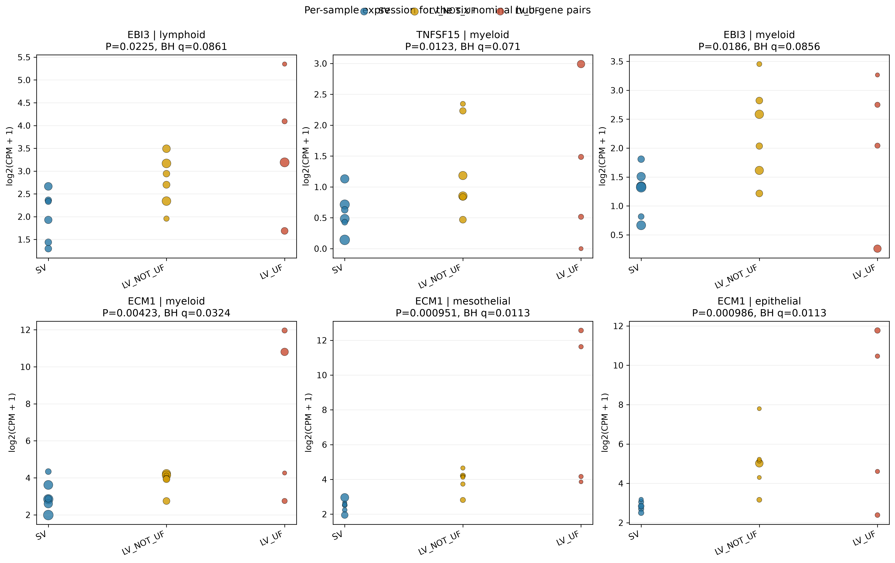
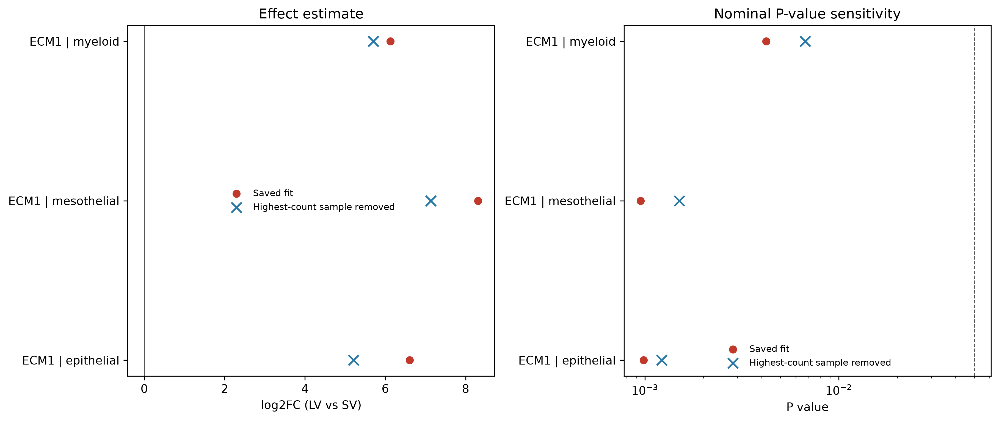
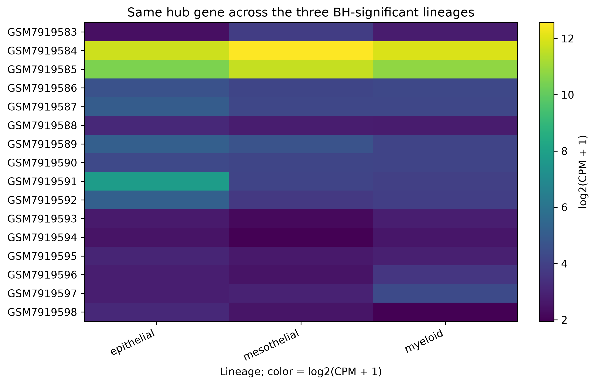
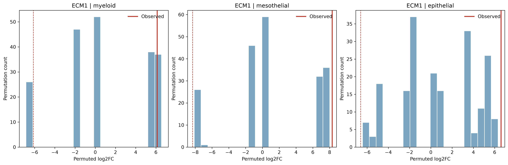

# GSE248762 seven-hub fold-change audit

## Scope and reproducibility

The analysis gene set was loaded from `results/revision/hub_gene_network_drug_gsea/validated7_kegg_gsea_summary.csv`. Only the six nominally significant saved hub-gene/lineage pairs were audited. The 3 BH-significant pairs were prioritized. No gene symbols are used in narrative text.

The original edgeR quasi-likelihood and Monte Carlo results were generated in an earlier full audit. This metadata-only refresh did not rerun edgeR, DecontX, or permutations. The historical Monte Carlo outputs are retained below for provenance only and are superseded by the separately completed exact enumeration. R 4.4.2 and edgeR 4.4.2 were used.

The original edgeR and Monte Carlo result files were produced in an earlier full audit run and reused unchanged. Exact permutation and DecontX sensitivity outputs were generated separately before this metadata-only refresh. SHA-256 checksums document current file contents and are not proof of which run generated reused outputs.

Original eligibility was retained: samples needed at least 20 QC cells per lineage; a hub gene needed at least two samples per group with at least 10 raw pseudobulk UMIs. The edgeR design was `~0 + group`, with `LV - SV` contrast, `filterByExpr`, robust dispersion estimation, and robust `glmQLFit`, matching `04_pseudobulk_edger.R`.

## Claim-by-claim findings

| Claim | Finding | Source / calculation |
|---|---|---|
| Saved comparisons audited | 6 nominal pairs; 3 BH-significant and 3 nominal-only | `sc7_hub_gene_lineage_results.csv` |
| Saved edgeR output completeness | The saved raw file contains hub-gene summary rows, not the all-gene fit tables or per-gene quasi-likelihood dispersions; all-gene control fits and dispersions were generated during the earlier full audit, not this metadata-only refresh | `edger_gene_lineage_results_raw.csv`; `04_pseudobulk_edger.R` |
| BH-associated hub gene across three lineages | The same hub gene occurs in all three BH-significant rows; 16 samples had nonzero raw pseudobulk counts in all three lineages | `sc7_bh_hub_expression_overlap.csv`; `sc7_bh_hub_sample_lineage_cpm.csv` |
| Historical permutation outputs | Earlier Monte Carlo files are retained for provenance only and are superseded by exact enumeration for the ECM1 comparisons | `sc7_permutation_results.csv`; `sc7_exact_permutation_summary_<lineage>.csv` |

The sample-count table includes all samples, including samples excluded from fitting by the 20-cell rule, and explicitly marks such samples. Group summaries use only samples meeting that rule. `sc7_pair_group_diagnostics.csv` contains zero/low/high count bins, raw-count and CPM summaries, library-size ranges, and maximum-sample contribution.

### Pair-level verdict table

| Hub | Lineage | Saved log2FC | EdgeR P | BH q | Exact permutation P (allocations) | Exact P - edgeR P; nominal agreement | LOO log2FC / P; omitted sample | Highest LV CPM sample (% LV CPM) | |log2FC| negative-control percentile | Verdict |
|---|---|---:|---:|---:|---|---|---|---|---:|---|
| ECM1 | myeloid | 6.12396276741692 | 0.0042269275581539 | 0.0324064446125132 | 0.171453546453546 (8008) | 0.167226618895392; disagree at P < 0.05 | 5.70351645767682 / 0.0067096419055819; GSM7919585 | GSM7919584 (67.7655471429568%) | 99.8621165115477 | FRAGILE |
| ECM1 | mesothelial | 8.30766876410162 | 0.0009508834036293 | 0.011338783220178 | 0.0009990009990009 (3003) | 4.81175953715999e-05; agree at P < 0.05 | 7.13534273383741 / 0.0015064347167832; GSM7919584 | GSM7919584 (64.9919723809051%) | 99.95994873438 | FRAGILE |
| ECM1 | epithelial | 6.60299329314642 | 0.0009859811495807 | 0.011338783220178 | 0.0024975024975025 (8008) | 0.0015115213479218; agree at P < 0.05 | 5.20661908699535 / 0.0012230841725622; GSM7919584 | GSM7919584 (66.1048381998678%) | 99.8787327573139 | FRAGILE |
| TNFSF15 | myeloid | 1.96310332575269 | 0.0123416529605596 | 0.0709645045232177 | NOT RUN | NOT CALCULATED; no permutation test | 1.35841267524579 / 0.0377937140089325; GSM7919585 | GSM7919585 (34.3774022398235%) | 97.0630816959669 | FRAGILE |
| EBI3 | myeloid | 1.41123739720539 | 0.0186121752291994 | 0.0856160060543172 | NOT RUN | NOT CALCULATED; no permutation test | 1.39545332782691 / 0.0259341156466969; GSM7919589 | GSM7919590 (22.0410448864633%) | 94.7397449155464 | NOMINAL_ONLY_UNCONFIRMED |
| EBI3 | lymphoid | 1.45543085082006 | 0.0224587289526643 | 0.0860917943185464 | NOT RUN | NOT CALCULATED; no permutation test | 1.48157056414901 / 0.0260500619655363; GSM7919586 | GSM7919585 (38.3900032035346%) | 98.7568699293379 | NOMINAL_ONLY_UNCONFIRMED |

### Verdict rules applied by the current script

The exact classification logic is:

```python
if not loo_sign_holds or not loo_is_nominal or all(
    bool(row.group_mostly_zero) for row in group_map.values()
):
    verdict = "ARTIFACT"
elif (
    low_count_groups
    or low_abundance
    or inflated == "yes"
    or permutation_disagrees
):
    verdict = "FRAGILE"
elif float(pair.BH_FDR_7hub_family) >= 0.05 or perm_row is None:
    verdict = "NOMINAL_ONLY_UNCONFIRMED"
else:
    verdict = "ROBUST"
```

`loo_is_nominal` means LOO P < 0.05; `low_abundance` means AveLogCPM < 1; `low_count_groups` includes groups with >50% zero counts or one sample contributing >50% of that group's CPM; `inflated` is yes when this count pattern exists and the absolute prior-count-1 logFC is <50% of the saved magnitude; and `permutation_disagrees` means an available permutation P is >=0.05. This ordering prevents a pair that failed BH or lacks a permutation test from being called ROBUST. The earlier saved table called the two nominal-only EBI3 pairs ROBUST; the current label for both is NOMINAL_ONLY_UNCONFIRMED.

## LV subgroup check for the shared BH-associated hub

Means below are arithmetic means of saved per-sample CPM and raw counts among samples meeting the original >=20-cell lineage rule. Zero counts are among eligible samples. These raw-CPM summaries do not refit the original subgroup model; separate DecontX-corrected contrasts are reported below. The per-sample source values, cell counts, and exclusion flags are in `sc7_ecm1_subgroup_sample_values.csv`.

| Lineage | Original group | Eligible n | Excluded n | Mean raw count | Mean CPM | Zero counts |
|---|---|---:|---:|---:|---:|---:|
| myeloid | LV_UF | 4 | 0 | 22828.75 | 1451.61555042973 | 0 |
| myeloid | LV_NOT_UF | 6 | 0 | 379.833333333333 | 14.2263026051984 | 0 |
| myeloid | SV | 6 | 0 | 277.166666666667 | 8.49786002205994 | 0 |
| mesothelial | LV_UF | 3 | 1 | 16573.6666666667 | 3080.39174344517 | 0 |
| mesothelial | LV_NOT_UF | 5 | 1 | 70.8 | 15.4412958646857 | 0 |
| mesothelial | SV | 6 | 0 | 67 | 4.70718809679679 | 0 |
| epithelial | LV_UF | 4 | 0 | 11697.25 | 1232.58165741175 | 0 |
| epithelial | LV_NOT_UF | 6 | 0 | 258.666666666667 | 58.3367057994759 | 0 |
| epithelial | SV | 6 | 0 | 54.5 | 6.31341825432931 | 0 |

LV_UF means exceed LV_NOT_UF and SV means in all three lineages, and the LV_UF CPM distributions include samples that dominate the pooled signal. Thus, the pooled LV versus SV contrast could be driven by the LV subgroup mix. The subgroup contrasts remain descriptive and underpowered; the CPM means are sensitive to individual samples.

## Permutation-space feasibility (calculation only)

The previous 200-draw tests sampled label assignments and used a plus-one correction. The approved exact test enumerated every fixed-size label allocation and used the inclusive two-sided tail count divided by the total number of allocations, without a plus-one correction.

| Lineage | Eligible LV | Eligible SV | Distinct assignments | Exact extreme allocations | Exact P | EdgeR P | Exact minus edgeR P |
|---|---:|---:|---:|---:|---:|---:|---:|
| myeloid | 10 | 6 | 8008 | 1373 | 0.171453546453546 | 0.0042269275581539 | 0.167226618895392 |
| mesothelial | 8 | 6 | 3003 | 3 | 0.0009990009990009 | 0.0009508834036293 | 4.81175953715999e-05 |
| epithelial | 10 | 6 | 8008 | 20 | 0.0024975024975025 | 0.0009859811495807 | 0.0015115213479218 |

These exact P values supersede the 200-draw Monte Carlo estimates for the sample-label permutation check. The edgeR P values remain model-based quasi-likelihood tests and use a different null calibration.

## Raw-count and leave-one-out audit

For each of the six pairs, `sc7_nominal_pair_sample_counts.csv` reports one row per sample with original and contrast group, lineage cell count, raw hub count, total library size, CPM, log2(CPM+1), and the 20-cell exclusion flag. Group-level zero/1–5/>5 bins and count/CPM summaries are in `sc7_pair_group_diagnostics.csv`.

A group is flagged as mostly zero when more than half of its eligible samples have zero counts. A single sample is flagged as supplying a majority of signal when its CPM exceeds half the sum of eligible sample CPMs in that group. The verdict `raw_count_driven` is yes when both groups have at least one such flag, partly when one group does, and no otherwise. The low-count inflation flag is yes when a count pattern is present and the magnitude of the prior-count-1 logFC is less than half the saved logFC magnitude. These are audit decision rules, not biological significance thresholds.

| Hub | Lineage | Omitted highest-count sample | Omitted group | Omitted count | LOO log2FC | LOO P |
|---|---|---|---|---:|---:|---:|
| EBI3 | lymphoid | GSM7919586 | LV_UF | 394 | 1.48157056414901 | 0.0260500619655363 |
| TNFSF15 | myeloid | GSM7919585 | LV_UF | 210 | 1.35841267524579 | 0.0377937140089325 |
| EBI3 | myeloid | GSM7919589 | LV_NOT_UF | 211 | 1.39545332782691 | 0.0259341156466969 |
| ECM1 | myeloid | GSM7919585 | LV_UF | 54096 | 5.70351645767682 | 0.0067096419055819 |
| ECM1 | mesothelial | GSM7919584 | LV_UF | 36596 | 7.13534273383741 | 0.0015064347167832 |
| ECM1 | epithelial | GSM7919584 | LV_UF | 41207 | 5.20661908699535 | 0.0012230841725622 |

## Fold-change scale and abundance

The following table compares the saved edgeR log2FC with the unnormalized mean-CPM ratio using a 1-CPM pseudocount and with the mean group difference in edgeR logCPM from `cpm(prior.count=1)`. `edgeR_AveLogCPM` is the fitted average abundance from the edgeR quasi-likelihood table. Quasi-likelihood dispersion is reported from `glmQLFit`; it was not present in the saved raw hub-only results.

| Hub | Lineage | Saved log2FC | Mean-CPM ratio log2FC (+1 CPM) | Prior-count-1 edgeR logCPM group difference | AveLogCPM | QL dispersion |
|---|---|---:|---:|---:|---:|---:|
| EBI3 | lymphoid | 1.45543085082006 | 1.41793236032887 | 1.15786404496909 | 2.90821886473116 | 5.66086451841681 |
| TNFSF15 | myeloid | 1.96310332575269 | 0.974826063662789 | 0.989424476873752 | 0.711059339454404 | 4.41089302327622 |
| EBI3 | myeloid | 1.41123739720539 | 1.16872396140625 | 1.10089930799211 | 1.67889322052007 | 3.00851142921192 |
| ECM1 | myeloid | 6.12396276741692 | 5.95741362046057 | 2.21846458588892 | 8.64945716588537 | 23.708918783151 |
| ECM1 | mesothelial | 8.30766876410162 | 7.67432165013285 | 3.84878738481698 | 9.68647332655989 | 18.9303464543816 |
| ECM1 | epithelial | 6.60299329314642 | 6.1766726341905 | 3.34929175012353 | 8.54332515501875 | 14.6721440433784 |

## Library size, cell count and LV subtype checks

`sc7_confounding_correlations.csv` reports Pearson correlation of the binary LV/SV indicator with eligible lineage cell count and library size, calculated within each pair's lineage. These descriptive correlations do not constitute a covariate-adjusted model.

| Hub | Lineage | r(group, lineage cells) | r(group, library size) |
|---|---|---:|---:|
| EBI3 | lymphoid | -0.0504644759501069 | 0.0775997138783502 |
| TNFSF15 | myeloid | -0.450953237544813 | -0.539282108737204 |
| EBI3 | myeloid | -0.450953237544813 | -0.539282108737204 |
| ECM1 | myeloid | -0.450953237544813 | -0.539282108737204 |
| ECM1 | mesothelial | -0.473070662051255 | -0.440112782627942 |
| ECM1 | epithelial | -0.112265505894836 | -0.117005014047236 |

The three-group descriptive edgeR contrasts compare SV separately with LV_NOT_UF and LV_UF. They use smaller groups and are underpowered; they are descriptive, not confirmatory. Full results, including non-significant P values and any non-testable contrasts, are in `sc7_three_group_descriptive.csv`.

| Hub | Lineage | Contrast | n comparison group | n SV | log2FC | P | Status |
|---|---|---|---:|---:|---:|---:|---|
| EBI3 | lymphoid | LV_NOT_UF vs SV | 6 | 6 | 0.835571487278112 | 0.137294748662481 | descriptive; underpowered |
| EBI3 | lymphoid | LV_UF vs SV | 4 | 6 | 2.18693578782359 | 0.00235506406962 | descriptive; underpowered |
| TNFSF15 | myeloid | LV_NOT_UF vs SV | 6 | 6 | 1.5230740984906 | 0.054560119721323 | descriptive; underpowered |
| TNFSF15 | myeloid | LV_UF vs SV | 4 | 6 | 2.45116256621626 | 0.0063666700258342 | descriptive; underpowered |
| EBI3 | myeloid | LV_NOT_UF vs SV | 6 | 6 | 1.45506097948043 | 0.0226872973185302 | descriptive; underpowered |
| EBI3 | myeloid | LV_UF vs SV | 4 | 6 | 1.16770102792179 | 0.115308686170822 | descriptive; underpowered |
| ECM1 | myeloid | LV_NOT_UF vs SV | 6 | 6 | 0.567911631417205 | 0.549912550349527 | descriptive; underpowered |
| ECM1 | myeloid | LV_UF vs SV | 4 | 6 | 7.41426811704329 | 1.33919851694114e-05 | descriptive; underpowered |
| ECM1 | mesothelial | LV_NOT_UF vs SV | 5 | 6 | 1.72820955885682 | 0.0538903876870179 | descriptive; underpowered |
| ECM1 | mesothelial | LV_UF vs SV | 3 | 6 | 9.70705812554607 | 1.40041211245151e-07 | descriptive; underpowered |
| ECM1 | epithelial | LV_NOT_UF vs SV | 6 | 6 | 3.23646872877368 | 0.0100030987580342 | descriptive; underpowered |
| ECM1 | epithelial | LV_UF vs SV | 4 | 6 | 7.82097588299146 | 2.52712223246706e-05 | descriptive; underpowered |

The sample-by-lineage CPM matrix for the hub gene shared by the three BH results is in `sc7_bh_hub_sample_lineage_cpm.csv`; samples with fewer than 20 cells remain in that matrix but are flagged. Expression overlap is defined as raw count > 0. The overlap count above indicates whether the nominally repeated lineage results are driven by a shared set of samples; it does not establish statistical independence.

## Negative controls: all fitted genes

The saved edgeR raw file did not store all tested genes. The full three-lineage fit was therefore recomputed using the same filtering, robust dispersion estimation, and quasi-likelihood contrast as the source R script. The complete tested-gene distributions are in `sc7_negative_control_all_genes.csv`; quantiles and hub-gene percentile ranks are in the following tables.

| Hub | Lineage | Metric | Other genes tested | Minimum | Q25 | Median | Q75 | Maximum |
|---|---|---|---:|---:|---:|---:|---:|---:|
| EBI3 | lymphoid | logFC | 15284 | -4.74422905299113 | -0.214427789166503 | 0.0114963151090529 | 0.247600332886925 | 8.66490871388648 |
| EBI3 | lymphoid | absolute_logFC | 15284 | 9.55305718995911e-05 | 0.103768710588497 | 0.231168154445477 | 0.423402991327615 | 8.66490871388648 |
| EBI3 | lymphoid | PValue | 15284 | 1.55536078731367e-05 | 0.0988852006841388 | 0.321220021651702 | 0.637800965329005 | 0.999813722897164 |
| TNFSF15 | myeloid | logFC | 14505 | -2.86352169430483 | -0.203990262596372 | 0.0671548373532692 | 0.404580542929885 | 9.36859433182932 |
| TNFSF15 | myeloid | absolute_logFC | 14505 | 3.67395375933294e-05 | 0.133107523941159 | 0.296320115394723 | 0.551993512055295 | 9.36859433182932 |
| TNFSF15 | myeloid | PValue | 14505 | 6.75425946692916e-06 | 0.0583433759665373 | 0.249851954350793 | 0.572439830446417 | 0.99989886850917 |
| EBI3 | myeloid | logFC | 14505 | -2.86352169430483 | -0.203990262596372 | 0.0671548373532692 | 0.404580542929885 | 9.36859433182932 |
| EBI3 | myeloid | absolute_logFC | 14505 | 3.67395375933294e-05 | 0.133107523941159 | 0.296320115394723 | 0.551993512055295 | 9.36859433182932 |
| EBI3 | myeloid | PValue | 14505 | 6.75425946692916e-06 | 0.0583433759665373 | 0.249851954350793 | 0.572439830446417 | 0.99989886850917 |
| ECM1 | myeloid | logFC | 14505 | -2.86352169430483 | -0.203990262596372 | 0.0671548373532692 | 0.404580542929885 | 9.36859433182932 |
| ECM1 | myeloid | absolute_logFC | 14505 | 3.67395375933294e-05 | 0.133107523941159 | 0.296320115394723 | 0.551993512055295 | 9.36859433182932 |
| ECM1 | myeloid | PValue | 14505 | 6.75425946692916e-06 | 0.0583433759665373 | 0.249851954350793 | 0.572439830446417 | 0.99989886850917 |
| ECM1 | mesothelial | logFC | 12484 | -4.00697675019613 | -0.27337423601694 | 0.0449822527788478 | 0.382425548308294 | 12.4643718334461 |
| ECM1 | mesothelial | absolute_logFC | 12484 | 0.000165459980325 | 0.14895347946327 | 0.330638823353139 | 0.630258846478174 | 12.4643718334461 |
| ECM1 | mesothelial | PValue | 12484 | 3.12540216938184e-07 | 0.0296985459289164 | 0.172346359880746 | 0.502746605301109 | 0.999407330656182 |
| ECM1 | epithelial | logFC | 13194 | -3.72199666617231 | -0.244918908999213 | 0.0563858991220011 | 0.389582157842367 | 11.9204821121565 |
| ECM1 | epithelial | absolute_logFC | 13194 | 6.80256283481928e-06 | 0.14129040850496 | 0.315299214927866 | 0.617566078172048 | 11.9204821121565 |
| ECM1 | epithelial | PValue | 13194 | 9.6705254920525e-07 | 0.042954398159864 | 0.215691118506836 | 0.543856325535306 | 0.999909128000321 |

| Hub | Lineage | Metric | Hub value | Ascending percentile among other genes |
|---|---|---|---:|---:|
| EBI3 | lymphoid | logFC | 1.45543085082006 | 99.169 |
| EBI3 | lymphoid | absolute_logFC | 1.45543085082006 | 98.757 |
| EBI3 | lymphoid | PValue | 0.0224587289526643 | 9.9908 |
| TNFSF15 | myeloid | logFC | 1.96310332575269 | 97.125 |
| TNFSF15 | myeloid | absolute_logFC | 1.96310332575269 | 97.063 |
| TNFSF15 | myeloid | PValue | 0.0123416529605596 | 10.01 |
| EBI3 | myeloid | logFC | 1.41123739720539 | 94.967 |
| EBI3 | myeloid | absolute_logFC | 1.41123739720539 | 94.74 |
| EBI3 | myeloid | PValue | 0.0186121752291994 | 13.03 |
| ECM1 | myeloid | logFC | 6.12396276741692 | 99.862 |
| ECM1 | myeloid | absolute_logFC | 6.12396276741692 | 99.862 |
| ECM1 | myeloid | PValue | 0.0042269275581539 | 4.4054 |
| ECM1 | mesothelial | logFC | 8.30766876410162 | 99.96 |
| ECM1 | mesothelial | absolute_logFC | 8.30766876410162 | 99.96 |
| ECM1 | mesothelial | PValue | 0.0009508834036293 | 4.5819 |
| ECM1 | epithelial | logFC | 6.60299329314642 | 99.879 |
| ECM1 | epithelial | absolute_logFC | 6.60299329314642 | 99.879 |
| ECM1 | epithelial | PValue | 0.0009859811495807 | 2.9332 |

Percentiles are the fraction of other fitted genes with a value less than or equal to the hub gene's value. For raw P values, a lower percentile corresponds to a smaller P value. These genome-wide distributions are contextual negative controls, not independent validation.

## Historical Monte Carlo permutation check (SUPERSEDED BY EXACT ENUMERATION)

The following earlier-run results are retained for provenance only and must not be used in place of the exact-test results above. Labels were permuted within lineage while preserving the observed LV/SV sample counts, and each permuted dataset was refit using edgeR quasi-likelihood with the original filtering approach. The empirical two-sided P value is `(1 + number of |permuted log2FC| >= |observed log2FC|) / (1 + number of valid permutations)`. Complete permuted effects are in `sc7_permutation_results.csv`.

| Hub | Lineage | Valid permutations | Observed log2FC | Permutation median | Empirical P |
|---|---|---:|---:|---:|---:|
| ECM1 | epithelial | 200 | 6.60299329314642 | 0.569224960628983 | 0.00497512437810945 |
| ECM1 | mesothelial | 200 | 8.30766876410162 | 0.370913191125528 | 0.00497512437810945 |
| ECM1 | myeloid | 200 | 6.12396276741692 | 0.237243894968059 | 0.203980099502488 |

## Verdict and recommended wording

- **ECM1 / myeloid:** higher in LV, but based on low counts / a few samples (interpret cautiously) (raw-count driven: partly; leave-one-out: yes; permutation P: 0.171453546453546).
- **ECM1 / mesothelial:** higher in LV, but based on low counts / a few samples (interpret cautiously) (raw-count driven: partly; leave-one-out: yes; permutation P: 0.0009990009990009).
- **ECM1 / epithelial:** higher in LV, but based on low counts / a few samples (interpret cautiously) (raw-count driven: partly; leave-one-out: yes; permutation P: 0.0024975024975025).
- **TNFSF15 / myeloid:** higher in LV, but based on low counts / a few samples (interpret cautiously) (raw-count driven: no; leave-one-out: yes; permutation P: NOT RUN).
- **EBI3 / myeloid:** nominal LV-minus-SV result only; BH correction failed and/or permutation test was not run (raw-count driven: no; leave-one-out: yes; permutation P: NOT RUN).
- **EBI3 / lymphoid:** nominal LV-minus-SV result only; BH correction failed and/or permutation test was not run (raw-count driven: no; leave-one-out: yes; permutation P: NOT RUN).

## Ambient-RNA screen and DecontX sensitivity

The extracted GEO directory contained the sample matrix, barcode, and feature files for the cell-called matrices, but no separate raw all-droplet or empty-droplet matrix. An empirical empty-droplet ambient profile is therefore NOT VERIFIED. The local `data/raw/GSE248762_series_matrix.txt.gz` file is 0 bytes and contains no readable series-matrix records or sample metadata. The official GEO download location is `https://ftp.ncbi.nlm.nih.gov/geo/series/GSE248nnn/GSE248762/matrix/GSE248762_series_matrix.txt.gz`; batch, donor, and collection-date fields are not inferred from this empty local copy. The raw matrices do contain pre-QC cell-called barcodes removed by the saved quality filter. Those excluded barcodes are not empty droplets, do not have saved lineage labels, and are summarized separately as a low-quality-cell check.
DecontX was run on QC-retained cells separately by sample, using the saved cell-type labels as clusters and seed 20261019. No empty droplets were supplied. DecontX corrected expected counts were rounded as documented by the package, summed to sample-lineage pseudobulk, and tested with robust edgeR quasi-likelihood models. This model-based sensitivity analysis is not proof that removed signal was ambient.

The per-cell expression export stores log1p(CPM10k). In the four LV_UF myeloid samples, hub-gene detection and expression were:

| Sample | Myeloid cells | Positive cells | Percent positive | Mean log1p(CPM10k) |
|---|---:|---:|---:|---:|
| GSM7919583 | 863 | 38 | 4.4% | 0.0222 |
| GSM7919584 | 575 | 296 | 51.5% | 1.54 |
| GSM7919585 | 4706 | 528 | 11.2% | 0.285 |
| GSM7919586 | 170 | 21 | 12.4% | 0.0755 |

In pre-QC cell-called barcodes excluded by the saved filter, no counts were observed in the first LV_UF sample; the two LV_UF samples with the strongest excluded-barcode signal had 12.0% and 19.2% positive barcodes, respectively. These observations do not estimate ambient RNA because the barcodes are not empty droplets and have no lineage assignments.

| Sample | Group | Excluded barcodes | Positive (%) | Mean CPM | Maximum raw count |
|---|---|---:|---:|---:|---:|
| GSM7919583 | LV_UF | 349 | 0 | 0 | 0 |
| GSM7919584 | LV_UF | 1037 | 12 | 185 | 18 |
| GSM7919585 | LV_UF | 449 | 19.2 | 457 | 45 |
| GSM7919586 | LV_UF | 1112 | 0.36 | 0.323 | 2 |
| GSM7919587 | LV_NOT_UF | 994 | 4.73 | 18.3 | 9 |
| GSM7919588 | LV_NOT_UF | 247 | 2.02 | 14 | 3 |
| GSM7919589 | LV_NOT_UF | 422 | 1.66 | 2.54 | 2 |
| GSM7919590 | LV_NOT_UF | 245 | 1.63 | 4.14 | 1 |
| GSM7919591 | LV_NOT_UF | 442 | 0.226 | 0.142 | 1 |
| GSM7919592 | LV_NOT_UF | 594 | 0.842 | 2.9 | 1 |
| GSM7919593 | SV | 530 | 0.377 | 0.419 | 1 |
| GSM7919594 | SV | 509 | 0.393 | 0.929 | 2 |
| GSM7919595 | SV | 621 | 0.483 | 2.55 | 1 |
| GSM7919596 | SV | 379 | 0.792 | 1.99 | 2 |
| GSM7919597 | SV | 306 | 1.96 | 3.8 | 3 |
| GSM7919598 | SV | 306 | 0.327 | 2.15 | 1 |

The strongest per-cell myeloid signal was concentrated in one LV_UF sample; that sample also had high expression in mesothelial and epithelial cells. The saved annotations assign cells by broad marker sets without using this hub gene, but cell labels cannot rule out ambient RNA or mixed-cell effects.

An exact one-sided LV_UF-versus-other-samples marker screen used sample-level myeloid CPM and all 1,820 allocations of four LV_UF labels among 16 samples. This is a marker-pattern screen, not a decontamination test.

| Gene | Mean CPM LV_UF | Mean CPM others | Exact P | BH q (8 genes) |
|---|---:|---:|---:|---:|
| ECM1 | 1.45e+03 | 11.4 | 0.0209 | 0.0835 |
| COL1A1 | 1.62 | 4.11 | 0.683 | 0.963 |
| COL1A2 | 0.803 | 4.24 | 0.963 | 0.963 |
| DCN | 0.758 | 2.22 | 0.865 | 0.963 |
| LUM | 0.521 | 2.41 | 0.897 | 0.963 |
| MSLN | 37.3 | 2.01 | 0.0176 | 0.0835 |
| KRT8 | 19.8 | 11.6 | 0.158 | 0.316 |
| KRT18 | 56.6 | 20.7 | 0.126 | 0.316 |

The four broad fibroblast/stromal markers were not elevated in LV_UF in this screen. Mesothelial and keratin markers had higher LV_UF means, but none of the eight screened genes had BH q < 0.05. This pattern neither demonstrates nor excludes ambient contamination.

DecontX returned per-cell contamination estimates and corrected-count contrasts:

| Sample | Group | QC cells | Mean estimate | Median estimate |
|---|---|---:|---:|---:|
| GSM7919583 | LV_UF | 2210 | 0.149 | 0.0176 |
| GSM7919584 | LV_UF | 5732 | 0.0839 | 0.00716 |
| GSM7919585 | LV_UF | 5230 | 0.24 | 0.176 |
| GSM7919586 | LV_UF | 7447 | 0.0578 | 0.00413 |
| GSM7919587 | LV_NOT_UF | 6928 | 0.0934 | 0.0228 |
| GSM7919588 | LV_NOT_UF | 4802 | 0.105 | 0.0219 |
| GSM7919589 | LV_NOT_UF | 7856 | 0.106 | 0.0361 |
| GSM7919590 | LV_NOT_UF | 7979 | 0.135 | 0.0218 |
| GSM7919591 | LV_NOT_UF | 7357 | 0.0944 | 0.0326 |
| GSM7919592 | LV_NOT_UF | 6117 | 0.0942 | 0.0222 |
| GSM7919593 | SV | 8169 | 0.0751 | 0.0239 |
| GSM7919594 | SV | 6552 | 0.0711 | 0.0271 |
| GSM7919595 | SV | 9532 | 0.109 | 0.0173 |
| GSM7919596 | SV | 8036 | 0.0654 | 0.0139 |
| GSM7919597 | SV | 8700 | 0.0726 | 0.0137 |
| GSM7919598 | SV | 7706 | 0.0701 | 0.0184 |

| Lineage | Contrast | n contrast / SV | Before log2FC / P | After log2FC / P | Status |
|---|---|---:|---:|---:|---|
| myeloid | LV vs SV | 10 / 6 | 6.12 / 0.00423 | 6.42 / 0.00526 | tested after DecontX |
| myeloid | LV_UF vs SV | 4 / 6 | 7.41 / 1.34e-05 | 7.71 / 1.36e-05 | tested after DecontX |
| myeloid | LV_NOT_UF vs SV | 6 / 6 | 0.568 / 0.55 | 0.51 / 0.602 | tested after DecontX |
| mesothelial | LV vs SV | 8 / 6 | 8.31 / 0.000951 | 8.76 / 0.00129 | tested after DecontX |
| mesothelial | LV_UF vs SV | 3 / 6 | 9.71 / 1.4e-07 | 10.2 / 3.84e-07 | tested after DecontX |
| mesothelial | LV_NOT_UF vs SV | 5 / 6 | 1.73 / 0.0539 | 1.68 / 0.0672 | tested after DecontX |
| epithelial | LV vs SV | 10 / 6 | 6.6 / 0.000986 | 6.7 / 0.00117 | tested after DecontX |
| epithelial | LV_UF vs SV | 4 / 6 | 7.82 / 2.53e-05 | 7.92 / 4.1e-05 | tested after DecontX |
| epithelial | LV_NOT_UF vs SV | 6 / 6 | 3.24 / 0.01 | 3.22 / 0.0137 | tested after DecontX |

BH q-values for the DecontX contrasts are NOT VERIFIED and are not reported. No DecontX BH q-value table is included.

Supporting files include the full sample-by-lineage cell-expression and pseudobulk CPM tables, per-sample myeloid marker CPMs, per-cell DecontX estimates, corrected pseudobulk counts, pre-QC excluded-barcode summaries, and per-lineage exact permutation results; see `FILE_INVENTORY.md`.

All findings remain exploratory because group sizes are small (approximately 6 SV and up to 10 LV samples), multiple lineages have limited eligible samples, and pseudobulk inference depends on sample-level rather than cell-level replication. Participant identifiers are not reported in the saved sample metadata, so samples may not be independent donors and donor-level independence cannot be verified.

## Figures









## Output tables

- `sc7_nominal_pair_sample_counts.csv`: per-sample counts, libraries, CPM, and exclusions.
- `sc7_pair_group_diagnostics.csv`: group count bins and count/CPM/library summaries.
- `sc7_fold_change_comparison.csv`: saved, simple CPM, prior-count logFC, AveLogCPM, dispersion.
- `sc7_leave_one_out.csv`: highest-count-sample removal sensitivity for all nominal pairs.
- `sc7_three_group_descriptive.csv`: LV_NOT_UF and LV_UF contrasts, kept descriptive.
- `sc7_ecm1_subgroup_summary.csv`: descriptive CPM/count summaries by original LV subgroup.
- `sc7_ecm1_subgroup_sample_values.csv`: per-sample expression and eligibility by lineage.
- `sc7_confounding_correlations.csv`: group correlation with lineage cells and library size.
- `sc7_bh_hub_sample_lineage_cpm.csv`: sample-by-lineage expression matrix for shared BH hub.
- `sc7_negative_control_all_genes.csv`: all genes retained/tested in the three edgeR fits.
- `sc7_negative_control_distribution.csv`, `sc7_negative_control_percentiles.csv`.
- `sc7_permutation_results.csv`, `sc7_permutation_summary.csv`.
- `sc7_exact_permutation_summary_<lineage>.csv`: exhaustive fixed-size label tests.
- `sc7_ecm1_ambient_marker_screen.csv`: exact LV_UF sample-label marker screen.
- `sc7_ecm1_pre_qc_excluded_summary.csv` and `sc7_ecm1_pre_qc_excluded_barcodes.csv`: low-quality cell-called barcodes removed by QC; not empty droplets.
- `sc7_decontx_contrast_results.csv`: saved and DecontX-corrected contrasts.
